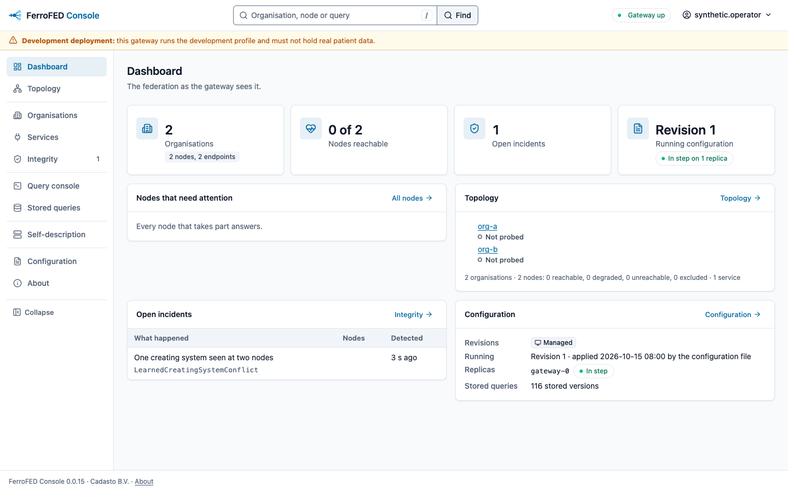

<!-- SPDX-FileCopyrightText: Cadasto B.V. -->
<!-- SPDX-License-Identifier: BUSL-1.1 -->
<div align="center">


**The openEHR federation gateway: one query, answered from every organisation that holds the patient's record.**

[Documentation](https://ferrofed.eu/docs/) ·
[Quick start](#quick-start) ·
[What it implements](#what-it-implements) ·
[Licensing](https://ferrohealth.eu/docs/licensing.html)

**Project**<br>
[](https://github.com/FerroHEALTH/FerroFED/releases/latest)
[](https://github.com/FerroHEALTH/FerroFED/actions/workflows/ci.yml)
[](LICENSE)
[](https://ferrofed.eu/docs/)
[](https://github.com/FerroHEALTH/FerroFED/pkgs/container/ferrofed)
[](https://github.com/FerroHEALTH/FerroFED/pkgs/container/ferrofed)

**Quality and security**<br>
[](https://scorecard.dev/viewer/?uri=github.com/FerroHEALTH/FerroFED)
[](https://www.bestpractices.dev/projects/15130)
[](https://sonarcloud.io/summary/overall?id=FerroHEALTH_FerroFED)
[](https://sonarcloud.io/summary/new_code?id=FerroHEALTH_FerroFED)
[](https://github.com/FerroHEALTH/FerroFED/actions/workflows/codeql.yml)
[](https://ferrofed.eu/docs/operate/container.html#the-release-binaries)
[](docs/release.md#the-build-legs)

**Conformance and compliance**<br>
<!-- conformance:begin -->
[](https://ferrofed.eu/docs/evaluate/conformance.html)
[](https://ferrofed.eu/docs/evaluate/conformance.html)
[](https://ferrofed.eu/docs/evaluate/conformance.html)
[](conformance/aql-golden/pass-list.txt)
<!-- conformance:end -->
[](https://ferrofed.eu/docs/evaluate/regulatory-status.html)
[](https://ferrofed.eu/docs/evaluate/cra-risk-assessment.html)
<!-- myhealth-eu:begin -->
[](https://ferrofed.eu/docs/evaluate/myhealth-eu.html)
<!-- myhealth-eu:end -->

</div>


## What FerroFED is

A patient's record is spread over many places: the hospital that treated
them last year, the clinic they visit now, a care organisation in another
country. Each keeps its own part, and a doctor who needs the whole picture
today has to phone around or wait for documents.

FerroFED connects those places. It is an openEHR federation gateway, in pure
Rust. An application asks it one ordinary AQL query about a patient, and
FerroFED asks every organisation that may hold part of the record, then
returns one combined answer that names where each part came from. It stores
no clinical data itself: the records stay with the organisations that own
them.

It does this with care for privacy. FerroFED first looks up which
identifier each organisation uses for the patient, through a patient index
(a service that matches one person's identities across organisations), and
never sends a patient's name or national number to the organisations it
asks. It keeps no patient index of its own: it asks FerroPIX, or any IHE
PIXm and PDQm service, as a client. Every access to patient data is logged.

It is for regions and networks of care providers that want a shared view of
a patient's record without one central database, for national contact
points and eHealth agencies that connect a country's records to
MyHealth@EU, and for vendors and integrators that build applications over
the records of several organisations.

<picture>
  <source media="(prefers-color-scheme: dark)" srcset="website/book/src/operate/img/console/dashboard-dark.png">
  
</picture>

## What it implements

FerroFED implements the openEHR Federation Working Group's
[Federation Tier with AQL](https://syntaric.github.io/openehr-federation-spec/)
specification, release 1.0.1, and reaches every node over openEHR ITS-REST
1.1.0. The
[conformance statement](https://ferrofed.eu/docs/evaluate/conformance-statement.html)
claims the specification point by point and names the test that holds each
point.

### Federated queries

- [The federated query](https://ferrofed.eu/docs/how-it-works/federated-query.html): ordinary AQL in, one merged openEHR result out, with the status of every member, and never a silent partial answer
- [Patient identifiers kept out of every query](https://ferrofed.eu/docs/how-it-works/identifier-hygiene.html), resolved first through IHE PIXm and PDQm
- [Localization](https://ferrofed.eu/docs/operate/localization.html): ask only the members that hold the patient, through IHE XCPD, the Dutch NVI or the patient index
- [Follow-ups and writes](https://ferrofed.eu/docs/how-it-works/follow-ups-and-writes.html) routed to the one member that owns the record
- [Stored queries](https://ferrofed.eu/docs/integrate/stored-queries.html) held by the gateway and run by name
- [Consent pre-filtering](https://ferrofed.eu/docs/operate/consent.html), such as the Dutch Mitz

### European exchange

- [The patient summary over FHIR](https://ferrofed.eu/docs/integrate/patient-summary.html) in the European exchange format, with [laboratory](https://ferrofed.eu/docs/integrate/laboratory-reports.html), [discharge](https://ferrofed.eu/docs/integrate/discharge-reports.html) and [imaging](https://ferrofed.eu/docs/integrate/imaging-reports.html) reports
- [Prescriptions and dispensations over FHIR](https://ferrofed.eu/docs/integrate/prescriptions.html) in the HL7 Europe profiles
- [A national contact point](https://ferrofed.eu/docs/integrate/national-contact-point.html) for MyHealth@EU

### Operations

- [The operator console](https://ferrofed.eu/docs/operate/operator-console.html), with versioned configuration revisions
- [Admitting a member](https://ferrofed.eu/docs/operate/admission.html) after a check, and a [conformance run](https://ferrofed.eu/docs/operate/conformance-run.html) to score a deployment
- [Health probes](https://ferrofed.eu/docs/operate/health.html), [metrics](https://ferrofed.eu/docs/operate/metrics.html), [tracing](https://ferrofed.eu/docs/operate/tracing.html) and [overload protection](https://ferrofed.eu/docs/operate/overload.html)

## Quick start

The quickstart runs the published gateway image beside four FerroEHR
record servers and FerroPIX, with synthetic patients. You need Docker
Compose 2.23.1 or newer, `curl`, `jq` and `openssl`, and no checkout. Every
release attaches the quickstart as one self-contained `compose.yaml`;
download the latest release's into an empty directory:

```sh
curl -fsSLO https://github.com/FerroHEALTH/FerroFED/releases/latest/download/compose.yaml
```

Write the gateway's signing key, readable by the gateway's user in the
container, and start the stack, which seeds FerroPIX and the four servers
with the synthetic patients:

<!-- tour:start -->
```sh
mkdir -p secrets
openssl genpkey -algorithm EC -pkeyopt ec_paramgen_curve:P-384 -out secrets/signing-key.pem
chmod 644 secrets/signing-key.pem
docker compose up --wait
```

Ask the development issuer for a token, and the gateway for the
compositions of the patient every server knows:

<!-- tour:query -->
```sh
token="$(curl --fail-with-body -s http://127.0.0.1:8190/quickstart/token \
  -d grant_type=client_credentials -d client_id=quickstart-client -d client_secret=any \
  | jq -er .access_token)"
curl --fail-with-body -s http://127.0.0.1:8080/v1/query/aql \
  -H "Authorization: Bearer $token" \
  -H 'Content-Type: application/json' -d @- <<'EOF' | jq -e '.meta.federation.complete and (.rows | length) == 4'
{"q": "SELECT c/uid/value FROM EHR e CONTAINS COMPOSITION c WHERE e/ehr_status/subject/external_ref/id/value = 'ffd-test-0001' AND e/ehr_status/subject/external_ref/namespace = 'urn:oid:2.999.1.1'"}
EOF
```

The answer holds a composition from each of the four servers, and its
`meta.federation` part reports all four as `active` and the answer as
complete. Every step is part of
[`scripts/quickstart/tour.sh`](scripts/quickstart/tour.sh), which CI runs
over the repository's `compose.yaml`, the file each release attaches. The
credentials are development values for a laptop, and
`docker compose down --volumes` removes what the quickstart started.
[The quickstart page](https://ferrofed.eu/docs/operate/container.html#the-quickstart)
walks through more queries.

## Deploy it

FerroFED is at v0.0.19. Every release publishes, from one tag:

- the gateway image `ghcr.io/ferrohealth/ferrofed` and the console image
  `ghcr.io/ferrohealth/ferrofed-console`, for `linux/amd64` and
  `linux/arm64`;
- the [Kubernetes package](https://ferrofed.eu/docs/operate/kubernetes.html),
  `deploy/kubernetes/`, with each image pinned by digest;
- the `ferrofed` binary for x86_64 and aarch64 Linux, on glibc and on musl,
  and the release `compose.yaml` on the
  [GitHub release](https://github.com/FerroHEALTH/FerroFED/releases).

[A production deployment](https://ferrofed.eu/docs/operate/production.html)
takes you from the release `compose.yaml` to a first federated query over
your own record servers, and
[Configuration](https://ferrofed.eu/docs/operate/configuration.html) names
every key.

## Security and conformance

- [Client authentication](https://ferrofed.eu/docs/operate/authentication.html) with OAuth 2.0 access tokens and SMART on openEHR scopes
- [Onward credentials](https://ferrofed.eu/docs/operate/onward-credentials.html): the gateway signs in to each member as itself, with DPoP or mutual TLS where asked
- [What a member is told about the caller](https://ferrofed.eu/docs/operate/caller-token.html), in a token the gateway signs
- [The access log](https://ferrofed.eu/docs/operate/access-log.html) of every access to patient data, as the EHDS asks, and [the audit trail](https://ferrofed.eu/docs/operate/audit.html) of every IHE transaction in the IHE ATNA format
- Every release is signed and carries an SBOM and SLSA Build Level 3 provenance, and every scan finding an OpenVEX judgement
- [What FerroFED claims](https://ferrofed.eu/docs/evaluate/what-ferrofed-claims.html), the [conformance matrix](https://ferrofed.eu/docs/evaluate/conformance.html) and the [regulatory status](https://ferrofed.eu/docs/evaluate/regulatory-status.html) under the EHDS Regulation

The source is public and every feature is in this repository; there is no
paid edition with extra functions.

## Crates

| Crate | What it does | Version | Docs | Downloads |
|---|---|---|---|---|
| [`openehr-federation`](https://crates.io/crates/openehr-federation) | The Federation Tier with AQL wire types, the AQL rewrite with identifier hygiene, and the federated result merge | [](https://crates.io/crates/openehr-federation) | [](https://docs.rs/openehr-federation) | [](https://crates.io/crates/openehr-federation) |

The interoperability component of Regulation (EU) 2025/327 the gateway runs, [`eehrxf`](https://crates.io/crates/eehrxf), is published from [FerroBRIDGE](https://github.com/FerroHEALTH/FerroBRIDGE).

## Part of FerroHEALTH

FerroFED is one of five [FerroHEALTH](https://ferrohealth.eu) servers. Each
does one job and reaches the others only over published standards:
FerroEHR stores the record, FerroBRIDGE translates it to FHIR and the OMOP
research model, FerroFED connects records across organisations and borders,
FerroPIX matches patient identities, and FerroTERM serves the code systems.
FerroFED works in front of any openEHR record server and beside any IHE
patient index.

## Documentation

- [The FerroFED book](https://ferrofed.eu/docs/): evaluate, integrate,
  operate and contribute, and the
  [FerroHEALTH book](https://ferrohealth.eu/docs/) for what the family
  shares
- [Data protection](https://ferrofed.eu/docs/evaluate/data-protection.html)
  and the [threat model](https://ferrofed.eu/docs/evaluate/threat-model.html)
- [Releases](https://ferrofed.eu/docs/operate/releases.html), the
  [changelog](CHANGELOG.md) and the
  [GitHub releases](https://github.com/FerroHEALTH/FerroFED/releases)

## Support and contributing

- [Support](SUPPORT.md) and the [security policy](SECURITY.md)
- [Contributing](CONTRIBUTING.md), [code of conduct](CODE_OF_CONDUCT.md),
  [governance](GOVERNANCE.md), [maintainers](MAINTAINERS.md) and the
  [AI statement](AI_STATEMENT.md)

## Licence

Business Source License 1.1 ([LICENSE](LICENSE)): free outside production
and for non-commercial production use, a commercial licence from Cadasto
B.V. for other production use, and Apache License 2.0 four years after each
version. The [licensing page](https://ferrohealth.eu/docs/licensing.html)
says which applies to you.
