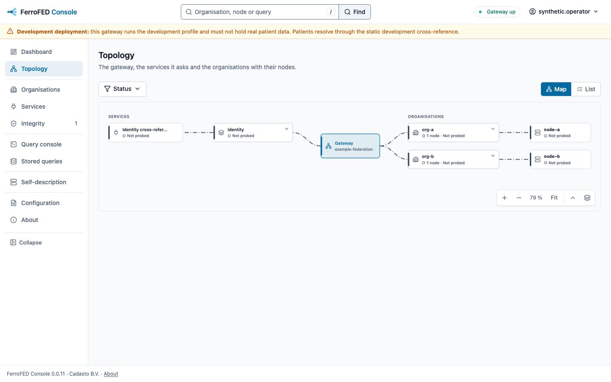

<!-- SPDX-FileCopyrightText: Cadasto B.V. -->
<!-- SPDX-License-Identifier: BUSL-1.1 -->
<div align="center">


**The openEHR federation gateway: one query, answered from every organisation that holds the patient's record.**

**Project**<br>
[](https://github.com/FerroHEALTH/FerroFED/releases/latest)
[](https://github.com/FerroHEALTH/FerroFED/actions/workflows/ci.yml)
[](LICENSE)
[](https://ferrofed.eu/docs/)
[](https://github.com/FerroHEALTH/FerroFED/pkgs/container/ferrofed)
[](https://github.com/FerroHEALTH/FerroFED/pkgs/container/ferrofed)

**Quality and security**<br>
[](https://scorecard.dev/viewer/?uri=github.com/FerroHEALTH/FerroFED)
[](https://www.bestpractices.dev/projects/15130)
[](https://sonarcloud.io/summary/overall?id=FerroHEALTH_FerroFED)
[](https://sonarcloud.io/summary/new_code?id=FerroHEALTH_FerroFED)
[](https://github.com/FerroHEALTH/FerroFED/actions/workflows/codeql.yml)
[](https://ferrofed.eu/docs/operate/container.html#the-release-binaries)
[](docs/release.md#the-build-legs)

**Conformance and compliance**<br>
<!-- conformance:begin -->
[](https://ferrofed.eu/docs/evaluate/conformance.html)
[](https://ferrofed.eu/docs/evaluate/conformance.html)
[](https://ferrofed.eu/docs/evaluate/conformance.html)
[](conformance/aql-golden/pass-list.txt)
<!-- conformance:end -->
[](https://ferrofed.eu/docs/evaluate/regulatory-status.html)
[](https://ferrofed.eu/docs/evaluate/cra-risk-assessment.html)

[Documentation](https://ferrofed.eu/docs/) ·
[Quick start](#quick-start) ·
[What FerroFED claims](https://ferrofed.eu/docs/evaluate/what-ferrofed-claims.html) ·
[Licensing](https://ferrohealth.eu/docs/licensing.html)

</div>

## What FerroFED does

A patient's record is spread over many places: the hospital that treated
them last year, the clinic they visit now, a care organisation in another
country. Each keeps its own part, and a doctor who needs the whole picture
today has to phone around or wait for documents.

FerroFED connects those places. An application asks it one ordinary
question about a patient, and FerroFED asks every organisation that may
hold part of the record, then returns one combined answer that names where
each part came from. It stores no clinical data itself: the records stay
with the organisations that own them.

It does this with care for privacy. FerroFED first looks up which
identifier each organisation uses for the patient, through a patient index
(a service that matches one person's identities across organisations), and
never sends a patient's name or national number to the organisations it
asks. Every access to patient data is logged.

FerroFED works with openEHR, the open standard for structured health
records, and with the European rules for sharing records across borders:
the European Health Data Space (EHDS) and the MyHealth@EU patient summary.

### Who it is for

- **Regions and networks of care providers** that want a shared view of a
  patient's record without moving all data into one central database.
- **National contact points and eHealth agencies** that connect a country's
  records to MyHealth@EU.
- **Software vendors and integrators** that build applications over the
  records of several organisations.

### Why you can trust what it claims

Every release is signed and comes with a software bill of materials (the
list of every component inside) and SLSA build provenance, so you can check
that what you install is what was built here. The source is public, and
every feature is in this repository: there is no paid edition with extra
functions. The
[conformance statement](https://ferrofed.eu/docs/evaluate/conformance-statement.html)
claims the Federation Tier specification point by point and names the test
that holds each point, so you can check a claim against the standard
yourself.

## Part of FerroHEALTH

FerroFED is one of five [FerroHEALTH](https://ferrohealth.eu) servers. Each
does one job and reaches the others only over published standards:
FerroEHR stores the record, FerroBRIDGE translates it to FHIR and the OMOP
research model, FerroFED connects records across organisations and borders,
FerroPIX matches patient identities, and FerroTERM serves the code systems
(the shared lists of medical terms). FerroFED works in front of any openEHR
record server and beside any IHE patient index, not only the FerroHEALTH
ones. Sign-in, the audit trail and the web consoles come from three shared
libraries: FerroAUTH, FerroAUDIT and FerroUI.

<picture>
  <source media="(prefers-color-scheme: dark)" srcset="website/book/src/operate/img/console/topology-dark.png">
  
</picture>

## Quick start

FerroFED is at v0.0.13. The quickstart runs the published gateway image
beside four FerroEHR record servers with synthetic patients. You need Docker
Compose, `openssl` and `git`:

```sh
git clone https://github.com/FerroHEALTH/FerroFED && cd FerroFED
scripts/quickstart/signing-key.sh
docker compose up --wait
scripts/quickstart/seed.sh
```

Then ask the gateway for the compositions of the patient every server knows:

```sh
curl -s http://127.0.0.1:8080/v1/query/aql \
  -H "Authorization: Bearer $(scripts/quickstart/token.sh)" \
  -H 'Content-Type: application/json' -d @- <<'EOF'
{"q": "SELECT c/uid/value FROM EHR e CONTAINS COMPOSITION c WHERE e/ehr_status/subject/external_ref/id/value = 'ffd-test-0001' AND e/ehr_status/subject/external_ref/namespace = 'urn:oid:2.999.1.1'"}
EOF
```

The answer holds a composition from each of the four servers, and its
`meta.federation` part reports all four as `active`. The credentials are
development values.
[The quickstart page](https://ferrofed.eu/docs/operate/container.html#the-quickstart)
walks through more queries, and
[a production deployment](https://ferrofed.eu/docs/operate/production.html)
takes you from the release `compose.yaml` to a first federated query over
your own record servers.

## What ships today

### Federated queries

- [The federated query](https://ferrofed.eu/docs/how-it-works/federated-query.html): ordinary AQL in, one merged openEHR result out, with the status of every member
- [Patient identifiers kept out of every query](https://ferrofed.eu/docs/how-it-works/identifier-hygiene.html), resolved first through IHE PIXm and PDQm
- [Localization](https://ferrofed.eu/docs/operate/localization.html): ask only the members that hold the patient, through IHE XCPD, the Dutch NVI or the patient index
- [Follow-ups and writes](https://ferrofed.eu/docs/how-it-works/follow-ups-and-writes.html) routed to the one member that owns the record
- [Stored queries](https://ferrofed.eu/docs/integrate/stored-queries.html) held by the gateway and run by name
- [Consent pre-filtering](https://ferrofed.eu/docs/operate/consent.html), such as the Dutch Mitz

### European exchange

- [The patient summary over FHIR](https://ferrofed.eu/docs/integrate/patient-summary.html) in the European exchange format
- [Prescriptions and dispensations over FHIR](https://ferrofed.eu/docs/integrate/prescriptions.html) in the HL7 Europe profiles
- [A national contact point](https://ferrofed.eu/docs/integrate/national-contact-point.html) for MyHealth@EU

### Security and privacy

- [Client authentication](https://ferrofed.eu/docs/operate/authentication.html) with OAuth 2.0 access tokens and SMART on openEHR scopes
- [Onward credentials](https://ferrofed.eu/docs/operate/onward-credentials.html): the gateway signs in to each member as itself, with DPoP or mutual TLS where asked
- [What a member is told about the caller](https://ferrofed.eu/docs/operate/caller-token.html), in a token the gateway signs
- [The access log](https://ferrofed.eu/docs/operate/access-log.html) of every access to patient data, as the EHDS asks
- [The audit trail](https://ferrofed.eu/docs/operate/audit.html) of every IHE transaction, in the IHE ATNA format

### Operations

- [The operator console](https://ferrofed.eu/docs/operate/operator-console.html), with versioned configuration revisions
- [Container images and release binaries](https://ferrofed.eu/docs/operate/container.html), and a [Kubernetes package](https://ferrofed.eu/docs/operate/kubernetes.html)
- [Admitting a member](https://ferrofed.eu/docs/operate/admission.html) after a check, and a [conformance run](https://ferrofed.eu/docs/operate/conformance-run.html) to score a deployment
- [Health probes](https://ferrofed.eu/docs/operate/health.html), [metrics](https://ferrofed.eu/docs/operate/metrics.html), [tracing](https://ferrofed.eu/docs/operate/tracing.html) and [overload protection](https://ferrofed.eu/docs/operate/overload.html)

<details>
<summary><b>Published crates</b> (2)</summary>

| Crate | What it does | Version | Docs | Downloads |
|---|---|---|---|---|
| [`openehr-federation`](https://crates.io/crates/openehr-federation) | The Federation Tier with AQL wire types, the AQL rewrite with identifier hygiene, and the federated result merge | [](https://crates.io/crates/openehr-federation) | [](https://docs.rs/openehr-federation) | [](https://crates.io/crates/openehr-federation) |
| [`eehrxf`](https://crates.io/crates/eehrxf) | The European EHR exchange format in FHIR R4 and its dataset model of the EHDS priority categories | [](https://crates.io/crates/eehrxf) | [](https://docs.rs/eehrxf) | [](https://crates.io/crates/eehrxf) |

</details>


## Learn more

- [Documentation](https://ferrofed.eu/docs/) and the [FerroHEALTH book](https://ferrohealth.eu/docs/)
- [What FerroFED claims](https://ferrofed.eu/docs/evaluate/what-ferrofed-claims.html), with its limitations, and the [conformance matrix](https://ferrofed.eu/docs/evaluate/conformance.html)
- [Regulatory status](https://ferrofed.eu/docs/evaluate/regulatory-status.html), [data protection](https://ferrofed.eu/docs/evaluate/data-protection.html) and the [threat model](https://ferrofed.eu/docs/evaluate/threat-model.html)
- [Changelog](CHANGELOG.md) and [milestones](https://github.com/FerroHEALTH/FerroFED/milestones)
- [Security policy](SECURITY.md)
- [Contributing](CONTRIBUTING.md), [code of conduct](CODE_OF_CONDUCT.md), [support](SUPPORT.md), [governance](GOVERNANCE.md), [maintainers](MAINTAINERS.md) and the [AI statement](AI_STATEMENT.md)

## Licence

Business Source License 1.1 ([LICENSE](LICENSE)), with Apache License 2.0 as
the Change License four years after each version; the
[licensing page](https://ferrohealth.eu/docs/licensing.html) says when you
need a commercial licence from Cadasto B.V.
