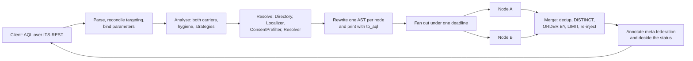
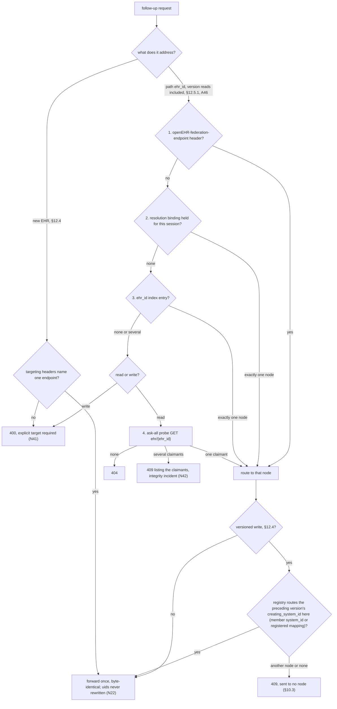
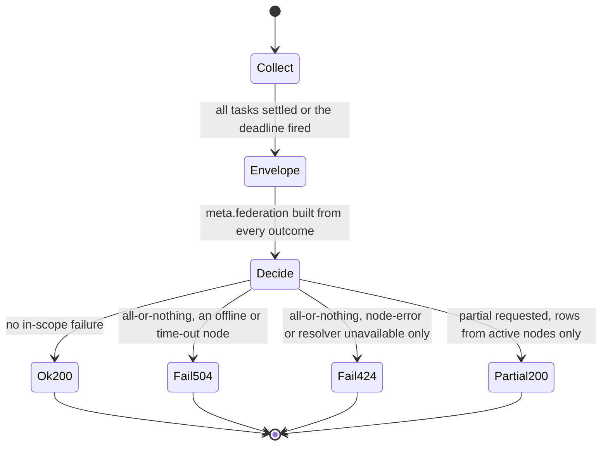
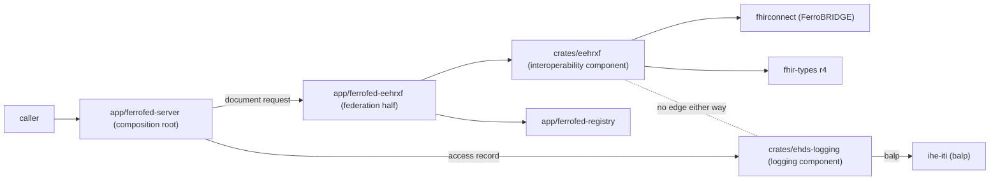
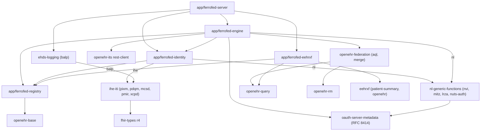

<!-- SPDX-FileCopyrightText: Cadasto B.V. -->
<!-- SPDX-License-Identifier: BUSL-1.1 -->

# Architecture

FerroFED is an openEHR federation gateway: a transparent ITS-REST intermediary
that takes an ordinary AQL query, resolves the patient outside the query,
sends standard AQL scoped to each node's own `ehr_id`, and merges what comes
back with each node's provenance. It follows the openEHR Federation Working
Group's Federation Tier with AQL specification and holds no clinical data of
its own.

This document is the design of record. It is the output of the first research
pass of 2026-10-01 (program #16), whose full reports are the evidence comments
on #18 to #27. Every decision below names its ground: a section, requirement
(N) or conformance point (CP) of the specification, a section of ITS-REST or
AQL, an IHE profile, an RFC, or published research. Where the specification is
silent, the decision is labelled FerroFED's own. Where it contradicts itself or
another specification, the contradiction is named and held as an
upstream-report draft on #17, to be re-checked against the 1.0 release.

Three owner rulings of 2026-10-01 shape every section:

- **The published `openehr-*` crates are the openEHR surface.** FerroFED
  re-implements nothing they provide. A gap in one of them is an issue on
  FerroEHR's tracker, and the FerroFED issue that needs it is blocked by it
  (section 2).
- **The reference implementation is evidence, not the bar.** FerroFED is held
  to FerroEHR's strictness: it accepts exactly what the specification admits
  and asserts every refusal with a negative test. That the Java reference
  implementation accepts a form, merges a result a certain way, or claims a
  conformance point proves nothing. Every place where it is laxer than the
  specification is named below and recorded on #17.
- **Build what FerroFED needs inside FerroFED first.** No capability waits on
  a sibling that is not built yet. FerroPIX, the family's planned MPI over
  PIXm and PDQm, exists only as a repository today, so every identity binding
  the gateway needs lands here, each as a self-contained crate behind its
  trait seam, shaped so it can move to FerroPIX later without changing the
  gateway core (sections 6 and 11).

The decision register in section 15 lists every choice this pass put to the
owner. The owner decided all of them on 2026-10-01, and the text describes the
decided design.

## 1. The problem and the specification pin

A record held by another organisation is out of reach of a client that speaks
to one CDR. The Federation Tier with AQL lets a client run one AQL query across
several CDRs as if they were one repository (§1). The Tier is a transparent
intermediary: a client sends a conformant AQL query and follow-up requests
without knowing it is federated, across the whole ITS-REST surface, read and
write (§1, N1). Federation keys on each node's local `ehr_id`. The patient is
resolved to a set of `{node, ehr_id}` pairs outside AQL, through an identity
cross-reference service (§5), and each node then receives standard,
non-federated AQL scoped to its `ehr_id` (§4, §7). The patient identifier used
for resolution is consumed at the gateway and never reaches a node, in any
carrier (§5.4, N33).

The specification is pinned at its 1.0.0 release, approved by the openEHR
SEC on 2026-10-12. #17 re-pinned to it from the 0.9.0 release candidate: the
release moves `federation.spec_version` to `"1.0"` (§7a.2) and the `$id` of
both schemas, and drops the change record page, and no N, CP or section
number moved.

**Pinned versions.** The pins live in `docs/VERSIONS.md`; this table records
the ground for each, and `scripts/checks/versions.sh` holds the two in step.

| Component | Pin | Ground |
|---|---|---|
| Federation Tier with AQL | 1.0.0 (`syntaric/openehr-federation-spec` tag `1.0.0`, commit `7dcf0f44ac122fe947b1e5ceba6bcbbb7721917d`, 2026-10-12, CC0 1.0) | the specification FerroFED implements, as approved by the openEHR SEC. It carries the SEC review amendments (the `meta.federation` nesting, the all-or-nothing default, the `node-error` status), and its `spec_version` `"1.0"` is the first value that names that contract unambiguously (§7a.2) |
| Federation Tier reference implementation | `syntaric/openehr-federation-ref` at `92aff3cb1d8738ea0ce0e013b5a8fc2942438fd5` (Apache-2.0) | it has no release matching 1.0.0 (its newest tag is `0.9.0`), so the pin stays. Evidence and a test corpus (the 17 AQL golden cases, the schemas, the demo data); never the bar, its code never copied. Its copy of `federated-result-set.schema.json` lacks `node-error` |
| openEHR ITS-REST | 1.1.0 (`openEHR/specifications-ITS-REST` tag `Release-1.1.0`, commit `24058992`) | the federation specification binds ITS-REST by name at `Release-1.1.0`; the façade serves all 96 operations of its seven modules |
| openEHR AQL | 1.1.0 (`openEHR/specifications-QUERY` tag `Release-1.1.0`, commit `b03c4800`) | the query language. AQL 1.1.0 leaves the default order, the order of nulls and string collation undefined and has no `GROUP BY` clause, which sections 4 and 9 build on |
| `openehr-query` | 0.0.84 | the AQL 1.1 lexer, parser, typed AST and canonical printer. 0.0.74 added the visitor, spans, parameter binding and the federation directive (FerroEHR #3505 to #3508, #3513); 0.0.77 classifies every function call as an AQL built-in or another name (FerroEHR #3529) |
| `openehr-its` | 0.0.84 | the ITS-REST 1.1.0 contract: DTOs, server traits, route tables, clients, canonical JSON. 0.0.74 added the router builder, the operation matcher with `forward`, the credentials provider and per-call options (FerroEHR #3509 to #3512); 0.0.76 keeps the extra members of an open schema, `Error` among them (FerroEHR #3526); 0.0.77 builds every client with redirects off (FerroEHR #3531); 0.0.78 makes the `Authorization` value of a credential public, checked against RFC 7617 and RFC 6750 (FerroEHR #3535); 0.0.80 adds the identifier class of each path parameter, a public request decoder per operation, a Simplified Formats CONTRIBUTION reader and every request-body media type (FerroEHR #3539 to #3541, #3543); 0.0.82 adds the DPoP credential (FerroEHR #3558); 0.0.83 says whether a send went out before a deadline passed (FerroEHR #3560); 0.0.84 says the same of a DPoP proof that could not be made (FerroEHR #3565) |
| `openehr-base`, `openehr-rm` | the same lockstep line | typed identifiers (`ObjectVersionId`, `HierObjectId`, ISO 8601 ordering), the RM with `DV_ORDERED` comparison and, from 0.0.79, the attribute model with the BASE primitives, the `Ordered` marker and the `OBJECT_REF` targets (FerroEHR #3537) |
| `openehr-sdt` | 0.0.84, the same lockstep line, joined with onward OAuth 2.0 (#81) | the SMART on openEHR scope grammar; 0.0.82 adds the `Display` that prints a scope in its canonical form (FerroEHR #3557) |
| IHE PIXm, mCSD, PMIR | 3.1.0, 4.0.0, 1.6.0 (FHIR 4.0.1, CC-BY-4.0) | the proposed IHE binding (Annex A). Each is vendored and pinned with the issue that first reads it (decision A18) |
| Netherlands Generic Functions | `fhir.nl.gf` 0.3.0 (EUPL-1.2) | the regional binding Annex B names; vendored with #87 |
| `fhir-types` | 0.1.108 (`r4` with `terminology`, `resources` from the PDQm client #119 and the mCSD reader #74; Apache-2.0) | the FHIR R4 model for PIXm `Parameters`, the PDQm `Patient` and the mCSD resources, compiled in the binding crates and in the interoperability component `crates/eehrxf`, never in the engine (decisions A16 and A59); 0.1.108 is the release `fhirconnect` builds on (#684) |
| `fhirconnect`, `openehr-mapping-core` | =0.1.108 (FerroBRIDGE, BUSL-1.1) | the FHIRconnect 1.0.0 engine `crates/eehrxf` runs in process under `openehr` (#730), pinned exactly because FerroBRIDGE's crate line moves by patch (decision A61, #684) |
| `jsonwebtoken` | 11, on `aws_lc_rs` | the family's JWT crate, for inbound validation and outbound assertions |
| `jsonschema` | 0.58.3 (draft 2020-12, `if`/`then`) | test-side validation of every envelope and `OPTIONS` body against the vendored schemas |
| PostgreSQL | 18 | only behind the optional high-availability backend of the stored-query store (section 8); a single gateway needs no database |

The `openehr-*` rows are the lockstep 0.0.84, published on 2026-10-05. The
gaps FerroEHR #3505 to #3514 closed in 0.0.74, which v0.0.2 coded against,
0.0.76 closes FerroEHR #3526, the open ITS-REST `Error`, 0.0.77 closes
FerroEHR #3529, the function classification the rewrite reads, 0.0.78
closes FerroEHR #3535, the `Authorization` value configuration load checks,
0.0.79 closes FerroEHR #3537, the model lookups the rewrite orders keys by,
and 0.0.80 closes FerroEHR #3539 to #3541 and #3543, the request decoder, the
path identifier classes, the Simplified Formats CONTRIBUTION and the body
media types, 0.0.81 closes FerroEHR #3548, #3551 and #3552, the typed
`201_EHR` body, the public body media-type picker and the agreeing media
tables, 0.0.82 closes FerroEHR #3557 and #3558, the printer of a SMART
on openEHR scope and the DPoP credential with its prover on the client,
0.0.83 closes FerroEHR #3560, the `sent` of a client deadline, and 0.0.84
closes FerroEHR #3565, the `sent` of a DPoP proof that could not be made.

## 2. The openEHR surface: the published crates

FerroFED takes every openEHR concern from the published crates, as one family
on one lockstep version. The table fixes what each crate carries for the
gateway.

| Crate (feature) | What FerroFED takes from it |
|---|---|
| `openehr-query` (`federation`) | AQL 1.1.0: `parse_str`, the typed AST, `printer::to_aql` with the fixed point `parse(to_aql(ast)) == ast`, `visit::Visit` and `visit::VisitMut`, `ast::Span` on every `IdentifiedPath` and `WHERE` leaf, `bind::bind` for `query_parameters`, and `federation::parse_federated` / `to_federated_aql` for the `FROM ENDPOINT` directive |
| `openehr-its` (`rest-server`) | the generated `server::router` per group, used where the typed contract fits (section 5) |
| `openehr-its` (`rest-client`) | one `rest::client::Client` per endpoint, `routes::lookup` (the operation matcher), `Client::forward` (one unclassified send with the bytes as received), `CredentialsProvider` and `CallOptions { deadline, headers }` |
| `openehr-its` (`rest`, `json`) | the `AdhocQueryExecute`, `ResultSet`, `ResultSetMetadata` and `ResultSetColumn` DTOs, with `ResultSetMetadata.additional_properties` as the extension point `meta.federation` occupies (N17), and canonical JSON of the RM |
| `openehr-base` | `ObjectVersionId` (`object_id()`, `creating_system_id()`, `version_tree_id()`), `HierObjectId` for `ehr_id`, the lexical rule for `system_id`, and `PartialOrd` on the ISO 8601 types |
| `openehr-rm` | `DV_ORDERED`'s `less_than` and `is_strictly_comparable_to`, for cross-node ordering of data values |
| `openehr-sdt` (`smart_scopes`) | `SmartScope::parse` and `parse_all` for the SMART on openEHR scope grammar (section 7): onward OAuth 2.0 (#81) checks that each `oauth2` scope is a `system/` resource scope, and client authentication (#80) reads each caller's scopes |

The research found eight gaps between these crates and what an intermediary
needs, filed as FerroEHR #3505 to #3512, and the work found a ninth (#3513, a
parser defect for `[$p and at0001]` and `[<archetype id> or …]`). All nine are
built on FerroEHR's side and ship in the lockstep 0.0.74, which is FerroFED's
pin for the workspace (section 1). Two residuals are FerroEHR's to note:
`Client::forward` defaults `Accept` when the client sent none, which a
byte-transparent intermediary would rather opt out of (one sentence on #3510),
and the ITS-REST OpenAPI documents leak `operationId: definition_query_store.yaml`
into generated method names.

**Typed carriers.** FerroEHR bans `serde_json::Value` outside approved seams
(clippy `disallowed-types`). FerroFED adopts the rule unchanged from #28
(decision A2). The ITS-REST contract itself puts `Value` in three places the
gateway touches, so the seams are fixed by the wire. Each is one module with a
scoped `#[expect]` naming it:

1. **Query intake.** `query_parameters` become `ast::Primitive` once, at the
   façade boundary, before `bind`. A JSON string becomes `String`, an integral
   number `Integer`, any other number `Real`, a boolean `Boolean`. A `null`, an
   array or an object is a `400` naming the parameter, never its value. The GET
   forms carry strings only, typed by the position they bind to.
2. **Result cells.** `ResultSetRow` from each node is decoded once by a cell
   codec: an RM object through canonical JSON into its RM type, a primitive as
   itself. The merged row is re-encoded on the way out, and no other module
   sees a `Value` cell.
3. **The envelope.** A typed `FederationMeta` is serialized once into
   `ResultSetMetadata.additional_properties["federation"]`, and the `424`/`504`
   failure envelope is built from the same type.
4. **Tests.** Schema validation hands `jsonschema` a `Value`, under
   `#[cfg(test)]` and in the testkit.

Single-node passthrough bodies, node error bodies, the `OPTIONS` bodies and the
registry are never seams.

## 3. The request pipeline

A federated query goes through five stages. The first resolves where the
patient is and under which local id; the rest are pure transformations over
typed values, except the fan-out.



1. **Resolve** (§4 Step 1, §5, §14, §15). The analysis yields a `PatientRef`
   (identifier plus issuing namespace). The registry snapshot, the localizer,
   the optional consent pre-filter and the cross-reference resolver turn it
   into the set of `{node, ehr_id}` pairs to dispatch to, and a status for
   every member that is not dispatched (section 6).
2. **Rewrite** (§7.1). One node AST per resolved node, scoped to that node's
   `ehr_id`, with every directly identifying identifier consumed or the query
   refused (section 4).
3. **Fan out** (§11.5, N38). One request per in-scope endpoint, concurrent,
   under a deadline fixed at entry (section 9).
4. **Merge** (§9 to §11.6). Positional decoding against the gateway's own
   `SELECT`, opt-in dedup, `DISTINCT`, the cross-node order, `LIMIT` and
   `OFFSET`, and the re-injected columns (section 9).
5. **Annotate** (§9.5, §11.4, N16, N17). `meta.federation` lists every registry
   member with its status, and the completeness decision picks `200`, `424` or
   `504`, carrying the envelope in every case (section 9).

A follow-up read or write to one record takes the single-node path of section
5 instead: no rewrite, no merge, byte-identical passthrough to the node that
holds it.

## 4. The AQL rewrite and identifier hygiene

Research: #18. Every step is a call on `openehr-query` or a pure function over
its public AST. FerroFED has no AQL parser, no printer and no text splicing.

**The pipeline.**

1. **Parse** with `federation::parse_federated`. It lifts a `FROM ENDPOINT` /
   `ORGANISATION` directive out at the token level, so the same words inside a
   string literal stay a string, and parses the remainder as strict AQL 1.1.0
   with spans kept (§8.1). The directive grammar is an extension no openEHR
   release defines, and it lives behind the crate's opt-in feature (decision
   A1).
2. **Reconcile targeting.** The directive and the
   `openEHR-federation-endpoint` / `openEHR-federation-organisation` headers
   must name the same set, or the request is `400`. An unknown identifier is
   `400` (§8.4.1, N35).
3. **Bind** the request's `query_parameters` with `bind::bind` before any
   analysis, so `… = $patient` is analysed as the literal it stands for. AQL
   substitutes a parameter "following the same rules as each type when the
   value is specified as a literal" (`master03-syntax.adoc` §Parameters), and
   §5.4.1 tests a value wherever it sits, so the order is forced. Faults name
   the parameter and its position, never the value.
4. **Analyse** on `visit::Visit`. The visitor is exhaustive, with no wildcard
   arm, so a new AST variant fails to compile in the traversal. A hand-written
   walk missed four literal positions in the research's experiment (a
   `MATCHES` list, a containment predicate, a function argument, a `SELECT`
   constant):
   - locate the patient in either carrier: `external_ref/id/value` with its
     `namespace`, or an `ENTRY`-level `subject/identifiers` with its
     `issuer`/`type` (§5.4.3, N33, CP-38);
   - take the namespace from the query, else from a declared default issuing
     namespace, else refuse `400` (§5.2; decision A5);
   - refuse a non-String operand on an identifier path, written or bound
     (decision A6);
   - enforce the reduction constraint: one patient value, in the top-level
     `AND` chain, under `=` (§7.1). The same value repeated is consumed once;
     two different values are `400` (decision A7);
   - refuse a directive-variable path outside the §9.3 attribute set, or
     outside a selected column or an `ORDER BY` key (decision A9), and a
     query whose node set the specification does not define
     (decision A8);
   - fold `CONCAT`, `CONCAT_WS` and `SUBSTRING` over literal arguments, and
     refuse a string function over a literal that cannot be folded on an
     identifier-bearing path (decision A4);
   - run the value test over every client literal the visitor reaches: equal
     to the patient value, or containing it, on any path, is a `400` (§5.4.1).
     A clinician predicate with a different value is legitimate (§5.4.3 note,
     golden case 08);
   - refuse what the declared strategies refuse: `OFFSET` or the ITS-REST
     `offset` member past the window, and undirected aggregates (N14, N39).

   A refusal is `400` carrying the span of the offending path or leaf and never
   the value (§5.4.3 last bullet).
5. **Rewrite per node** with `visit::VisitMut`, one AST per node with a
   resolved `ehr_id`: replace the patient predicate with
   `<ehr>/ehr_id/value = '<ehr_id>'`, the canonical form of N29; remove the
   consumed namespace leaves, the subject projections and the directive's
   projections; wrap `FROM` in `EHR e CONTAINS …` when the query had no `EHR`
   containment (decision A3); add the hidden `ORDER BY` columns and the uid
   tie-break of section 9. The resolved `ehr_id` is validated as an RM
   `HIER_OBJECT_ID` through `openehr-base`, never by a UUID pattern, because
   N42a admits "UUID-v4 or equivalent".
6. **Print** each node AST with `printer::to_aql`. A value reaches the text
   only through the printer's escaping, and comments never survive a parse
   (golden case 12). FerroFED builds one AST per node; it never renders a
   template once and substitutes a string into it, as the reference
   implementation does.
7. **Gate** the composed request line and headers: no path segment, query
   parameter or header value equals a consumed identifier (N33). The URL
   authority, and the `Host` header the HTTP client writes from it, are the
   registry's and are not read (decision A48). The node-side wire capture of
   track 10 (#90) is the backstop.

`columns[]` is rendered once, from the façade AST, with
`IdentifiedPath::column_path_text` and the select alias (or `#i`), never from a
node's answer (§9.2, N17, CP-35). Rows are positional, so the merge maps each
node column to its façade index and inserts the re-injected subject constant
(N5) and any selected ENDPOINT attribute (N12, N18) at theirs.

**ITS-REST paging members.** `AdhocQueryExecute` and the stored-query bodies
carry `offset` and `fetch` beside the AQL, and the GET forms carry them as
parameters. §11.6 and N39 speak only of AQL `OFFSET` and `LIMIT`. ITS-REST
1.1.0 defines `offset` as "the row number in result-set to start result-set
from" and `fetch` as the "number of rows to fetch" (`query-codegen.openapi.yaml`),
so FerroFED reads the members as a window over the rows the AQL selects: the
skip is the AQL `OFFSET` plus `offset`, and the count is the smaller of the
rows the AQL `LIMIT` leaves after `offset` and `fetch`. The window is then
paged across the fan-out under the declared `OFFSET` strategy exactly as the
clauses are, `max_offset_window` holding the composed skip plus count
(decision A10, amended on #354; report T161 on #212).

**An explicit `fetch` on every node query.** ITS-REST leaves the rows a node
answers without `fetch` to the node ("the default depends on the
implementation"), and a node's default page would look like its whole answer,
which §11.5 forbids reading as complete. Every node query therefore carries
`fetch`: the `LIMIT` its AQL carries (the client's `n`, or `k + n` under the
bounded strategy), and for a query with no `LIMIT` the configured
`federation.max_node_rows` plus one; the ceiling is 9999 by default, so the
node is asked for 10000 rows, the largest page FerroEHR serves by default. A node that
answers more rows than that ceiling is `node-error`, never merged: the query
fails under all-or-nothing, and under best-effort the answer is incomplete and
names the node (§11.4). `OPTIONS {base}/` declares the ceiling as
`paging.max_node_rows`. No specification governs the ceiling: our own design
(decision A10).

**A query with no patient carrier.** N4 derives an undirected node set from
localization, and localization is keyed on the patient. FerroFED answers such a
query only where its node set is defined: directed by the directive or the
header (§8), or ask-all in a deployment with no localizer (N4's last sentence).
Where a localizer is configured and nothing names the nodes, it is `400`
(decision A8).

**Only the subject selected.** The specification is silent. FerroFED dispatches
`SELECT e/ehr_id/value` per node, so each row stands for an EHR that exists,
and answers each row with the re-injected input (N5). FerroFED's own.

**The golden cases.** The reference implementation's 17 cases run as a corpus
test compared by AST equality, because parenthesisation and spacing are the
printer's. On published 0.0.72, 16 of the 17 already pass as a rewrite written
against the public AST alone; the 17th is the directive, which 0.0.74's
feature parses. Each case is adjudicated against the specification text: none
is disagreed with, and four are adopted on a different mechanism or scope (02
the crate feature and the strict attribute set; 05 a declared strategy that
also covers the ITS-REST member; 11 the node-set rule; 13 the `EHR` wrapping).
Beside them sits FerroFED's own strict corpus, each case an asserted test:

- an unqualified identifier with no declared default namespace (`400`);
- an integer literal on the String-typed identifier path (`400`);
- the subject under `!=`, `<`, `>`, `MATCHES`, `EXISTS` and `NOT` (`400`);
- the same subject value twice (consumed once);
- the subject path in `ORDER BY` (§5.4.2 names it a leak path);
- a parameter bound to the patient value in a non-subject position;
- `CONCAT('12','345')` rebuilding the identifier at the node;
- directive and header with different sets (`400`) and identical sets;
- two `ENTRY` qualifiers that do not reduce to one namespace (`400`);
- a namespace predicate with no id predicate (ordinary query material);
- `COMPOSITION c[$t and …]` binding and analysing (#3513);
- a query with no `EHR` containment (wrapped, not refused).

**Where the reference implementation is laxer than the specification.** Each is
recorded on #17 and refused here:

- an unqualified identifier resolves in a default namespace that falls back to
  the literal `"facade"` when unconfigured (§5.2 requires the namespace);
- an integer operand is coerced to the identifier's digits, although
  `OBJECT_ID.value` and `DV_IDENTIFIER.id` are `String`;
- `p/organization` is accepted through the directive, which neither §8.3 nor
  §9.3 names;
- the ITS-REST `offset` and `fetch` members are dropped without a word, and
  `GET /v1/query/aql` answers `501`;
- `GET /v1/ehr?subject_id=` forwards the patient identifier to a node;
- its final hygiene gate is a substring search over all composed text, which
  misses `CONCAT('12','345')` and false-positives on short values.

It is also stricter than the specification in two places, which refuse
queries the specification admits: a query with no `EHR` containment, and a
`SELECT` of only the subject. FerroFED answers both.

**Two specification gaps held on #17.** Stripping an `ENTRY`-subject predicate,
as §5.4.3 requires, widens "compositions with an OBSERVATION about this
subject" to "any composition with an OBSERVATION in this EHR", which also
matches entries whose subject is a `PARTY_RELATED` (family history). And a
second value in an `ENTRY` carrier may name a relative, which the gateway
cannot tell from the patient by path; FerroFED refuses it, the reading that
cannot leak.

## 5. The façade and node dispatch

Research: #26. The façade serves the 96 operations of the generated route
tables, split by what each area needs (decision A11):

| Area | Operations | How |
|---|---|---|
| `query` | 6 (ad hoc and stored, GET and POST) | FerroFED handlers over the generated DTOs, matched by `routes::lookup`; fan-out under sections 3 and 9. They answer `424`/`504` with `meta.federation` (N37), which `ApiError` and the typed answers cannot express, and which belong in no ITS-REST crate. Without the stored-query registry, `{base}/v1/query/{name}[/{version}]` answers `501`; re-checked against 1.0.0 (#354): N32 still allows `501` for an unsupported area, so this stands, because routing it would send the client's `query_parameters` (a §5.4.2 carrier) against a definition the gateway cannot read and so cannot hold to N33; N32 also requires the `501` declared under N30, in `OPTIONS {base}/`, and it is (#871): without the registry `its_rest.query` says `GET` and `POST {base}/v1/query/{name}[/{version}]` answer `501`, and with it that those paths are served from the registry (§12.7, N44) |
| `ehr` | 33 | single-node and byte-identical: `routes::lookup` names the operation from the method and path without reading the body, the routing of §12 picks the node, and `Client::forward` sends it once, unclassified and unretried |
| `definition/template` | 9 | single-node to an explicitly chosen node, as `ehr` (§12.6, N43); where `federation.fan_out_template_upload` is set, a template upload naming `*` or several endpoints fans out to each, `Client::forward` per member, answered per node with `meta.federation` and never rolled back (§12.6 `template-fanout`, #76) |
| `definition/query` | 4 | the generated router over the gateway-held registry when N44 is on; single-node raw otherwise; where `federation.fan_out_stored_queries` is set beside the registry, a `PUT` naming `*` or members is also distributed to each and a `GET` naming them reports drift per member (§12.7, #78). A list, `GET {base}/v1/definition/query/{name}`, matches `{name}` as a prefix of the whole qualified name; re-checked against 1.0.0 (#354): the Federation Tier text is still silent and ITS-REST 1.1.0 is unchanged ("all versions of all queries with names starting with `org.openehr`", `definition-codegen.openapi.yaml`), so this stands, as the literal reading of that text, and a superset of entries that each name themselves loses a client nothing |
| `admin` | 2 | single-node raw, explicit target only |
| `demographic` | 41 | `501`, never federated (§7a.1, N32); where `federation.demographic_endpoint` declares the one endpoint that serves the area, single-node raw to it as `definition/template`. A request without a targeting header goes to that endpoint, and a header naming another is `400` `targeting-conflict`: one destination the operator fixes and `OPTIONS {base}/` declares is §12.6's explicit choice, not an implicit pick (§7a.1 DEMOGRAPHIC row, §12.6, N32, CP-25; decided on #354, #873). The query string and headers are held as on every single-node route (N33) |
| `system` | `OPTIONS {base}/v1/` | ITS-REST's own body through the typed System trait (N1) |
| federation | `OPTIONS {base}/` | FerroFED's handler: the §7a.2 body, validated against `options-root.schema.json` (N30). The two `OPTIONS` documents live at different URLs, so a client of a single CDR still gets the shape it expects |

The typed traits decode request bodies into RM types, which N22, N31 and §7a.3
rule out for a single-node route, so those routes go through the matcher and
`forward` instead.

**Single-node answers.** Status, body, `Location` and `ETag` pass through
unmodified (N22, N31). The routed handler adds `openEHR-federation-endpoint`
and `openEHR-federation-system-id` to every routed answer, the gateway's own
`504` and `424` for a node that gave no answer included, and hop-by-hop fields
are stripped from the answer (RFC 9110 §7.6.1). The request side is an
allow-list read from `openehr-its`'s per-operation parameter table
(`routes::lookup`, FerroEHR #3530): the request headers the matched operation
declares and nothing else, so neither a hop-by-hop field, the client's
`Authorization` or `X-Request-Id` nor any other client header reaches a node,
and a query string travels only when the operation declares every parameter
in it; any other is a `400` before dispatch (§5.4.1, N33). `subject_id` and
`subject_namespace` are refused wherever declared. The `openehr-its`
transport follows no redirect (FerroEHR #3531), so a node's `3xx` is passed
on as the node's answer and no request is re-sent to a host the registry does
not name. Built in #61 for the EHR area, with the full §12.5.1 order of a
path `ehr_id` in #62. A CDR's `Location` is usually an
absolute URL on the node, so a client that follows it bypasses the gateway,
which works against N1 and N28. FerroFED passes it unmodified as N31 requires,
and the conflict is a draft on #17 to revisit at the re-pin (decision A13).

**Follow-up routing.** A follow-up names its node in one of four ways, and
each has its own normative order (§12.3 to §12.5, the routing-key table of
§12a.2). A path `ehr_id` is resolved by the explicit target, the session's
resolution binding, the `ehr_id` index, and only for a read an ask-all probe,
never skipping a step that answers (N41); several claimants are a `409` and an
integrity incident, never a choice (N42). A read of a `VERSION` under a path
`ehr_id` routes by that `ehr_id` in the same order, never by its
`creating_system_id` (decision A46): every ITS-REST version read is
EHR-scoped, so the order of §12.3 routes none of them. A versioned write is
EHR-scoped too: it routes by its path `ehr_id` in the same order, never by
ask-all, and is sent only when the registry routes the preceding version's
`creating_system_id` to that same node, as the member's own `system_id` or a
registered mapping, never a learned one (§12a.1 `route-write`, N23). When the
two name different nodes, or the registry names none, the write is a `409`
and no node is sent it, because the path `ehr_id` cannot be rewritten for the
controlling node (N22) and a commit at a holder would fork the object (§10.3
`copy-write-reject`). A write naming no single preceding version is a `400`.
A new EHR goes only to the endpoint the targeting headers name, and a write
no step routes is a `400` (N23, N41). The answer is forwarded once,
byte-identical, and no uid is rewritten.



**`GET {base}/v1/ehr?subject_id=`.** `ehr_get_by_subject` carries a patient
identifier in the query string, which N33 forbids the gateway to dispatch, and
the specification is silent on the operation. FerroFED treats `subject_id` and
`subject_namespace` as resolution input (§5.2), dispatches
`GET {base}/v1/ehr/{ehr_id}` to the one node that resolved, answers `404` when
none did, and `400` naming the endpoints when several did, N41's answer when
the earlier steps yield no one node, which requires an explicit target
(decision A12, amended on #354 from `409`: N42 keeps `409` for an `ehr_id`
two nodes claim, an integrity defect, while several members holding one
patient is the normal state of a federation; FerroFED's own; draft on #17). Built in #218: the targeting
header narrows the resolution to the one endpoint it names (§8.4), which is
how a client reads one of several holders, and a cross-reference that cannot
answer for a member is a `424`, never the `404`, because that member may hold
the EHR. The `404` is the operation's own: it reads one EHR resource, so
§11.3's `200` with no rows, which answers a query, does not apply.

**A query scoped to one `ehr_id`.** N29 makes `WHERE e/ehr_id/value = …`,
`FROM EHR e[ehr_id/value=…]` and the path `{base}/v1/ehr/{ehr_id}`
semantically equivalent, and §12.5.1 orders only the routing of a path
`ehr_id`; the specification is silent on where an undirected query in either
AQL form goes. FerroFED moves the `FROM` predicate into `WHERE` on the AST
before the scan, so both forms dispatch the canonical query of §7.1, and
routes an undirected query scoped to exactly one `ehr_id` as a read of that
path: binding, index, then the ask-all probe, every other member reported
`excluded` and the acting endpoint named (N31). A directive or a targeting
header is step 1 and is never overridden (#69; FerroFED's own).

**The base path.** The gateway serves every route under `[server] base_path`,
`/` by default; it reserves no prefix and checks the path at boot (§4.1, N28,
#69). A node is always asked at its own base URL, so the gateway's base never
travels.

**Per-node clients.** Each endpoint has one `rest::client::Client` built from
the registry snapshot: its base URL, a `CredentialsProvider` for the onward
grant (section 7) and a retry policy. Every call carries `CallOptions` with the
deadline derived from the §11.5 budget and the conveyed client identity (N24).
The deadline bounds the whole call: no attempt or backoff runs past it, and
each attempt's engine timeout is the time left. The overall budget is the
fan-out's own timeout over the join (section 9).

## 6. Identity, localization and addressing

Research: #19. FerroFED keeps the three Step-1 questions apart, as §14 and
§5.2 do: localization says where a patient's data might be, the optional
consent pre-filter says which nodes may not be asked, and resolution says under
which local `ehr_id` each remaining node knows the patient. A localization hit
is candidacy, never clearance (N27, §14.3), and a Tier "MUST work in either [a
consent-aware or a plain locator] without change" (§14.3).

**The seams** (decision A14). One trait per role, exactly one active
implementation per role, chosen in configuration. One adapter type may
implement several traits (a regional service that answers both where and
whether); the core never assumes it does.

| Trait | Returns | Role |
|---|---|---|
| `Directory` | `Arc<RegistrySnapshot>` | the addressing registry (N21, §15), refreshed off the clinical path; a query never awaits a directory call |
| `Demographics` (optional) | `Identified(PatientRef)`, `NoMatch`, `Ambiguous(Ambiguity)`, `Unavailable(error)` | which master identity a patient identifier in a namespace the cross-reference does not map names, asked of a demographics service ahead of localization (Annex A §A.2 and §A.7, #487) |
| `Localizer` | `NotConfigured`, `Candidates(set)`, `NoRecords`, `Unavailable(error)` | where (N4, §14) |
| `ConsentPrefilter` (optional) | `Denied(set)`, `NoSignal`, `NotAsked(reason)` (the patient's namespace or value, or missing or refused caller claims; the service saw nothing), `Unavailable(error)`, `Partial { denied, failure }` | which candidates may not be asked about the patient on behalf of the verified caller's `Requester`, when its token names one (N27a, §13.4); absence from `Denied` asserts nothing |
| `Resolver` | per member: `Resolved(EhrId)`, `Unknown`, `Unavailable(error)` | under which local id (N3, §5.2) |
| `OnwardAuth` | per endpoint: a `CredentialsProvider`, the conveyance header, an optional transport layer | how the gateway authenticates to each node (section 7) |

No seam returns an error to the core. A backend that did not answer is an
`Unavailable` outcome carrying its reason. Every seam a request awaits is
cut at the request's overall deadline, and the three Step-1 seams that ask a
remote service each run inside a budget of their own: the localizer's
(`federation.localization.timeout_ms`, its default under
`node_selection = "localized"` when the section is not written), the
demographics step's (`pdqm.timeout_ms`) and the consent pre-filter's
(`nl_gf.mitz.timeout_ms`; the development table asks no service and has
none). Each is declared in `OPTIONS` beside the N38 timeouts
(`timeout.localization_ms`, `demographics_ms`, `consent_ms`) and is a strict
part of the overall budget: a configuration whose localizer budget alone,
or whose configured budgets together, reach the overall budget is refused
at load with an error naming the keys (#538). No specification governs the
seam budgets: our own design. The order is `Directory`, then
`Demographics` for an identifier in a namespace it handles, then `Localizer`,
then `ConsentPrefilter`, then `Resolver`; only `Resolved` members are
dispatched (N8).

**When a seam fails.**

- **The localizer.** A configured localizer that does not answer leaves an
  empty candidate set, every member `not-localized` with the error, and no
  ask-all unless the deployment declared `on_failure: "ask-all"` (N4, §14.1,
  CP-5). XCPD discovery is a broadcast that tells every responding community
  the patient was asked about, which is why §14.1 forbids widening silently.
  With no localizer configured, every registry member is a candidate (§4.3,
  #46). The read of an EHR by subject (`GET {base}/v1/ehr?subject_id=…`) is
  localized too (#409): it names the patient and no node, so it is undirected,
  and N4 and §5.2 speak of "an undirected query" without limiting it to AQL.
  A deployment relies on its localizer to narrow which members learn of a
  patient, so every patient route keeps that narrowing. A targeted read is
  not localized (§8); a localizer that fails closed answers `424
  localization-unavailable` with no member asked. The specification is
  silent on whether a by-subject read is a query; the question is a draft on
  #212. The localizer shows on `GET {base}/operator/dependencies` under the members'
  rule and is counted by outcome (#410).
- **The XCPD audit.** ITI TF-2 §3.55.5.1 has the Initiating Gateway record
  an audit message for every exchange, and ITI TF-1 Table 27.1.3-1 groups it
  with an ATNA Secure Node. `ihe-iti` hands the full message to an
  `AuditRecorder`, and a message the recorder cannot accept fails the
  discovery as `LocalizerError::AuditFailed`, which fails closed under every
  `on_failure` policy: ask-all covers a localizer outage, never an exchange
  the gateway could not audit, so no answer is used without its audit. The server's `[xcpd] audit` has no default:
  `repository` sends the DICOM PS3.15 message over ITI-20 (RFC 5424 syslog
  over TLS) through a bounded on-disk spool, as §3.20.4.1.1 has a sender
  store what it cannot deliver, so only a full or unwritable spool, or one
  that does not store a message within its time bound, is an audit
  failure (#418, #512); `log` writes a structured event at the
  `ferrofed::audit` target without the query parameters; and `off` is
  refused outside the development profile and declared in `OPTIONS` (#410).
- **The audit of the FHIR profiles** (#486, #469). PIXm (§2:3.83.5.1.1),
  mCSD (§2:3.90.5.1, §2:3.91.5.1), PMIR (§2:3.93.5.1, §2:3.94.5.1) and PDQm
  (§2:3.78.5.1, §2:3.119.5.1.1) each define their audit record as a FHIR `AuditEvent`
  profile built on the IHE Basic Audit Log Patterns, and BALP has the Audit
  Creator send it over the ATX: FHIR Feed Option of ITI-20 (BALP
  §1:52.1.1.1; the RESTful ATNA supplement, ITI TF-2 §3.20.4.2), a FHIR
  `create` at the repository. So these transactions are not audited as
  DICOM messages over syslog: `ihe-iti`'s `balp` feature writes each
  profile's `AuditEvent` and posts it through the same spool and forwarder
  as the ITI-55 trail, and each client (`PixmClient`, `McsdClient`,
  `PmirSubscriber`, `PdqmClient`) takes an `AuditRecorder` and fails the
  transaction when its record cannot be stored, the XCPD policy. The FHIR
  Feed adds what syslog lacks, an answer: a `4xx` other than `408` and
  `429` is a refusal a retry cannot change (§3.20.4.3.3 leaves it to the
  client), so the record is quarantined and the drain goes on. The server's
  `[audit]` table routes them: `repository`, `log`, or `off` under
  development only, with no default outside development once `[pixm]`,
  `[pdqm]`, `[registry.mcsd]` or `[pmir]` is set. A record names the patient
  (the source identifier of ITI-83, the input identifier of ITI-119, the
  identities of an ITI-93 message) toward the repository only, never in a
  log, a metric or a node request (§5.4, N33). No record names a user agent,
  which every BALP pattern leaves optional.
- **The demographics step** (#487). Annex A places a PDQm query ahead of
  XCPD and PIXm (§A.2, §A.7: `ITI-104` → `[PDQm ITI-78/119]` → `XCPD ITI-55`
  → `PIXm ITI-83`), for a patient the cross-reference cannot resolve by the
  identifier it is named by. `[pdqm]` takes an identifier issued in one of
  its namespaces to the Supplier, with ITI-78 by default (an `identifier`
  search that asks for the master domain only, §2:3.78.4.1.2.3) or ITI-119
  where the deployment declares it (`onlyCertainMatches`, §2:3.119.4.1.2),
  and the identifier the one matched Patient carries in the master domain
  replaces the client's for localization, the consent pre-filter and
  resolution. The outbound gate withholds both identifiers (§5.4.1, N33).
  No match, or a match with no master identifier, is `not-resolved`
  everywhere and fails nothing (N6). Several matched Patients (ITI-78
  counts them in `Bundle.total`, §2:3.78.4.1.3 Case 1; ITI-119 returns an
  entry each, §2:3.119.4.1.3 Case 2), two master identifiers on one, or an
  ITI-119 match not graded `certain` refuse the resolution: every member is
  `not-resolved` with the reason and the query fails `424`; the gateway
  never picks one. A deprecated Patient (`active` false) is no match
  (§2:3.78.4.1.3 Case 6). The step feeds localization (§4.2, §A.2), so its
  outage on an undirected query follows the localization failure policy
  (§14.1): `not-localized` everywhere under `closed`, `not-resolved` and
  `424` under `ask-all` and on a directed query; an exchange whose audit
  record cannot be stored fails closed under every policy, as XCPD's does.
  The step needs a cross-reference (`[pixm]` or `[dev]`), is refused for a
  namespace `[pixm.namespaces]` maps, and a registry reload rebuilds it from
  `[pdqm]`, as it rebuilds the resolver. It shows as `demographics` on `GET
  /operator/dependencies` and is counted by outcome. No specification
  governs the outage mapping: our own design.
- **The resolver** (decision A17). A resolver that cannot answer is not a
  patient who is unknown. An ITI-83 `404`, or a `200` with no identifier in a
  domain, is `not-resolved` and, per N6, does not fail the query. An outage, a
  timeout, an ITI-83 `403` (target domain unknown, a configuration fault) or a
  malformed answer is reported `not-resolved` with the error
  `cross-reference unavailable: …`, clears `complete`, and under the
  all-or-nothing default fails the query `424`, as an unreachable in-scope node
  would. §11.1 has no status that separates the two cases, so this is
  FerroFED's own, and the gap is a draft on #17. The reference implementation
  folds every PIX failure into `not-resolved`, so a PIX outage there looks like
  an empty record.
- **The consent pre-filter** (#83). One that does not answer leaves Step 1
  with no consent signal, which is the state of a deployment with no consent
  service, and that deployment is fully conformant (N27a, §13.2.1). Every
  candidate is therefore asked, and each node checks consent itself (N26,
  N27). `OPTIONS {base}/` declares this as `federation.consent.on_unavailable
  = "pass-to-node"` beside the pre-filter's mode. No fail-closed variant is
  offered: no §11.1 status says "not asked because consent could not be
  checked", and `excluded` would leave `complete` true on an answer that asked
  nobody. No specification governs the policy: our own design. The outage is
  carried in `meta.federation.consent.error` beside §14.1's
  `localization.error`, on `{base}/operator/dependencies` as `consent` (a decision or
  an answer below `500` is up, a `5xx` failing, no answer down, the members'
  rule) and in `ferrofed.consent.prefilter.requests` by outcome (#400). A
  pre-filter that denied some candidates and could not answer for others
  answers `Partial`: the denied are `consent-denied`, the rest are asked
  under the same policy, and the failure is carried as above (#475).

**Mitz, the Dutch pre-filter** (#475). `[nl_gf.mitz]` binds the seam to
Mitz's closed authorization question (Annex B §B.6), the wire of the VZVZ
Implementatiehandleiding Open en gesloten autorisatievraag 3.8.2: a SOAP 1.2
request carrying one XACML 3.0 `XACMLAuthzDecisionQuery` over mutual TLS,
asked once per data holder among the candidates, through the `mitz` feature
of `nl-generic-functions`. The data user is the verified caller: its
professional by UZI number and role and its organisation by URA and type,
read from the claims each trusted issuer's `[auth.issuer.requester]` maps
and carried to the seam as a `Requester` (§3.2.4.2, §13.4). Mitz records
that professional and decides on that role, so a configured identity is
never substituted: a caller whose token lacks the claims is not asked
about, and no member is filtered for it. Each member's data holder is its care provider by URA, from the configuration,
the NVI custodians or the directory, and its configured category. A member
is denied only when Mitz denies its holder for every category asked; any
`Permit` leaves the node to decide (N27, §14.3). Only `Permit` and `Deny`
are decisions: `Indeterminate`, a fault, a status, a timeout and a
malformed answer are failures under the policy above. Mitz is asked by BSN,
so a patient named by the pseudonym of §B.7 gets no signal. VZVZ states no
licence for its documents, so they are pinned by sha256 and not committed
(`scripts/vendor/mitz.sh`). Whether a gateway may be admitted as a Mitz
connector at all is a matter for the afsprakenstelsel, which the gateway
cannot settle.

**Consent stays with the node** (#83). The pre-filter runs at Step 1 on every
patient route: every federated query, a directed one included, and the read
of an EHR by subject (#399), which answers `403 consent-denied` when every
member that might hold the subject is denied. It runs after localization and
before resolution, over the candidates localization left (every member the
request lets the plan ask, where nothing localizes); a member localization
did not name stays `not-localized`, since nothing decided about it. A member
it denies is `consent-denied` with no `latency_ms`, is never
resolved and never sent a request, and the session's bindings that name it are
dropped (`ResolutionBindings::forget_denied`). A member it does not deny is
asked: absence from `Denied` asserts nothing (§14.3). A node's own refusal is
recognised by an explicit signal only, because ITS-REST 1.1.0 defines none: a
`403` whose ITS-REST `Error` carries a `code` member listed in the endpoint's
`consent_refusal_codes` (native form) or its
`https://ferrofed.eu/fhir/StructureDefinition/consent-refusal-code` extensions
(FHIR form) is `consent-denied`, read through `openehr-its`'s open `Error`;
every other refusal, and every `403` of an endpoint that lists no code, is
`node-error`. The list is empty by default. A node's `consent-denied` carries
the `latency_ms` of the request it refused, because N40 requires it for every
endpoint the gateway dispatched to and names only the pre-filtered form as
settled before dispatch. Either form clears `complete` and fails the query
under neither strategy (§11.1, §11.3, §11.4, N37). The key and the extension
are FerroFED's own design; the missing signal is report T151 on #212.

**Withholding consent exclusions** (#493, A53). Regulation (EU) 2025/327
Art 8: "The fact that a natural person has restricted access ... shall not
be visible to healthcare providers" (and Art 11(5)). `consent-denied` tells
the requesting clinician that a restriction exists at that member, so
`[federation.consent] disclose = false` keeps every consent exclusion out of
what a client sees; the default, `true`, is N27a's `consent-denied`. With
it off:

- **The status is `not-resolved`.** A member the pre-filter excludes, and a
  node that refuses with a listed consent code, are reported as a member the
  cross-reference does not know the patient at: `not-resolved`, with the one
  error text such a member carries in this mode, and no `latency_ms`.
  `not-resolved` is in scope, clears `complete` and fails nothing, the
  consequences §11.1 and §11.3 give `consent-denied`, so the answer is never
  presented as whole (N16, N37). `not-localized` was rejected: N37 says such a
  member "MUST NOT clear" `complete`, so `complete: false` beside it
  contradicts the §11.4 derivation (the `FederationMeta` reader refuses it as
  `CompleteMismatch`, and a client spotting the mismatch learns of the
  exclusion), while `complete: true` presents a partial answer as whole. A
  refusing node keeps no `latency_ms`, against N40's "every endpoint the
  gateway actually dispatched a query to", because a `not-resolved` record
  with one would show the refusal; the conflict with N40 is part of T182.
- **The cross-reference is asked about an excluded member.** The query and
  the read by subject resolve it with the other candidates and never send it
  a request, so its record, a resolver outage included, is the one any member
  carries. The cross-reference is the gateway's own service, the node learns
  nothing, and without the lookup the exclusion would show through a
  differing record; the data-minimisation purpose of §13.2.1 (no disclosure
  to the node) holds.
- **A read the gateway cannot serve is `404 subject-unavailable`.** A read by
  subject that only an excluded or refusing member could serve, a routed read
  or a request routed to a chosen node that the node refuses on consent, and
  an ask-all probe the holder refuses all answer one gateway code, the same
  answer as for a subject or an `ehr_id` no member holds in this mode. RFC
  9110 §15.5.5 defines `404` for a resource the server did not find "or is
  not willing to disclose that one exists" (and §15.5.4 lets a server hide a
  forbidden resource behind it), so it claims no absence the gateway does not
  know. `no-destination` was rejected: it asserts the request routes nowhere,
  which is false when an excluded member holds the EHR. A routed answer still
  names the endpoint the request was routed to (N31); a read by subject names
  none, as for a subject no member holds. On a path where the gateway's `404`
  would otherwise arise only from a refusal (a request under `{base}/v1/ehr/`,
  the creation of an EHR, a DEMOGRAPHIC request), a node's own `404` gets the
  same answer in this mode in place of §11.2's pass-through, and the node's
  body, which may name the refusal, is never passed on; the definition area
  holds no patient's data and is left as §11.2 has it. Every such answer
  carries one fixed message. A read by subject a holder refuses still costs
  one node request that a subject no member knows does not, a timing
  difference the gateway cannot remove without asking a node it need not.
- **The operator still sees every exclusion.** The pre-filter metrics count
  each denial, the node request metrics count a node's refusal as
  `consent-denied` on every path, a refusal on a routed path is logged, and an
  outage of the consent service stays in `meta.federation.consent.error` and
  on `{base}/operator/dependencies`, since it says nothing about a patient. `OPTIONS
  {base}/` declares the choice as `federation.consent.disclose`.

The specification's side, a declared non-disclosure mode in place of N27a's
reporting duty, is report T182 on #212. No specification governs the setting
itself: our own design.

**The bindings.**

| Role | Binding | Issue | Version |
|---|---|---|---|
| Resolver | the static development cross-reference | #36 | none: FerroFED's own, not a binding of N3 |
| Resolver | PIXm ITI-83 `$ihe-pix` against any conformant PIX Manager (a FerroPIX instance once it exists), one call per PIX Manager with `targetSystem` repeated per member domain (`targetSystem` is `0..*` in the OperationDefinition) | #42, #43 | PIXm 3.1.0 |
| Harness | a PIX Manager answering ITI-83 and seeded by ITI-104 | #47 | PIXm 3.1.0 |
| Lifecycle | the PMIR hook, driven by an ITI-94 subscription at a Patient Identity Registry: an authenticated ITI-93 merge or delete drops the bindings of the `ehr_id`s it carries in a member's `ehr_id` domain, an update or an unscoped change drops every binding, and the TTL bounds the rest; track 8 is provisional and not claimed | #48 (the hook), #147 (the subscription and the feed) | PMIR 1.6.0, vendored by #147 |
| Localizer | none (ask-all); the static development cross-reference, whose `StaticResolver` names the members that hold a row for the patient | #46, #36 | none: FerroFED's own, development profile only |
| Localizer | the PIXm resolver as a registry-scoped localizer, the members whose domain returned an identifier (§14.2's "demographic-registration" kind), over the same ITI-83 call its resolution reuses | #408 | PIXm 3.1.0 |
| Localizer | XCPD ITI-55 initiating gateway: HL7 v3 over SOAP 1.2 and, in every US network, a SAML XUA assertion, behind the `xcpd` feature of `ihe-iti` | #85 (decision A15) | ITI TF Vol 2 Rev 20.1 |
| Localizer | the Annex B NVI adapter | #87 | `fhir.nl.gf` 0.3.0 |
| Directory | the static registry document, or an mCSD directory: ITI-90 reads at boot, then ITI-91 `_history`/`_since` synchronised into the snapshot (section 8); under the Dutch binding, the URA each `Organization` carries with the LRZa as its source, read by the `lrza` feature of `nl-generic-functions`, gives the NVI custodian map (Annex B §B.2) | #36, #74, #86, #87 | mCSD 4.0.0; `fhir.nl.gf` 0.3.0 for the URA |
| ConsentPrefilter | none; the static development pre-filter (`[[dev.consent_denied]]`, development profile only); or the Annex B Mitz adapter (`[nl_gf.mitz]`), the closed authorization question | #83, #475 | none for the development table; for Mitz, the VZVZ Implementatiehandleiding Open en gesloten autorisatievraag 3.8.2, pinned and not redistributed |

**Built here, movable later.** The protocols live in two published crates
that know nothing of FerroFED: `ihe-iti`, with a feature per profile (`pixm`,
`pdqm`, `mcsd`, `pmir`, `xcpd`), and `nl-generic-functions`, with a feature per
Annex B function (`nvi`, `mitz`, `lrza`, `nuts-auth`), and `authorizer`, the
FHIR-free trait a data user implements to authenticate each request to a
Generic Function, which `nvi` turns on and the engine's Nuts grant implements
(#730). The RFC 8414 checks the
OAuth 2.0 issuer audience, the FAPI 2.0 grant and the Nuts grant share are a
crate of their own, `oauth-server-metadata` (decision A54). The adapters that turn
those clients into the seams, and the development cross-reference, which binds
nothing, sit beside the traits in `app/ferrofed-identity` (section 11, #106).
The gateway core depends only on the traits. When FerroPIX exists, it can use
`ihe-iti` directly, a binding can move there, or the gateway can point its
PIXm resolver at a FerroPIX instance, with no change to the core. FerroFED
never blocks on FerroPIX.

**One module and one feature per binding** (decision A52, #489). The server
wires each regional or national binding through one `Binding` trait, and each
binding is one module of `app/ferrofed-server/src/binding/` behind one Cargo
feature of `ferrofed-server`: the development binding (`[dev]`, always
built), `binding-ihe` (PIXm, PDQm, XCPD, mCSD, PMIR and XCPD's ITI-55 syslog
trail) and `binding-nl` (NVI, Mitz, the LRZa URAs and the Nuts grant), both
features on by default. The `[audit]` trail and the BALP access record are
built in every build, whatever the bindings (#697), because access logging is
a duty of every deployment (A58). A binding declares the
configuration sections it reads and whether a registry reload applies each or
it takes a restart, resolves them, and declares the roles they fill
(resolver, localizer, demographics step, consent pre-filter, registry source,
identity feed) from the settings alone, before anything is built. It builds
each role it fills, holds its own transport sites to the policy of section 7,
keeps the boot's value of what takes a restart, and adds its health
indications and instruments; its self-description is the mode each role it
builds carries. An onward credential kind of a region, the Nuts grant today,
is an `OnwardGrant` the binding resolves. The core holds the role rules once
for every binding: at most one resolver, one consent pre-filter and one
localizer of a binding's own, refused with one `RoleConflict` naming the
sections, and a binding's own localizer under the ask-all selection refused
naming its section. FAPI 2.0 stays in the core with OAuth 2.0: it is an OpenID
Foundation profile that Annex B §B.4a selects, and its RFC 8414 checks are the
ones the OAuth 2.0 issuer audience already uses. A build without a binding's
feature compiles none of its code and none of its binding crate: the server's
features turn on the `ihe` and `nl` features of `ferrofed-identity`, which
hold the adapters, and the `nl` feature of `ferrofed-engine`, which holds the
Nuts grant (#551), and the registry document in FHIR form, read with the mCSD
reader, is part of `binding-ihe`. A new country is a specification
crate, a binding module and a feature line (the book's "Adding a country").
No specification governs the module layout: our own design.

**Choosing the localizer.** Under `federation.node_selection = "localized"`
exactly one localizer is active, built from the bindings: a binding's own
localizer when one is configured, the XCPD localizer of `[xcpd]` or the NVI
localizer of Annex B §B.1 of `[nl_gf.nvi]` (#87; two together are refused
with one error naming both sections), otherwise the resolver itself where it
localizes, the PIXm resolver of `[pixm]` or the development cross-reference
under `profile = "development"`. `OPTIONS {base}/` declares it as
`localization.mode`: `"xcpd"`, `"nl-gf-nvi"`, `"pixm"` or
`"development-static"`. With `[xcpd]` or `[nl_gf.nvi]` set, `[pixm]` only
resolves. Under `node_selection = "ask-all"` no localizer runs, and `[xcpd]`
or `[nl_gf.nvi]` there refuses the configuration, naming the section.

**XCPD** (decision A15). ITI-55 is built with the localization seam (#85) as
the `xcpd` feature of `ihe-iti`, so the SOAP 1.2, HL7 v3 and SAML XUA
dependencies stay confined to that feature and reach no deployment that does
not enable it. Its discovery is a broadcast to every responding community, so it
runs under the same fail-closed rules as every localizer (N4, §14.1), and its
answers are candidacy, never clearance (§14.3). Of its three request modes,
the gateway uses only the shared identifier, because its input is an
identifier and never demographics.

ITI-83 is GET only, and its query string carries the source identifier, so the
outbound span never records the request URL (#45). FerroFED's input is AQL,
which carries an identifier and never demographics (§5.4.3), so the gateway
asks PDQm by identifier alone: the demographics step above sends the
client's identifier in the body of an ITI-78 `POST` search or an ITI-119
`$match`, never in a URL (#487).

**The openEHR connection type.** mCSD 4.0.0 defines endpoint types for the IHE
transactions and none for openEHR. FerroFED defines `openehr-rest-query` in a
FerroFED-owned CodeSystem, `https://ferrofed.eu/fhir/CodeSystem/connection-type`,
carried in `connectionType` itself: the mCSD `Endpoint` profile binds it to the
HL7 endpoint connection types extensibly, and its `ihe-endpointspecifictype`
extension belongs to the document-sharing profile, which an openEHR endpoint
is not (#74). That meets N19 and CP-20 and is FerroFED's own; the missing
registered code is a draft on #17. A member's own exchange-format endpoint
(A64) is `hl7-fhir-rest` in HL7's endpoint connection type system: its
Art 14(1) categories are `Endpoint.payloadType` codings in the priority
category code system ("the type of content that may be used at this
endpoint", FHIR R4), and its profiles and the identifier system of its
`ehr_id` are two FerroFED extensions, `payload-profile` and `ehr-id-system`,
because neither R4 nor mCSD 4.0.0 carries them; a FHIR-form or mCSD registry
holds it to every refusal the TOML registry does (#883).

**The FHIR model** (decision A16) comes from `fhir-types` (`r4`), compiled
only in `crates/ihe-iti` (section 11), so the core never compiles it. Its
`terminology` root set carries every type ITI-83 reads (`Parameters`,
`OperationOutcome`, `Identifier`, `Reference`, `Bundle`); `resources` joins
with the PDQm client (#119), whose ITI-78 search and ITI-119 match answer
with `Patient` resources (#487), and the mCSD directory reader (#74) and the ITI-90 and ITI-91
client of #86 read `Organization` and `Endpoint` from the same set.
`ferrofed-identity` maps that directory content onto the registry document
through `ihe-iti`'s accessors, so it names no FHIR type itself. A
hand-written struct for a FHIR resource is refused by the codegen rule.

**The patient identifier inside the gateway.** It is a `PatientRef`: the
issuing namespace and a `SecretString` value, with redacted `Debug` and
`Display`, never `Serialize`, never logged, traced or measured. A pseudonym is
treated exactly like a direct identifier (§5.3, §B.7). A stable pseudonym is
still personal data and a persistent linkage key (GDPR Art. 4(5) and Recital
26; EDPB Guidelines 01/2025), and quasi-identifiers and encoded identifiers
re-identify (Sweeney 2000; Rocher et al. 2019; Christen et al. 2019). FerroFED
supports a client presenting either a pseudonym or a direct identifier, and
never pseudonymises in the core; a regional adapter may (decision A19).

**Caching resolution** (decision A20). The resolution bindings of §12.5.1 step
2 belong to the client session: they are held in memory, keyed by the
authenticated session (the verified caller's issuer, subject and client, so
two apps of one subject do not share bindings), and expire with it under a TTL
declared as a correctness bound. A consent denial drops the caller's resolution
bindings that name the denied member; the shared `ehr_id` index is a routing
hint and is kept, because it records only which node holds an EHR, the node
checks consent on every request (N27), and a denial can be specific to one
caller or purpose. "No signal" is never cached as consent. FerroFED keeps no cross-session resolution cache and writes
nothing derived from a patient identifier to disk (section 8). An unkeyed hash
of a national identifier space reverses by enumeration (the BSN space is about
10^9 values with an eleven-check), and a keyed hash is pseudonymised personal
data, so the cost of a re-probe after a restart is the price of holding none.

**Identity lifecycle** (#48, track 8). An identity merge or split at the
source can make a binding name the wrong patient's `ehr_id`. Track 8 asks that
the change propagate so a later query resolves the surviving identity, and it
is provisional: §16.3 marks it so and §18 lets full propagation be deferred.
What FerroFED owes is that no binding outlives a change it could have learned
of. Two parts give that: every binding expires the configured TTL
(`federation.binding_ttl_ms`) after the last resolution that returned it, and
`ResolutionBindings::identity_changed` is the hook the PMIR identity feed
calls (#147). The hook drops the bindings
that name the touched `ehr_id`s in every session, or every binding when the
change cannot be scoped. A dropped binding costs one re-resolution, never a
misrouted follow-up.

**The PMIR identity feed** (#147). Under `[pmir]` the gateway creates an
ITI-94 `Subscription` at the Patient Identity Registry with a `message`
channel to its own feed route. Before creating, it searches for its own by
the channel endpoint and adopts it, so a create answered late is never made
twice; a create answered with no `Location` under the base stops every
later create until a restart. It reads the subscription back every check
interval, replaces one in `error` or `off` (§2:3.94.4.4) or one the Registry
has lost, doubles the wait after each failed check up to 32 times the
interval, and on a drain stops the loop before it deletes the subscription.
The route sits under `{base}` outside the ITS-REST surface. The subscription
carries no credential for the feed (PMIR §2:3.94.5) and ITI-93 leaves the
client authentication to an agreement between the two parties (§2:3.93.5),
so the Registry presents a bearer token agreed out of band, compared in
constant time; a message without it, or one that breaks the PMIR profiles,
changes nothing. A merge or a delete is scoped by the identifiers its Patient
carries in a member's `ehr_id` domain (the `[pixm]` map, Annex A.1); an
update states only the identity as it now is, so it is unscoped, and so is a
merge or delete that carries no member `ehr_id`. The `ehr_id` index is kept,
since a merge moves no EHR. PMIR 1.6.0 has no unmerge (§2:3.93.4.1.3), so no
split is ever reported. A subsequent federated query re-resolves in any case,
because no resolution outlives its session, so track 8 stays deferred in
`conformance/tracks.tsv`, and FerroFED claims no propagation. No
specification governs the retry policy or the scoping rule: our own design.

**The development cross-reference** (#36). A TOML table
(`[[dev.crossref]]` with `namespace`, `value`, `member` and `ehr_id`) read by
one `StaticResolver`, which implements both `Resolver` and `Localizer`: under
`node_selection = "localized"` it is the development localizer and names the
members that hold a row for the patient. It is accepted only under
`profile = "development"`; a server in any other profile refuses to start with
the table present, warns at startup that it is no identity binding, and reports
`localization.mode = "development-static"` in `OPTIONS`. Its values are
synthetic.

**The PIXm resolver** (#43). `[[pixm.manager]]` names each PIX Manager's FHIR
base, its credentials, and each member it resolves mapped to that member's
`ehr_id` domain (Annex A.1); `[pixm.namespaces]` maps a client's issuing
namespace to the PIX assigning authority when the namespace is not itself an
absolute URI. Boot is refused unless every registry member has exactly one
Manager, and `[dev]` and `[pixm]` together are refused (decision A14). One
ITI-83 call per Manager carries a `targetSystem` per asked member. A domain
with no identifier, or the profile's not-found answer, is `Unknown` (N6). A
domain with two identifiers, a value that is not an `ehr_id`, a namespace with
no mapping, a timeout and any other failure are `Unavailable`, which fails the
query `424` (decision A17). No specification governs the namespace mapping or
the coverage rule: our own design. Each resolution's `{node, ehr_id}` set is
recorded as the session's resolution bindings (decision A20), the session
being the verified caller's issuer, subject and client (#412); follow-up
routing reads them (#62).

**A national PIX Manager may restrict `targetSystem`** (#488). §5.2's
proposed call asks the cross-reference for `targetSystem=<the domain's ehr_id
system>`, and a national profile can refuse it. The Swiss CH:PIXm Manager
(CH EPR FHIR 5.0.0, ITI-83, vendored under `docs/specs/ch-epr-fhir/`) takes a
`targetSystem` that "SHALL be the Assigning authority of the EPR-SPID and MAY
be the Assigning authority of the community", and answers `403` to any other.
Such a Manager is never the cross-reference to an `ehr_id`: asked for a
member's `ehr_id` domain it refuses, which the resolver reports as
`Unavailable` and the query fails `424` (decision A17). N34 lets the role
come from the node itself, its organisation's MPI or a regional service, so in
such a deployment each member's `[[pixm.manager]]` names a PIX Manager of the
member's own organisation, keyed on an identifier that organisation knows,
such as the community's MPI-PID or a local id.

**Cross-border access in the EU.** Regulation (EU) 2025/327 Art 11(2) has
cross-border access, where the Member State of affiliation and the Member
State of treatment differ, "provided through the cross-border infrastructure
referred to in Article 23", MyHealth@EU, through each Member State's national
contact point. The Federation Tier text does not say whether a federation
whose nodes sit in different Member States is in scope, and FerroFED neither
detects nor refuses one: whether such a deployment is lawful, and for which
data categories, is the deployment's to answer. No specification governs
this: our own design, pending report T183 on #212. Section 16 records the
regulatory position, in which a deployment reaches cross-border care through
its national contact point (#524).

## 7. The security handoff

Research: #22. N25 requires inbound authentication at the Tier, onward
authentication, and propagation of the client identity; N24 requires that
identity on every routed follow-up; N26 and N27 keep the release decision at
the node.

**Callers** (#80). A caller presents a bearer access token, validated as a JWT
(RFC 9068) against configured issuers and their JWKS, or by RFC 7662
introspection. Validation fails closed:

- a missing, expired, not-yet-valid or wrongly audienced token is `401`; `aud`
  names this gateway;
- an issuer not on the trust list is `401`;
- the algorithm is on an allow-list (ES256, ES384, PS256, RS256); `none` and
  HMAC algorithms are refused (RFC 8725 §3.1, §3.2);
- an introspection endpoint that does not answer is `503`, never a pass;
- a token with no scope covering the operation is `403`.

The texts this section is held to are vendored (#414). SMART on openEHR is
the ITS-REST Release-1.1.0 source under
`docs/specs/its-rest/docs/smart_app_launch/`, whose `manifest_vars.adoc`
declares it DEVELOPMENT status in that release, so the scope grammar and
the launch context it defines are a draft the release does not stabilise.
IHE IUA (ITI-71, ITI-72) is the Revision 2.5 Trial Implementation
supplement under `docs/specs/ihe-iua/`.

Scopes are read with `openehr_sdt::smart_scopes::SmartScope::parse_all`, never
a FerroFED parser. `openehr-sdt` joined the workspace with onward OAuth 2.0
(#81), which checks each scope an endpoint's `oauth2` grant requests, and
this work reads the caller's scopes with it. A
query needs an `aql-…` search scope in the `user/` or `system/` compartment,
and a routed follow-up needs the matching `composition-` or `template-`
permission; one table in `ferrofed-server` (`auth::permission::TABLE`) maps
every ITS-REST operation to what it requires, and an operation it does not
list is refused. Where the gateway cannot see the resource (an ad hoc query,
a composition whose template only the node knows, an upload), only a `*` or
`**` pattern covers it. A scope `SmartScope::parse` maps to `Other` grants
nothing. A wildcard `system/aql-*` grant is honoured only for backend clients
the deployment lists, because it "would grant access to all registered and
ad-hoc AQL queries system-wide" (`master08-scopes.adoc` §Resource Scopes). Three further
rules are FerroFED's own design, decided with #80 after a security review:

- **`patient/` grants nothing at the gateway, unless its issuer is bound.**
  SMART on openEHR confines a patient grant to the token's launch context,
  an `ehrId` at one platform (`master07-authorization.adoc` §Context
  Selection), conveyed "via the `ehrId` token claim"
  (`master04-service_discovery.adoc` §Capabilities); no claim the specifications
  define names the patient as the identifier and namespace the gateway
  resolves. By default the grant admits nothing (decided on #413,
  2026-10-04): an `ehrId` names no namespace, and §12.5 says an `ehr_id` "is
  meaningless outside the CDR that issued it", so matching a bare `ehrId`
  against the resolved set could admit another patient's EHR at another node
  (§12.5.2). The silence is reported upstream (#212, T176 and T177).
- **The issuer-bound opt-in** (built with #443). `[auth.issuer.patient]`
  binds one issuer's patient tokens to one member endpoint and names the
  identifier system under which the cross-reference knows that member's
  `ehr_id`s. The start refuses a binding without a registry, one whose
  endpoint the registry lacks, and one without a resolver. For a bound
  issuer, a `patient/` scope counts on an EHR's data alone (the
  `composition-` family and an `aql-` search, `auth::permission`), and when
  only `patient/` scopes cover the operation the gate reads the `ehrId`
  claim, from the token or the introspection answer, into a
  `PatientContext`; a missing or malformed claim is `403`
  `patient-context-missing`. The façade (`facade::confined`) resolves
  (`ehr_id_system`, `ehrId`) through §5.2 at every member, the bound member
  keeping the token's own `ehrId`, into the set T of the patient's
  `{endpoint, ehr_id}` pairs; a resolver that cannot answer, or that places
  the patient under another `ehr_id` at the bound member, is `424`
  `patient-context-unavailable`. Every request is then held to T, `403`
  `patient-confinement` with nothing sent otherwise: a query with no patient
  and no `ehr_id`, or one whose `FROM` holds a class not contained,
  conjunctively, under its one scoped `EHR` (a class beside it under `AND`
  or `OR`, a second `EHR`, an `EHR` under `NOT CONTAINS`; the typed
  `openehr_federation::aql::Analysis::within_one_ehr`, read off the
  `openehr-query` syntax tree, §7.1), so a node never answers rows of
  another EHR; a named patient that, resolved at the bound member alone,
  is not the token's own `ehrId` there (checked before any localizer,
  consent pre-filter or other member is asked, so nothing beyond the bound
  member learns of another patient and no ITI-55 exchange or audit is made
  for it); a plan whose every dispatched pair is not in T (or that
  dispatches nothing, so a confined caller never learns whether another
  patient is known anywhere), an `ehr_id` route or `ehr_id`-scoped query that
  T does not place at its member (located by the targeting headers and T
  alone, `owner::located_within`, with no index lookup and no probe), a read
  by subject outside T (refused before the session's resolution bindings or
  the index learn anything of that subject), and EHR creation and
  definitions. A token whose resource scopes are all `patient/` is refused
  the DEMOGRAPHIC area at the gate, `403` `patient-confinement`, bound or
  not and listed in `demographic_clients` or not: a patient scope reaches
  its patient's own compartment only (`master08-scopes.adoc` §Resource
  Scopes). The pair is compared, never the bare `ehr_id`
  (`conveyance::Confinement::admits`). Each node's conveyance
  carries an `ehrId` claim with that node's own `ehr_id` in T and narrows
  `scope` to the covering `patient/` scopes, so the node can enforce the
  grant (N26); an endpoint outside T is signed no conveyance
  (`ConveyanceError::Unconfined`), so no request reaches it. The outbound
  gate holds the `ehrId` to the node-local `ehr_id` the request is composed
  for, as it reads every other carrier (§5.4.1, N33): the query's scope (an
  `ehr_id`-scoped query carries its `ehr_id` as its scope, as a patient
  query does), the `ehr_id`
  of a routed path, or none for a definition; a mismatch or no `ehr_id` is
  `ConveyanceError::NotOwn` with nothing sent. The residual
  risk is the cross-reference: the confinement is only as correct as its
  link from the `ehrId` at the bound member to the patient's `ehr_id` at
  every other member, and a wrong link admits the wrong EHR there; the
  deployment records which issuers it binds in its §13.4 page. No
  specification governs this: our own design, until T176 is settled
  upstream.
- **The DEMOGRAPHIC API admits only listed clients.** The grammar defines no
  demographic family, so each issuer entry lists its `demographic_clients`,
  empty by default, and no scope grants the area.
- **The ADMIN API, and any operation the table does not list, is refused
  `403` to every caller**, before a credential is read. The EHR's other
  resources (`EHR`, `EHR_STATUS`, `DIRECTORY`, `CONTRIBUTION`) have no family
  either and are held to `composition-*` with the operation's permission.

**Professionals and assurance** (#661). Regulation (EU) 2025/327 Annex II 3.1
asks an EHR system for "reliable mechanisms for the identification and
authentication of health professionals", and Implementing Regulation (EU)
2026/2099 Art 6(3) sets assurance level "substantial", and "high" from 26
March 2032, for a cross-border exchange. A request that reaches patient data
(`auth::permission::Requirement::reaches_patient_data`: an EHR's content, an
`aql-` search, the DEMOGRAPHIC API) is held to two rules at the gate,
after its scopes and before its purpose of use. A token names no natural
person when its `sub` is its `client_id` (IUA ITI TF-2 3.71.4.2.2.1) or only
`system/` scopes cover the operation (`master08-scopes.adoc`: "acting
without a user context"); it is refused `401 natural-person-required` unless
its issuer sets `client_tokens_act_for_professional` and the token names the
professional (the IUA `national_provider_identifier` or the
`[auth.issuer.requester]` professional). Per issuer,
`[auth.issuer.assurance]` names the claim (`acr` by default, RFC 9068
§2.2.1), the values at each Regulation (EU) No 910/2014 Art 8(2) level and
the least level; a token without a value at that level or above is
`401 authentication-assurance-insufficient`, with the RFC 9470 §3
`insufficient_user_authentication` challenge. An issuer without the table
requires no level and `config check` notes it. A national contact point's
level is read as it asserts it (2026/2099 Art 6(2) gives the check to the
requesting Member State's entity). The conveyance carries `acting`,
`assurance_level`, the IUA `subject_name`, `national_provider_identifier`
and `subject_role`, and the identifier's issuing authority from the claim
the issuer's `professional_issuing_authority` names, as
`national_provider_identifier_authority` (#662, 2025/327 Art 13(4),
2026/2099 Annex Table 1), which the outbound gate reads with every
other caller claim. Which claims carry the level and the refusal are our
own design; no specification governs them.

**The edge mode** (#80). A deployment that authenticates at a proxy sets
`auth.mode = "edge"`: the proxy signs an RFC 9068 assertion for the gateway
in a configured header, verified against the edge's key set exactly as a
token is, and the gateway logs the identity it asserted. A header trusted for
the address it came from was rejected: a forwarded header "cannot be relied
upon to be correct", and a list of trusted proxy addresses leaves it open to
anyone "with access to the network" (RFC 7239 §8.1).
Sender-constrained tokens (RFC 8705, RFC 9449) can be required per deployment
toward a node and are off by default. Toward the gateway, mutual TLS protects
the transport and is never an organisation's identity (§13.4; the VWS memo,
§B.4a.2); toward a node, the gateway's certificate is its client identity
only where a grant declares RFC 8705 client authentication (below).

**Nodes** (#81). FerroFED authenticates to each node as itself, with OAuth 2.0
client credentials and an RFC 7523 §2.2 assertion (§13.1, N25):

- **keys:** ES384, loaded from a `_file` secret; the JWKS is served at
  `{base}/.well-known/jwks.json` and declared as `federation.auth.jwks_uri`
  (N30), or an external `jwks_uri` is configured;
- **rotation:** the JWKS publishes the current and the previous `kid` for one
  overlap window of at least the assertion lifetime plus the nodes' JWKS cache
  time;
- **assertions:** `exp` of 300 s or less, a unique `jti`, `aud` the node's
  token endpoint, or, with `assertion_audience = "issuer"` (built with
  #497), the authorization server's configured issuer identifier as one
  string, the other value RFC 7523 §3 admits and the only one the FAPI 2.0
  Security Profile accepts (§5.3.2.1);
- **tokens:** cached per endpoint until `exp` minus 30 s and handed to the
  node's `rest-client` through its `CredentialsProvider`; a `401` drops the
  token;
- **token exchange** (built with #439): where a node's authorization server
  supports RFC 8693, the endpoint's `oauth2` grant is `token_exchange`. The
  `subject_token` is the caller's verified access token, the `actor_token` an
  assertion of the gateway with its own `jti`, the request still
  authenticates with a client assertion, and `resource` names the node (RFC
  8707), which a token-exchange grant must set. The issued token must be an
  access token (`issued_token_type`, RFC 8693 §2.2.1), is audience-restricted
  and carries the caller as the delegating subject in `act`. It is cached per
  endpoint by the SHA-256 of the caller's token and the scope, at most 1024
  tokens, until 30 s before it expires, and dropped on a `401`
  (`ferrofed_engine::onward::grant::exchange`). Only a caller verified by signature
  or introspection has a token to exchange: a caller the edge asserted is
  refused for that node, `node-error` with nothing sent. The gateway's own
  requests, the admission check and the stored-query redistribution, use the
  client-credentials grant at the same token endpoint. The caller's token
  reaches that authorization server alone, never a node; one whose text or
  JWS payload carries a withheld identifier is not sent (N33). It is
  preferred where available and is the FerroSMART target;
- **DPoP** (built with #439, moved onto the client with #448): an `oauth2`
  grant with a `dpop_key_file` (a P-256 or P-384 key) binds its tokens to
  that key (RFC 9449). A bound token is `openehr-its`'s `Credentials::Dpop`,
  which the node client writes under the `DPoP` scheme and never under
  `Bearer` (RFC 9449 §7.1). The client asks the endpoint's
  `ferrofed_engine::onward::dpop::NodeProver`, its `DpopProver`, for the
  proof of every request over the final method and URL with the token's
  hash in `ath`, and answers a node's `401` with a `DPoP` `use_dpop_nonce`
  challenge by sending the request once more, as the crate's `Transport`
  contract documents (§9). The token request is composed by the gateway, so
  it proves itself and answers a `400 use_dpop_nonce` once more within the
  token request's budget (§8), with a client assertion, and under token
  exchange an actor token, signed anew so no `jti` repeats (RFC 7523 §3).
  Every nonce a server sends is kept per origin and per role for the next
  proof, so the token endpoint's and the node's never mix even on one
  origin (§9), and a token endpoint that answers a bearer token to such a
  grant fails the node. A deadline that passes before the nonce re-send is
  the node's `time-out` with the node counted as asked (`Contact::Silent`),
  and a re-send no proof could be made for is the node's `node-error`,
  counted as asked the same way, never as a request never sent (#470): both
  are read from the `sent` of the client's `DeadlineElapsed` and
  `DpopProof` (`openehr-its` 0.0.83 and 0.0.84, #566, #574);
- **mutual TLS** (built with #492, RFC 8705): a node's `[credentials]`
  section takes `client_identity_file` and `trust_roots_file`, the keys
  and the `ferrofed_identity::fhir::Tls` type every outbound client takes
  (#507), and the node and its token endpoint are reached over one
  transport of the endpoint's own built with them
  (`NodeClients::from_snapshot_over`), `https` under every profile. An
  `oauth2` grant may then authenticate with `tls_client_auth` or
  `self_signed_tls_client_auth` (§2): the token request carries
  `client_id` and no client assertion, and a token exchange still names the
  gateway as the actor with an assertion. With
  `tls_client_certificate_bound_access_tokens` its tokens are bound to the
  certificate (§3): the grant holds the certificate's `x5t#S256`
  thumbprint (§3.1), takes `Bearer` tokens, and refuses one whose stated
  binding, a `cnf` in the token response or the `cnf` claim of a JWT access
  token, names another certificate or another method, before it is cached
  or sent (`ferrofed_engine::onward::mtls`). An opaque token states no
  binding; the gateway has no introspection client of its own toward a
  node's authorization server. A grant holds one `SenderConstraint`, `DPoP`
  or the certificate, and a section that configures both is refused at
  load.

**The Nuts track** (built with #88; Annex B §B.4, §13.3). An endpoint whose
`[credentials]` name a `nuts` grant authenticates on the Dutch Generic
Functions' GF-Authentication track instead of `oauth2`. The gateway is the
holder: its `did:web` identifier, a P-256 or P-384 key its DID document
publishes under a DID URL, and the JWT Verifiable Credentials its
authoritative sources issued it, each configured with the input descriptor it
answers. The wire is Nuts RFC021, the VP Token Grant Type, built in `nl-generic-functions`
feature `nuts-auth` (`nuts_auth::NutsClient`): RFC 8414 metadata held to the
issuer, a `presentation_definition_endpoint` and `vp_formats` naming `jwt_vp`
(RFC021 §3.1, §5); the Presentation Definition for the scope, against which
the configured mapping is checked before any credential leaves (Presentation
Exchange 2.0.0; the authorization server evaluates the constraints, RFC021
§4.1); a JWT presentation (VC Data Model 1.1 §6.3.1) with `iss` and `sub`
the DID, `aud` the issuer, `nbf` to `exp` five seconds, a fresh `nonce`
(RFC021 §4.2); and `grant_type=vp_token-bearer` with the presentation, the
submission and the scope. The token is always `DPoP`-bound (GFI-005): the
crate takes a `DpopProver` trait, which the engine implements over the
endpoint's `Prover` in the authorization server's role
(`ferrofed_engine::onward::grant::nl::nuts::AuthorizationProver`), so the same key and
the same `DPoP` code prove the token request and every node request through
the endpoint's `NodeProver`. A demanded nonce is answered once with a new
presentation. The token is cached as the client-credentials token is
(`ferrofed_engine::onward::grant::nl::nuts::NutsCredentials`). The IG's own
GFI-004 names the RFC 7523 JWT bearer grant with a presentation in both
`assertion` and `client_assertion`; Nuts RFC021 defines the
`vp_token-bearer` grant with no client assertion instead, and FerroFED speaks
RFC021 (recorded on #88). The gateway does not serve its
DID document. The same grant authenticates the gateway to the NVI as a data
user (built with #539; the IG's Localization page, GFI-005): the engine's
`NutsAuthorizer` holds a `NutsCredentials` for the service and is the
authorizer of `nl-generic-functions`' NVI client, which asks it for the
`Authorization` and `DPoP` headers of each search, handing it the URL
without the query that holds the pseudonym, and tells it every answer, so a
`401` drops the token and a demanded nonce is answered once. An `oauth2` or
`fapi2` grant for the NVI is refused: the IG defines none for the
Localization Service.

**The FAPI 2.0 grant** (built with #497; Annex B §B.4a, §13.3, §13.4). An
endpoint whose `[credentials]` name a `fapi2` grant authenticates to an
authorization server under the FAPI 2.0 Security Profile, the harmonised
BgZ/eOverdracht track's choice (the VWS memo, concept v0.9, §B.4a.2). The
grant is generic FAPI 2.0 in `ferrofed_engine::onward::grant::fapi2`; the track is
a configuration of it, with no branch for a region:

- **discovery:** at the first token request the metadata is read once from
  the issuer's RFC 8414 §3.1 well-known URL over the node transport and kept
  for the provider's life; a failed read is not kept. It is held to the
  issuer with the checks the Nuts grant built, moved for both tracks into the
  `oauth-server-metadata` crate (`Issuer`:
  the canonical issuer, the identical-`issuer` check of RFC 8414 §3.3, the
  same-origin endpoint check, and the refusal of a repeated name), and it
  must list the grant's client authentication method (`private_key_jwt`
  with `ES256`, or the RFC 8705 method), `client_credentials` and, for an
  exchanging grant, token exchange, every configured
  `authorization_details` type (RFC 9396 §10), `ES256` for `DPoP` when it
  lists `DPoP` algorithms and the grant uses `DPoP`, and
  `tls_client_certificate_bound_access_tokens` as `true` for a grant bound
  to its certificate (RFC 8705 §3.3). A grant that uses mutual TLS takes
  the `token_endpoint` of `mtls_endpoint_aliases` in preference (RFC 8705
  §5), held to the issuer's origin as the other endpoint is, or to an
  `https` host the endpoint's `mtls_alias_hosts` names (#560; our own
  design, since RFC 8705 §5 places an alias on any host). RFC 8414 §2
  defaults read strictly: an omitted method list is `client_secret_basic`,
  an omitted grant list `authorization_code` and `implicit`;
- **client authentication:** `private_key_jwt` (FAPI 2.0 §5.3.2.1), the
  same RFC 7523 assertion as `oauth2` with `aud` the issuer as one string
  (§5.3.3.1), signed ES256 with a P-256 key of the grant's own, since
  §5.4.1 admits PS256, ES256 and EdDSA and the `[signing]` key is ES384.
  The key's public half is published in the gateway's JWK Set beside the
  `[signing]` keys (§5.4.2; §B.4a.2), so a `fapi2` grant requires
  `[signing]`. MTLS, the profile's other method, is built with #492:
  `client_auth = "tls_client_auth"` or `"self_signed_tls_client_auth"`
  with the node section's certificate, and then a client key is needed
  only to sign a token exchange's actor token (`Fapi2Security`);
- **sender-constraining:** `DPoP` with a P-256 key, through the engine's
  `Prover` as for `oauth2`, or, with #492, the node section's certificate
  (`tls_client_certificate_bound_access_tokens`, RFC 8705 §3), never both
  (§5.3.2.1 requires MTLS or `DPoP`);
- **authorization details:** an optional RFC 9396 `authorization_details`
  value per endpoint, configured as JSON text, held to the §2 shape and sent
  as written in every token request (§6); a grant that asks for some takes
  only a token response that states the details granted (§7), and a
  refusal with `invalid_authorization_details` names that code. A grant
  asks for a scope, details, or both, never neither (FAPI 2.0 §5.3.3.1,
  least privilege);
- **token exchange:** per verified caller where the endpoint's `grant` is
  `token_exchange`, through `onward::grant::exchange` at the discovered token
  endpoint, with the same caching, scope narrowing and withheld-identifier
  refusal.

The authorization code grant is refused at load: it needs a user agent to
redirect, with PAR (RFC 9126) and PKCE (FAPI 2.0 §5.3.2.2, §5.3.3.2). The
purpose of use and organisation type travel as the endpoint's configured
`authorization_details`, a declaration of the gateway's organisation the
same for every request; the caller's purpose still reaches the node in
`openEHR-federation-client` (§13.4 authn-purpose-of-use). Verifying the
access token the issuing organisation signs is the node's (§B.4a.2).

**Scope attenuation.** The gateway never requests onward more than the caller
holds. Under token exchange the requested scope is the caller's granted
scopes that cover the operation, as the gate's permission table reads them,
and every exchange carries it with `resource`. An operation no granted scope
covers (one with no SMART family, a demographic client, a route that needs
only a caller) is never exchanged, `node-error` with nothing sent: without
`scope` the authorization server would choose one, often the whole grant
(RFC 8693 §2.1). The gate keeps a caller's verified token only while some
node's grant exchanges it, and only for a caller verified by signature or
introspection; it is a `SecretString` no `Debug`, log, span, metric or
conveyed claim carries. Under client credentials the
node's grant to the gateway is `system/`, so the caller's narrower scope is
enforced at the gateway and also conveyed, so the node can apply it (N26).

**The caller's token is never forwarded to a node.** Its audience is the
gateway, and one token would unlock every member that accepts its issuer (RFC
9700 §2.3). There is no passthrough profile; under token exchange the
caller's token reaches the node's authorization server as the subject of the
exchange, and never the node. An onward token that cannot be
obtained fails that node as `node-error`, with the token endpoint's error; the
gateway never dispatches unauthenticated.

**What a node is told about the caller** (decision A21, built with #82).
Every dispatched and routed request carries `openEHR-federation-client`, a
JWS signed with the gateway key from the same JWKS: the query fan-out, every
routed read and write, the definition routes and the template fan-out, the
stored-query calls, the ask-all probe and the read of an EHR by subject. Its
claims: `iss` (the gateway), `aud` (the
node's `endpoint_id`), `exp` of 60 s or less, `jti`, `sub` and `iss_upstream`
(the verified caller), the caller organisation, `purpose_of_use` (the IHE IUA
claim name, HL7 v3 PurposeOfUse coding) and `scope` (the caller's scopes as
granted, or under the issuer-bound opt-in the covering `patient/` scopes,
with `ehrId` the patient's own `ehr_id` at that node). It never carries
`person_id` or any patient identifier (N33): a node-local `ehr_id` is the
value N33 lets locate a node. §13.1
leaves end-user conveyance unspecified, naming RFC 8693 and an OIDC `id_token`
as candidates without mandating either, so the header and its claim set are
FerroFED's own. Production federations do the same: the US XCPD networks
convey a signed assertion with the end user, the organisation and a purpose of
use on every cross-gateway request (Sequoia NHIN Authorization Framework v3.0;
eHealth Exchange Authorization Framework v4; TEFCA QTF v2). The details
decided with #82:

- **the token:** `typ` `openehr-federation-client+jwt` (RFC 8725 §3.11), so
  a node cannot take it for an access token or a client assertion; signed
  for each node separately, so `aud` and `jti` differ per node;
- **`iss`:** the `client_id` of the endpoint's OAuth 2.0 grant, the `iss` of
  the gateway's client assertions at that node, so a node can check it
  against the `client_id` of the access token on the same request; for an
  endpoint without a grant, the federation id `OPTIONS {base}/` declares;
- **the caller claims:** `subject_organization_id` names the organisation
  (the IUA claim), each purpose of use is a `{system, code}` object, and
  `verified_by` (`signature`, `introspection` or `edge`) records how the
  gateway verified the caller, so an identity the edge asserted is marked as
  such; the caller's `client_id` and token are not conveyed;
- **the gateway's own requests:** the admission check and the operator's
  redistribution of a held stored query have no client caller, and name the
  gateway itself as `sub` with no caller claim;
- **no caller, no dispatch:** a request that reaches the dispatcher without a
  verified caller is a `500` with nothing sent, and `DispatchOptions` cannot
  be built without a conveyance, so no request to a node leaves without the
  header;
- **the outbound gate:** it reads every caller claim (`sub`, `iss_upstream`,
  the organisation, each purpose of use and `scope`) against the identifiers
  the request withholds, and a match refuses the request with nothing sent,
  as for any header the gateway adds (§5.4.1, N33); `iss`, `aud`, `iat`,
  `exp` and `jti` come from no request and are not read, as the minted
  `X-Request-Id` is not;
- **`[signing]` is required** whenever a registry is configured, by
  `registry.document` or by `[registry.mcsd]`: a federating gateway without a
  key cannot convey the caller, so it refuses to start.

**Purpose of use** (decision A24). Required by default: a request whose token
carries no purpose of use (an IUA `purpose_of_use` claim, ITI TF-2 3.71.4.2.2.1.1, or RAR
`authorization_details`, RFC 9396) is a `403` at the gateway. §13.4 says a
deployment "MUST NOT rely on a node inferring it from the query", and
forwarding a request without one leaves exactly that inference to the node. A
deployment relaxes it only by declaring `purpose_of_use.required = false`,
recorded in its §13.4 page.

**`OPTIONS {base}/`** (decision A23) answers `401` without authentication, and
the JWKS is public. §7a.2 says the endpoint list "MUST be subject to the
gateway's normal authentication" and that a deployment "MAY restrict the detail
returned to unauthenticated callers"; FerroFED takes the stricter sentence, and
the ambiguity is held on #17 (T158). Public keys are public material (RFC 7517),
and a node is configured with the gateway's `jwks_uri` at admission anyway.

**The §13.4 decisions** (#84, CP-39). FerroFED documents its own answers and
ships an operator template for what only a deployment can answer, on the
book's operate page `deployment-decisions.md`, which a test holds to one
section per obligation:

1. **The identity verified across the trust boundary.** Gateway to node: the
   gateway's organisation identity, the `client_id` its assertion asserts,
   or, where the grant declares RFC 8705 client authentication (#492), the
   client its TLS certificate is registered as, verified by the node's
   authorization server against its own client registry. Caller to gateway:
   the issuer and subject of a validated token and the organisation it
   names. The authentic organisation register (URA in the Netherlands) is
   the deployment's to name.
2. **Who authenticates the end user.** The requesting organisation does.
   FerroFED verifies the token that organisation's authorization server issued
   and never re-authenticates the user; the node relies on the conveyance JWT.
3. **Purpose of use.** It travels in the caller's token, is relayed to every
   node, and is required by default.
4. **What the token is bound to.** Bearer by default at both hops, and
   sender-constrained toward a node where the deployment configures it: an
   `oauth2` grant with a `dpop_key_file` binds its tokens with DPoP (#439,
   on the client since #448), and the Nuts grant (#88) and the FAPI 2.0
   grant (#497) always do; an `oauth2` or `fapi2` grant may bind them to the
   gateway's TLS client certificate instead (RFC 8705 §3, #492). A
   transport identity is never read as a caller's organisation identity.
   The gateway's own certificate is read as its organisation identity
   toward a node only where the deployment declares it, by giving that
   node's grant `tls_client_auth` or `self_signed_tls_client_auth`;
   otherwise it authenticates the connection alone.
5. **What the technique does not cover.** Addressed in FerroFED: patient
   identifiers never reach a node, the caller's token is never forwarded,
   tokens are audience-restricted where the node's authorization server allows
   it, keys rotate, consent is never inferred from localization. Addressed by
   agreement: admission (§12b), the trust list of caller issuers, the
   organisation register, audit and supervision (§2.2), logging and liability.

**Where the reference implementation is laxer.** Recorded on #17 and refused
here:

- the gateway authenticates no caller, yet claims CP-17;
- it parses the inbound JWT's `sub` "without verifying (already verified
  inbound)" and signs that value into an `act` claim of its own client
  assertion: a confused deputy, the gateway lending its key to an unchecked
  statement about the end user;
- `act` sits in a client assertion, where RFC 7523 defines none and RFC 8693
  does not place it, so a node never demonstrably sees it (N24);
- its shipped outbound profile is `passthrough`, which replays the caller's
  token to every node (RFC 9700 §2.3);
- every PIX failure becomes `not-resolved` (section 6);
- its assertions are RS384 only.

## 8. The registry and storage

Research: #20. The gateway holds no clinical data. Its state has five
origins, and each lives where its origin puts it (decision A25; the
specification is silent on storage, so this section is FerroFED's own). The
fifth is the audit records awaiting delivery to an ATNA Audit Record
Repository (#418, #486): audit records, not clinical data, and the one place
the gateway writes a patient identifier to disk, since each XCPD audit
message carries the query parameters as ITI TF-2 §3.55.5.1.1 requires, and
each PIXm and PMIR record names the patient as its profile requires.

| State | Origin | Where it lives |
|---|---|---|
| Organisations, nodes, endpoints, node identifiers, configured `system_id` | the operator, at admission (§12b.1) | a reviewed bootstrap document, loaded into an immutable snapshot |
| Observed `creating_system_id` to node (N21) | learned from result rows and routed answers | an in-memory map behind one lock every request shares, as the `ehr_id` index is, written once each answer is settled (#64) |
| The `ehr_id` to node index (§12.5.1 step 3) | learned from resolution and probes | a bounded in-memory LRU |
| Resolution bindings (§12.5.1 step 2) | per verified caller | in memory, keyed by the caller's session, bounded by a TTL and a capacity (decision A20) |
| Integrity incidents (N42, §12b.2) | raised at request time | events: a structured log and a counter |
| Stored-query definitions (N44) | a client `PUT` | the one durable store, behind `DefinitionStore` |
| Outbound credentials | the operator | `_file` secrets per endpoint |
| Audit records awaiting delivery (ITI-55 audit messages) | ITI-20 store-and-forward (ITI TF-2 §3.20.4.1.1), one per XCPD exchange | a bounded spool directory, one fsynced `0600` file per message in a `0700` directory the gateway refuses to start on when it is open to other users, drained in order and removed once delivered, a message that cannot be read moved to its `quarantine` subdirectory and counted under the same bounds; in memory under the development profile without `spool_dir` (#418) |
| Audit records awaiting delivery (BALP `AuditEvent`s of ITI-83, ITI-90, ITI-91, ITI-93, ITI-94) | ITI-20 store-and-forward over the FHIR Feed, one per transaction | a spool of its own, as above, holding FHIR JSON; a record the repository refuses is quarantined too (#486) |

**Routing state across replicas** (#641). The resolution bindings and the
`ehr_id` index live in one process's memory, as decisions A20 and A25 place
them, so several replicas hold several copies, each filled by the requests
that replica served. A read routes the same on every replica, because a
replica without the binding probes (§12.5.1 step 4). A write does not: §12.5.1
never probes for a write's destination (N41), so the replica that resolved
the patient routes a write that names no node, and any other replica refuses
it `400` `target-required` before a node is asked. Nothing is misrouted, but
the outcome depends on the replica count. Sharing the bindings and the index
would take them out of process memory, which A20 and A25 rule out, so they
stay per process. The client contract asks a client to send
`openEHR-federation-endpoint` on every write, which routes on any replica,
and names balancer affinity as the operator's fallback, which narrows the
window and cannot close it. No specification governs the process model: our
own design.

**A secret is a type** (#364, the design FerroEHR's configuration uses). Every
credential the configuration holds is a `Secret` (a bearer token, a basic
password) or a `SecretUrl` (a URL or connection string that may carry one:
the stored-query store's PostgreSQL `url`, `metrics.otlp_endpoint`, a PIX
Manager URL, a registry endpoint URL), both in `ferrofed_registry::secret`,
the one crate the registry document, the identity bindings and the server
configuration share. Both hold their value in a `secrecy::SecretString`,
zeroed on drop. A `Secret` renders as `***` through `Debug`, `Display` and
`Serialize`; a `SecretUrl` renders with its userinfo and its query replaced
by `***` (`postgres://***@host:5432/db?***`), and as `***` whole when it has
no `://`, since a libpq key/value string carries its password outside any
userinfo. Both deserialize from a plain string, and a `_file` sibling is
read straight into the same type at load (the text read is zeroed once it
is trimmed), so a consumer only ever holds the redacting type. Redaction is
a property of the type, never a list of fields to mask, so no derived
`Debug` can print a credential. The value leaves the type only where a
request is composed: the node client and the PIXm client take the wrapped
`SecretString`, and a URL is parsed from `expose()` where load validates it
and where its client or store is built. A PIX Manager URL, like a registry
endpoint URL, refuses userinfo at load: its credentials go in
`[pixm.manager.credentials]`.

**Membership is configuration.** The bootstrap document is TOML
(`[[organisation]]`, `[[node]]`, `[[endpoint]]`, `[[node.identifier]]`) with
`deny_unknown_fields` throughout, or a FHIR R4 `Bundle` of `Organization` and
`Endpoint` resources, the form N19 recommends, with a registered connection
type on every `Endpoint` and exactly one managing organisation (N20). It is
validated strictly and published as an immutable snapshot: the server holds
the federation built over it as an `Arc` behind a std `RwLock`, which guards
only the clone of that `Arc` and its replacement (#282; `arc-swap` is not a
dependency).
A `[[node]]` may record its CDR `product` and `version`; they reach
`meta.federation.endpoints[]` only from there, and are absent when the registry
does not say, never invented (§9.5, N40).
A `[[creating_system]]` entry maps a `creating_system_id` that is no member's
own `system_id` to an endpoint (N21, §12.2, #67); a member's own `system_id`
maps to it implicitly, and a mapping that names an undeclared endpoint, maps
one id twice, or re-maps a member's `system_id` refuses the document.
The TOML document also refuses an organisation that manages no endpoint, a
native one counting (§8.1: "an Organization manages 1..* Endpoints"; #354
item 5, #874). The FHIR form and the mCSD directory keep such an
organisation, for the reason the directory paragraph below gives for a
deleted endpoint, and an `ORGANISATION` selector that selects no endpoint
answers `404` `no-destination` (§11.2) in every form.
A query takes the snapshot once at entry and uses it to the end, so a reload
never changes membership under a running query. Admission is a reviewed act,
so there is no registry write API; the document's own change process (review,
deploy, reload) is its audit trail. The reload is on `SIGHUP` only, with no
file watch, because a watch can read a document the operator is still
writing; the reloaded configuration passes the boot checks or is refused and
the running registry stays. An admin
surface would need its own authorization design and has its own issue when it
is planned.

**The registry from an mCSD directory** (#86; §15.1, N21, Annex A.5).
`[registry.mcsd]` replaces the document with a care services directory, and
the two are never set together. The members are the directory's
`Organization`s and `Endpoint`s carrying the FHIR form's
`organisation-id` and `endpoint-id` identifiers, read with ITI-90's
`identifier=[system]|` search; the rest of the directory is not the
federation's. `ihe-iti`'s `Replica` holds them, `ferrofed-identity` maps them
through the FHIR form's own mapping, with one difference (#423, #433): a
member organisation's listing that names no selected `Endpoint` (another
service's, one that left the selection, or one the directory deleted) is
ignored and logged by its reference, at a start and on a refresh alike,
where the document refuses it. An ITI-91 entry whose `request.method` is
`DELETE` drops the resource from the `Replica`, so a deleted endpoint leaves
the registry and is no longer called; refusing that refresh would keep
routing to it, and N20 binds an endpoint's managing organisation, never an
organisation's list. The server keeps them in step: every
`refresh_interval_s` an ITI-91 `_history?_since=` per type, asked from 60
seconds before the `Date` the directory stamped its previous answer with, so
the directory's clock decides and a version applied twice changes nothing; a
directory that sent no readable `Date` is read again whole. A changed
registry goes through `Federation::reloaded_over`, the reload's own checks,
with the settings the last reload applied: it replaces the running one, or
it is refused, logged and counted as a refused reload with the running
registry kept, and the content advances only with an applied registry, so the
next refresh asks from the same instant. Each read and refresh draws on one
`ihe-iti` budget: a deadline for the whole walk, and caps on its pages, bytes
and entries (30 seconds, 200, 64 MiB and 50,000 by default); running past one
is refused and counted the same way, and a partial answer never becomes the
registry. A directory that cannot be reached keeps the registry, and every
outcome shows as `directory` on `{base}/operator/dependencies`. At
boot a directory that cannot be read, or holds no valid registry, stops the
start, as a document that does not load does. A `SIGHUP` rebuilds the
federation over the registry in place and never asks the directory, and a
change to `[registry.mcsd]` takes a restart. No specification governs the
selection, the instant or the refresh policy: our own design. The `Directory`
seam of section 6 is not a trait yet: the document and the directory are the
two sources the server reads, and both feed the same snapshot and checks.

**Organisation identifiers and the Dutch custodian map** (#87; decided
2026-10-04 by the orchestrator under the owner's standing delegation;
Annex B §B.2, mCSD `Organization.identifier`). The registry's organisation
record keeps the organisation's identifiers as the directory publishes them:
`system` and `value`, both strings, ordered and each once, every whole
identifier beside the `organisation-id` one, which stays the selection key.
They name organisations, never patients. The FHIR form and the mCSD source
fill them; the native form writes none. When a registry so read carries URAs,
the NVI localizer derives its custodian map from it: each member
organisation's `http://fhir.nl/fhir/NamingSystem/ura` identifiers, read by
the LRZa rules of `nl-generic-functions` (`lrza::ura_in`: one URA, none, or a
refusal for two different ones), map that URA to the members the organisation
operates. The `[nl_gf.nvi] custodians` table is then optional; given beside a
derived map it must equal it, and a disagreement refuses the configuration,
never a merge. A member no URA maps to refuses it too (`UnlocatedMember`), as
an unmapped XCPD community does. A reload or a directory refresh rebuilds the
localizer, so the derived map follows the new snapshot, and a refresh that
leaves a member unmapped is refused with the running registry kept. No
specification governs the record or the derivation: our own design.

**The three namespaces** (N32, §12a.1) are three newtypes, `NodeId`,
`EndpointId` and `SystemId` (the last through `openehr-base`'s lexical rule),
in three maps, with no conversion between them.

**Learned state.** The observed `creating_system_id` map only adds candidates,
so a stale entry is harmless. A route is looked up in the document first, then
in the learned map, and an id neither answers is a typed miss. The map learns
only an id the document does not route: an import keeps its uid (§10.2), so a
routed id seen elsewhere is a copy and teaches nothing. One sighting learns a
read route to the endpoint it was seen at, because more sightings would still
not prove that the holder created the version (§12.2, §10.3), and a learned
route is never a write's controlling CDR. A read of a version under a path
`ehr_id` never takes a learned route (decision A46); the map answers which
node holds a `creating_system_id`'s versions for the write routing of §12.4
and §10.3. A sighting at a second node, or a
learned route a reloaded document contradicts, withdraws it and raises an
integrity incident (`LearnedCreatingSystemConflict`,
`RegisteredCreatingSystemConflict`). An index insert that finds the same `ehr_id` at
another node raises the §12b.2 alarm. On a miss after a restart, or on another
gateway instance, routing falls through to the explicit target, which is
RECOMMENDED anyway, or to the ask-all probe for reads (N41). A miss costs a
probe, never a wrong route.

**No patient-derived data at rest** (decision A26). Nothing derived from a
patient identifier is written to disk: not the identifier, not a keyed hash of
it, not a result row. The reference implementation stores resolution bindings
as HMAC-SHA256 values in PostgreSQL, which is pseudonymised personal data held
for a performance gain the session-scoped design does not need.

**Incidents are events.** An `ehr_id` claimed by two nodes fails the request
with `409` listing the claimants (N42) and emits an integrity incident: a
structured `tracing` event at `ERROR` with a stable kind (`EhrIdCollision`,
`IndexInsertCollision`), and a count under that kind
(`ferrofed_integrity_incidents_total{kind}`). It carries
the `ehr_id` and the claiming endpoints, never a patient identifier. The
operator's log pipeline is the durable record, where each participant's audit
already lives (§2.2). The request waits on none of it. There is no webhook
(decision A50): an operator alerts on the counter, and a webhook would add an
outbound channel with its own credentials, retries and failure handling for
no gain over a scrape.

**The operator's clear of a held collision** (decided on #354, built on
#876; §12b.2 and §18 leave what a federation does about a confirmed
collision to its governance, so the clear is our own design). A collision
the index or a binding holds answers `409` at the step that holds it until
it is forgotten, and nothing the gateway observes shows that a node
remedied it, so the operator who observed the remedy clears it:
`POST /admin/ehr-ids/{ehr_id}/clear` on the admin listener, admitted and
recorded like every admin write action. It takes the node-local `ehr_id`
alone, parsed as a `HIER_OBJECT_ID`, and no body, and forgets that
`ehr_id` from the index and from the bindings of every session of the
process. A later read takes §12.5.1 again, so a collision that still stands
is found by the ask-all probe and refused `409` again (N42); a write is
never probed for, so one the targeting headers do not route answers `400
target-required` (N41). The state is per process (decision A56), so the
clear acts on the replica that receives it and its answer says `scope:
"replica"`; an `ehr_id` that process holds nothing for answers `200` with
`held: "nothing"`, because another replica may still hold it. An incident is
an event and is never withdrawn, so a cleared collision is listed under
`cleared` in the incident report beside the incidents (bounded like them),
and the clear is logged at `INFO` under `ferrofed::integrity`, naming the
`ehr_id` only when it is a bare UUID (§5.4.1, N33). The "complete probe"
alternative of the same decision is dropped: a held entry answers `409`
before any probe runs.

**The export of the identity state** (decision A89, #798; Regulation (EU)
2025/327 Annex II 2.6 asks that no feature place an undue burden on
exporting for the reasons of replacing the EHR system; no specification
governs the format: our own design). `POST /admin/identity-state/export` on
the admin listener, admitted and recorded like every admin write action,
takes no body and answers JSON with `format_version` `1`, the
`federation_id`, `exported_at`, the `replica` it was taken at (A99), every learned
`creating_system_id` mapping (`learned` with its node and endpoint, or
`withdrawn`), and the fixed `not_exported` list. The resolution bindings
are left out (A20: session-scoped, TTL-bounded, and a replacement asks the
PIX Manager or the NVI itself), the `ehr_id` index too (one entry per
patient's EHR, a hint the ask-all probe of §12.5.1 rebuilds), and the
development cross-reference, the membership document and the stored
queries, which the operator already holds. The export therefore carries no
patient identifier (§5.4.1, N33). The state is per process (A56), so the
book tells the operator to export each replica, and each file names its
replica (A99). Nothing imports
the file: the issue asks for an export a replacement reads.

**The replica name** (decision A99, #637, amending A89; no specification
governs this: our own design). The incidents, the learned routing table and
the dependency states are each process's own (A25, A56), so every answer of
the operator surface names the process that gave it: the
`ferrofed-replica` response header on every answer of `{base}/operator/`,
a `400` included, and a `replica` member in each report, all three of them
FerroFED's own bodies (`IncidentReport`, `Page`, `DependencyReport`); the
ITS-REST `StoredQuery` items of a page are unchanged. The identity-state
export carries `replica` where it carried `scope: "replica"`. The name is
`[server] replica`, 1 to 64 ASCII letters, digits, `.`, `_` and `-`, a
configured name outside the form refused at load; unset, the `HOSTNAME`
the process runs with, which Kubernetes sets to the pod's name; and
`unnamed` when that is unset or outside the form, so a host name never
refuses a start. The name is no patient identifier and never reaches a
node. The operator console shows on each view of the operator surface the
replica its reports name, each one when a view's two reports came from two
replicas. It reads the gateway through one `base_url`, behind the Service,
so it cannot show every replica at once; the book states that limit.

**Metrics** (#281, decision A50; no specification governs metrics: our own
design). One OpenTelemetry `MeterProvider` feeds two readers, the
Prometheus pull reader and, when `[metrics] otlp_endpoint` names a
collector, a periodic OTLP push over gRPC, so an instrument cannot exist on
one surface and not the other. The pull reader is served as the Prometheus
text exposition at `GET /metrics` on an admin listener of its own,
`[metrics] listen`, off when unset and never the gateway's client listener,
so no client of the federation reaches it; the
configuration refuses a non-loopback address unless `[metrics]
allow_remote = true`, an address equal to `server.listen`, and a collector
that is no `http://` URL. The scrape is open until `[metrics]
scrape_token_file` sets a bearer token it must carry, compared in constant
time; outside the development profile a non-loopback listener is refused
unless that token or `[metrics.tls] client_ca_file` authenticates the
scrape (#635). The instruments fill from what the gateway already
observes and send nothing of their own: `ferrofed.integrity.incidents{kind}`
reads the per-kind counts `Incident::emit` keeps, `ferrofed.node.requests
{endpoint, outcome}` and `ferrofed.node.request.duration{endpoint}` read the
per-endpoint report of each request a member was sent (the §11.1 status
with its `latency_ms`, or for a routed request and an ask-all probe the
same reading of the node's answer, timed by the probe's own latency), and
`ferrofed.registry.reloads{result}` reads each reload's outcome. Every label
value is drawn from a closed enum (`kind`, `outcome`, `result`) or is a
registry endpoint id (`endpoint`), never request text (§5.4.1, N33), and a
test sends the patient identifier in a query, a path and a header and finds
it nowhere in the exposition. `GET {base}/operator/dependencies` (#303) stays
the last observed state; the metrics count over time beside it. No trace is
exported: span attributes need a hygiene review of their own first.

**The operator's stored-query distribution** (#342; no specification
governs this: our own design). §12.7 names a failed distribution and a node
admitted after it as drift sources, and gives drift repair no request, and
`stored-query-versioning` refuses every second `PUT` of a held
`{name}/{version}`, the same body included, so the repair is not on the
ITS-REST surface. The admin listener serves it beside the metrics:
`POST /admin/stored-queries/{qualified_query_name}/{version}/distribute`,
with no body and the members in the targeting headers (`*`, ids, an
organisation), sends the registry's held copy of that exact version to them
through the distribution of #78, and leaves the registry unchanged; over a
shared store it reads the store again first. Its answer has the shape and
statuses of a first distribution, with `meta.registry: "held"` where a first
distribution says `stored`. It is refused with `404` for a version the
registry does not hold, `400` for a request naming no member, a body, a
deployment without `federation.fan_out_stored_queries`, or an
endpoint-targeted definition, and `405` with an empty `Allow` at a read-only
registry (RFC 9110 §10.2.1), whose operator publishes the definitions. With
`[metrics] listen` unset the action does not exist. Every write action on
the admin listener is admitted by the client authentication gate of
`[auth]`, reused as it stands, only for a token carrying its issuer's
`operator_scope`, from any peer; the development profile also admits a
loopback peer that sends no credential (#635).

**Stored queries** (§12.7, N44, #77) are the one state that needs a store.
A client registers a federated stored query with
`PUT {base}/v1/definition/query/{name}/{version}`, and N44 makes each version
immutable: a second `PUT` of a held name and version MUST be refused. That
version must outlive the process, because a client that registered it invokes
it by name after any restart, and a refusal that held before a restart must
still hold after it. Configuration cannot carry a client write, and memory
does not survive a restart, so the definitions need a durable store. They are
written once and never changed, so
`DefinitionStore::insert_if_absent((name, version), aql)` is the write
interface, beside `DefinitionStore::insert_assigned(name, aql)` for a `PUT
{base}/v1/definition/query/{name}` with no version (decided on #354, #875):
§12.7 `stored-query-versioning` says changing a definition means a new
version, and ITS-REST lets that operation store a new query or update one,
so the registry stores it as a new version it assigns, `1.0.0` for a new
name, else the next patch of the newest version by number, and names it in
`Location` as `./{name}/{version}`. It never replaces a held version, the
literal-patient refusal comes before any version is assigned, a distribution
sends the assigned version, and the `400 query-version-required` it answered
before is a retired code. The trait's default reads the versions of the name
and inserts the next with `insert_if_absent`, reading again when another
writer stored it first, at most eight times, and then answers `409
stored-query-held`; two writers racing on one name so store two versions or
one is refused, never one silent winner:

- **`redb`** (the default, one gateway instance): the insert runs in one write
  transaction, so a second `PUT` of a held pair fails atomically, which is the
  immutability rule with no race, and an unversioned insert reads the newest
  version and writes the next in one write transaction. `redb` is the family's embedded store
  (FerroBRIDGE's identity store, FerroTERM's concept store);
- **PostgreSQL 18** (the server's `postgres` cargo feature, off by default,
  where several gateway replicas run; built with #268): the same interface,
  with the primary key `(name, version)` of `ferrofed.stored_query_definition`
  as the race guard. The insert is `INSERT … ON CONFLICT DO NOTHING`, and the
  affected-row count says stored or held, so two replicas inserting one pair
  at once store exactly one; an unversioned insert takes the trait's default,
  that statement and a bounded retry. A `redb` file is opened by one process at a time,
  so each replica would hold its own copy: a version registered on one replica
  would be unknown to the next, and two replicas could each accept a different
  first `PUT` of the same name and version, which breaks the immutability
  rule. One shared database makes a registered version visible to every
  replica and makes the refusal hold across them. The client is
  `tokio-postgres` on a thread and runtime of the store's own, because the
  trait is called where a thread may block, with rustls and the platform's
  roots for TLS. The schema and table are created when absent at each
  connect, under an advisory lock. The connection string is a `_file`
  secret, and only the backend kind reaches the banner and the log;
- **read-only** (`backend = "files"`, #268): definitions loaded at start from
  one file per `{qualified_query_name}/{version}.aql`, each admitted as a
  `PUT` admits its body, and every `PUT` answered `405` with `Allow: GET,
  OPTIONS`, so several instances share definitions with no shared database.
  A malformed directory refuses the start and `config check`, naming the
  file. The registry is still declared in `OPTIONS {base}/`, and definition
  fan-out is refused beside it, since no `PUT` stores anything to
  distribute.

Reads go through an in-memory cache of immutable versions, which never needs
invalidating. Over a store several processes share
(`DefinitionStore::is_shared`), a read and a name expansion first read that
name's rows again and add what the cache lacks, so every replica selects the
same version; nothing the cache holds is replaced. That read happens once,
before any node is contacted, and a failure answers `500` (#268). A stored
query whose subject is a literal is refused; the
subject is always a `$parameter`. SQLite is not a candidate: `rusqlite` links C
`libsqlite3`, and the family is pure Rust.

**Nothing on the clinical path waits on storage** (#40). A store call on
the request path adds a latency and a failure mode to every node of every
query, and a failure there is easy to swallow. The types that execute a
federated query hold no store handle, and the crate graph pins it: no
`crates/*` member and no `app/*` crate but the server may reach a storage
implementation (`redb`, `sqlx`, a PostgreSQL or SQLite driver, and the like)
or the server crate through its normal or build dependencies, with every
feature on, and `app/ferrofed-engine/tests/it/architecture.rs` fails when one
does. The
storage implementations live in `app/ferrofed-server`. No specification
governs this: our own design.
`DefinitionStore` is reached only from the definition routes and the
name-expansion step, which reads the cache, and over a shared store reads the
one name's rows first, before the fan-out starts. The reference implementation states
the same invariant and breaks it: its identity pipeline reads and writes the
binding table on the request thread.

**Membership change.** An added or re-addressed node applies to queries that
start after the reload. A removed node finishes the queries already running
and is never asked again, and bindings and index entries naming it are dropped
at the swap. An entry naming it that a running query learns after the swap is
dropped at its next lookup and never narrowed to the claimant that remains
(§12.5.2, N42). A suspended endpoint (a `status` other than `active` in the
document) is reported `excluded` with an operator-policy reason (§11.1) and is
not contacted. §12b.3 leaves revocation open, so these rules are FerroFED's
own, held on #17 as the behaviour to put to the working group.

**Configuration from the file and from the console** (#575, decision A88).
Today the gateway reads one TOML file with `FERROFED__` environment
overrides and `_file` secrets, checked by `config check` and by
`Config::resolve` at start, and a `SIGHUP` reload re-reads the registry and
the sections it names. The planned design keeps that file and adds the
operator console as a second author without a second source of truth. Every
change, a file load or a console save, becomes a complete configuration
revision, validated by the same `Config::resolve`, transport checks and
`config check` the file goes through, so the console accepts nothing the
file would refuse. A revision carries its diff against the running one,
applies atomically through the reload path (or waits for a restart when a
setting takes one), is kept in history, rolls back in one step, and is saved
with optimistic concurrency so two operators cannot overwrite each other.
Each resource (a member, an endpoint's credentials, a binding section, a
stored query) has one owner. A resource the file defines is provisioned by
the file and read-only in the console; every other resource is owned by the
console and held in the gateway's own store, shared across replicas.
Ownership never splits inside a resource, and nothing writes back to the
TOML file. A bootstrap core stays file-only: the listen address, the
profile, the configuration store, the admin authentication and the
transport policy, so the console can neither lock the operator out nor
lower the security floor. A change to client authentication, onward
credentials, the localization failure policy or consent disclosure applies
under commit-confirm and rolls back unless the operator confirms it within
a configured window. A secret is write-only in the console: it can be set
or rotated, is stored as a reference to a secret file or store, and is never
read back or rendered. Any revision exports as TOML, and an import is a
dry-run revision that shows its diff before it applies. Every revision
records who, when and why as an audit event (and in the access log of
#521 where it applies), and a resource can require a second operator's
approval. One switch, `config.ui = "off" | "managed"`, `off` by default,
leaves a file-only deployment as it is. The build order is the revision
store with the switch (#576), console-managed members, endpoints and stored
queries (#577), credentials and bindings with commit-confirm and approval
(#578), and export and import (#579). The revision store with the switch,
the console-managed members and stored queries, and the credentials and
bindings are built (#576, #577, #578): a console member is held in the
revisions as `[[registry.members]]`, owned whole and joined to the registry
document's, a stored-query version the console stores goes to the
stored-query store, immutable (§12.7, N44; decision A94), and an onward
credential or a binding section is owned whole, its secrets references
alone, under commit-confirm and the optional approval of decision A97, with
client authentication staying in the file. No specification governs this:
our own design.

## 9. Fan-out, completeness, timeouts and the merge

Research: #21.

**Dispatch.** One `tokio` task per in-scope endpoint under a `JoinSet`. A single
deadline is fixed at entry: the configured overall budget, or the client's
`Prefer: wait` when that is shorter, never longer (§11.5). Each request carries
a per-node timeout cut down to the time left. When the deadline fires, the
remaining tasks are aborted; dropping one request touches no other (no
cascade), each abandoned node is `time-out` with the elapsed time (§9.5), and a
late answer has nowhere to go. There is no hedging: hedged requests need
replicas of the same data (Dean and Barroso, "The Tail at Scale", CACM 56(2),
2013), and federation nodes hold different data. There is no retry inside the
client's budget.

**Classification.** A reached node that answered an HTTP error is
`node-error`, never `offline`. A refused connection, a DNS failure or a TLS
failure is `offline`; a connect or read timeout is `time-out` (§11.1, N16). A
node's own consent refusal has no specified signal in ITS-REST 1.1.0, so it is
`node-error` until 1.0 says otherwise (held on #17, T151).

**The decision** is a pure function from the outcomes to a status, built after
the envelope, so a failure carries it (§11.4, CP-30):



- The default is all-or-nothing (N37). An `offline` or `time-out` node fails
  the query `504`; a `node-error` node fails it `424`; `504` wins when both
  occur.
- `not-resolved` (patient unknown) and `consent-denied` are answers and never
  fail the query (§11.3, N6). A resolver that could not answer is an in-scope
  failure (section 6, decision A17).
- `complete` is true only when every in-scope node is `active`.
- A client that sends `openEHR-federation-completeness: partial` gets the rows
  that arrived and a `200` that says what is missing. `all` is accepted when
  requested explicitly.

**No `OperationOutcome`** (decision A45, #58). §11.4 [[completeness-flag]]
says that "for FHIR-facing consumers, incompleteness also surfaces as an
`OperationOutcome` warning", and CP-12 and track 4 repeat it "for FHIR
consumers". The specification defines no FHIR surface for the gateway: N17
makes the answer an ITS-REST `RESULT_SET` whose members are ITS-REST's, and
§9.1 puts the federation additions under `meta.federation` only. FerroFED
therefore emits no `OperationOutcome` on its ITS-REST face, since one in the
`RESULT_SET` would break N17, and `meta.federation.complete` alone carries
incompleteness. CP-12 is scored on its status-code half. Where the resource
would travel for a gateway that does face FHIR consumers is a specification
gap, recorded as an upstream report on #212.

**The merge**, in order (FerroFED's own sequence where the specification gives
none):

1. decode each `active` node's rows positionally against the façade's own
   `SELECT`, never against node-reported column names;
2. check each node's visible order (below) on the rows it returned, before
   anything is removed, so a node at its `LIMIT` is still seen as cut;
3. version-identity dedup, if requested (below);
4. `ORDER BY` under the Tier comparator and the tie-break;
5. `DISTINCT` over the positional value tuple under the Tier equality (N13),
   after dedup, because dedup decides which copy's provenance survives, and
   after the order, because the copy kept is the first in it;
6. `OFFSET` and `LIMIT`;
7. re-inject the subject and ENDPOINT projections (N5, §9.3);
8. render `columns[]` from the façade AQL (N17, CP-35).

The k-way merge is the optimised form of step 4: each node's stream is sorted
once its agreement check passes, so a binary heap over the node heads yields
the global order in `O(N log m)` for `N` rows over `m` nodes and stops after
`offset + limit` rows.

**The Tier comparator.** AQL leaves the order of nulls, the collation of
strings and the order of data values undefined (`master03-syntax.adoc` §ORDER
BY), so two conformant CDRs can sort the same values differently. The gateway
owns one total order, completing the crates' partial orders. For two values of
one `ORDER BY` column, the first rule that applies decides:

1. **nulls** are last under `ASC` and first under `DESC`, the convention
   PostgreSQL uses (FerroFED's own);
2. **class rank** orders a cross-class pair: boolean, then number, then
   temporal, then string, then data value object, then other JSON;
3. **within a class**: numbers exactly, an integer as an integer and a fraction
   as the `f64` the JSON reader holds, an integer never rounded through `f64`;
   complete date-times by instant, through `openehr-base`'s `diff` from the
   epoch (an offset is honoured), zoned before unzoned; strings by Unicode code
   point, which is reproducible where a locale collation is not (FerroFED's
   own); data values by `openehr-rm`'s `less_than` where
   `is_strictly_comparable_to` holds;
4. **fallback**: the canonical JSON of the value by code point, deterministic
   and documented.

The row order is the `ORDER BY` keys in turn, then `endpoint_id`, then the
row key by the comparator above (the `uid/value` or `ehr_id/value` string a
node sorts too),
then the positional row under rule 4, so a repeated query returns the same
bytes (§11.6.1 MUST). Under `version-identity` dedup the row key, the version
uid, comes before `endpoint_id`. §11.6.1 MUSTs only "a stable secondary key"
and RECOMMENDS `endpoint_id`, then uid; with the endpoint first, a suppressed
copy tied on the client's keys can take a node's last slot ahead of a row of
the global top `n`, and the containment argument below fails. With the uid
first, every row a node orders ahead of a row of the top `n` is either kept
or a copy whose kept twin carries the same keys and uid, so it ranks ahead in
the Tier order too, and the node's top `n` still holds the row. An `ORDER BY` path that is not in the `SELECT` is added
to the dispatched `SELECT` as a hidden column and stripped after the merge
(decision A28); the reference implementation refuses such a query. The
reference implementation compares every non-numeric value by its string form,
so `2026-01-01T10:00:00+02:00` sorts after `2026-01-01T09:00:00Z` although it
is earlier, and a `DV_QUANTITY` orders by its `toString()`.

**`ORDER BY` with `LIMIT` as §11.6.1 states it** (decision A43, which
supersedes A27). For a query with `ORDER BY` and `LIMIT n` and no `OFFSET`,
the gateway dispatches `LIMIT n` to each node, applies the `ORDER BY` across the
merged rows whenever more than one node contributed (N13), and applies
`LIMIT n` to the merged, re-ordered set (§11.6.1, N39). Ties on the `ORDER BY`
keys break on `endpoint_id`, then the uid, the order §11.6.1 recommends.

The dispatched query is the client's, plus what the Tier needs to read it:

1. an `ORDER BY` path that is not selected travels as a hidden column (A28);
2. a row key is read as a column and appended as the last `ORDER BY` key,
   ascending: the uid of the first `COMPOSITION`, else of the first `VERSION`
   (`c/uid/value` for `COMPOSITION c`). A row with no uid, as in an
   `EHR`-only query, is keyed on `<ehr>/ehr_id/value`, which the RM makes
   mandatory and unique per `EHR`, and with no `EHR` class on the uid of an
   `EHR_STATUS` or `EHR_ACCESS`, one per `EHR`. A patient query is scoped to
   one `ehr_id` per node, so those two are skipped there. `FOLDER` is never a
   key, because the RM recommends a uid only on a tree-root folder. This
   choice follows §11.6.1's RECOMMENDED order and is FerroFED's own (#157).
   Under `DISTINCT`, the remaining selected paths take the row key's place,
   since a hidden column would change which rows are distinct;
3. the `LIMIT` is the client's `n`, unchanged.

Appending a key after the client's keys refines their order and never
reorders it. A node's top `n` under the refined order is therefore always one
of its top `n` under the client's `ORDER BY`: where the client's keys tie
across the node's cut, AQL lets the node return any of the tied rows, and the
appended row key makes it return the same ones on every repeat. Without
that, the Tier's tie-break would order whichever tied rows a node happened to
return, and two runs of one query could return different rows, which
§11.6.1's determinism rule forbids.

A query with no row key, such as a patient query over `OBSERVATION` with no
`COMPOSITION`, or rows that share their key, is not refused. §11.6.1 makes
the Tier's order deterministic, and the Tier orders the rows it receives on
their cells after the keys, `endpoint_id` and the row key. Which rows a node
returns among those tied on every key it was sent is the node's choice: AQL
`master03-syntax.adoc` §LIMIT says that "deterministic behavior requires that
the `ORDER BY` clause is also used to constrain the result in a unique
order", which the client's own `ORDER BY` can do.

FerroFED fails loudly on what it can see (FerroFED's own, within §11.6.1):

- A node that returned exactly `n` rows may have been cut. Its rows must be
  non-decreasing under the Tier comparator on the dispatched keys and
  tie-break, with data values compared through `openehr-rm`, never as strings.
  If they are not, the node is `node-error` with
  `result order disagrees with the federation order` ("a response the gateway
  could not use", §11.1). The query then fails `424` under all-or-nothing, and
  the node is reported under best-effort (§11.4).
- A node that returned more than `n` rows answered past the `LIMIT` it was
  sent, and is `node-error` too.
- A node that returned fewer than `n` rows returned everything it matched, so
  its order cannot hide a row, and the Tier orders what it got.

**The gap the specification leaves.** §11.6.1's argument, "under a total order
the global top `n` is necessarily contained in the union of the per-node top
`n`", holds only if every node orders under the same total order as the Tier.
AQL leaves null order, string collation and the order of data values
undefined (`master03-syntax.adoc` §ORDER BY), so a node that orders
differently can leave out a row that belongs in the global top `n`, and
nothing in the `n` rows it returns shows it. An example: a case-insensitive
node holding `a`, `b` and `B`, asked for `LIMIT 1`, returns `a`, which is in
the Tier's order, while the Tier's top 1 under code point order is `B`. The
check above catches a disagreement that is visible and cannot catch this one.
The precondition is a specification gap, held on #17 (T167). The deprecated
`TOP n` is treated as `LIMIT n`.

**`OFFSET`** (decision A29, #53). Bounded `k + n`, the second strategy of
§11.6.2 ("retrieving `k + n` rows per node, merging, ordering and slicing"):
each node is sent `LIMIT k + n` with no `OFFSET`, under the same pushed-down
order as `LIMIT n` (the hidden key columns and the row key as the last key). The
merge runs the visible-order check of A43 on the `k + n` the node was sent (a
node that returned `k + n` rows out of the Tier order, or more than `k + n`,
is `node-error`), orders under the Tier comparator with the `endpoint_id`,
then row key, tie-break, keeps the first `k + n` rows and slices `[k, k + n)`.
Under the Tier's total order the global first `k + n` rows lie in the union of
every node's first `k + n`, which is the same containment argument §11.6.1
makes for `LIMIT n`, with the same precondition gap (T167).

The window `k + n` is checked arithmetic, capped by `max_offset_window`, 1000
rows per node by default, and a request past it is `400` naming the bound and
never the query. §11.6.2 permits the strategy "only where the gateway can
bound `k + n`", so an `OFFSET` with no `LIMIT` (the ITS-REST `offset` member
with no `fetch`) is `400` too. An `OFFSET` with no `ORDER BY` is `400`: the
query fixes no order, so there is no merged order to slice and no global page
to return. §11.6.2 is silent on this case, so the refusal is FerroFED's own,
within its "merging, ordering and slicing". The strategy is configured,
`bounded` by default or `reject` (§11.6.2 option 1, every `OFFSET k > 0` a
`400`), and `OPTIONS` declares `paging.offset_strategy` (`"bounded"` or
`"reject"`) and, when bounded, `paging.max_window` (#73). The spelling is
FerroFED's own: §11.6.2 admits three strategies, but the schema description
and `future.adoc` name only reject and cursor (held on #17). The ITS-REST
`offset` member follows the same strategy (section 4).

**Aggregates** (decision A30, #54). With no `DISTINCT`, no `COUNT(DISTINCT …)`,
no dedup mode and no non-aggregate column beside them:

- `COUNT(*)` and `COUNT(path)`: the sum of the node counts;
- `SUM` over numeric values: the sum of the non-null node sums, or `NULL`;
- `MIN` and `MAX` over numeric and temporal values, under the Tier comparator;
  not over strings (the collation problem with no row stream to check) and not
  over data value objects;
- `AVG` over numeric values, rewritten in the dispatched AST to `SUM(x),
  COUNT(x)` and recombined exactly in decimal arithmetic.

These are the distributive and algebraic cases of Gray et al. ("Data Cube",
DMKD 1(1), 1997); a holistic aggregate (`MEDIAN`, `COUNT DISTINCT`) does not
decompose. Mixing aggregates with plain columns would need `GROUP BY`, which
AQL 1.1.0 does not have, so §11.6.3's `GROUP BY` rule has no object (held on
#17, T153). Anything else is `400` naming both alternatives (§11.6.3). An
undirected aggregate is `400` (N14); a directed single-node aggregate passes
through.

As built (#54), the set is configured (`federation.decomposable_aggregates`,
all five by default, `[]` for none) and the library `aql::Context` declares
none until told, so the golden case 06 refusal holds there. "The result must
be exactly correct" (§11.6.3) decides three further cases. A node value that
cannot take part in an exact answer (a string for `MIN`, a real or a `NULL`
for `COUNT`, an `AVG` whose `SUM` and `COUNT` disagree, more or less than one
row, a number beside a date-time) refuses the node as `node-error`, a
response the gateway could not use (§11.1), and no row is returned, so the
query fails `424` under all-or-nothing. A request for `partial` on a
recombined aggregate is `400` (`partial-aggregate`): a recombination over the
nodes that answered is a wrong value for the federation, not a subset of a
right one, and §11.4 forbids silently serving all-or-nothing to a request
that asked for `partial`. A real arrives as the binary64 nearest the node's
text and is read back as its shortest decimal; a sum the decimal or the JSON
number cannot hold exactly is a `500`, never a rounding. AQL 1.1.0
§3.9.1.5 lets the input type "determine the return type" of `AVG`, and the
input type reaches the gateway as the type of the node sums, which §3.9.1.4
ties to the same input (decision A49). When every node sum is an integer, the
mean is an integer: the one nearest the exact quotient of the federation's
sum and count, a tie going to the even one, rounded once and never per node.
When a node sum is a real, the mean is the decimal quotient to 28
significant digits, written as the nearest JSON number. With no node
answering, the answer has no row, as §11.3 requires of a patient found
nowhere.

**Dedup** (decision A32, #56). `none` by default (N15), `version-identity` on
request, with the header `openEHR-federation-dedup: version-identity`
(FerroFED's spelling, since the specification leaves the name to the gateway
through `request_header`). The key is the full `ObjectVersionId` from the
row's uid column, parsed by `openehr-base`. §10.2 says the import signature is
the same `object_id` under two different `creating_system_id`s, while §10.3's
own scenario has both copies hold `8849…::cdr-a::1`, because an import retains
the original uid; the second matches the RM's copy semantics. So the duplicate
is the whole version id seen at two endpoints, and the keeper is the copy from
the endpoint whose `system_id` equals the uid's `creating_system_id`, else the
lowest `endpoint_id`. Both comparisons follow BASE
`master05-identification_package.adoc` §"Composite Identifiers and Case"
through `openehr-base`'s `composite_ids_equal` and `composite_id_key`: two
version ids, or a `system_id` and a `creating_system_id`, that differ only in
case are one identifier, and a kept row keeps its text as the node sent it
(#225). Two versions of one object both survive, which §10.2
requires for version-history queries. The unit is the copy: every row of the
keeper's copy stays, and every row of a dropped copy is suppressed and
counted. Rows with no uid (a `null` cell) pass through, and every
suppression is recorded in `meta.federation.dedup` (§10.3): the mode on
every answer, failing `424` and `504` envelopes included, and beside the rows
`suppressed_rows` and `suppressed_endpoints[]`, counted before `DISTINCT`,
`OFFSET` and `LIMIT`. The uid is dispatched as a hidden column when the
client does not select it, except under `DISTINCT`, where only a selected uid
is the key (N13); a query with a `LIMIT` and no `ORDER BY` is ordered on it.
`none` is accepted when sent, and any other value, or a repeated header, is
`400` `dedup-invalid`, never served as `none`, as §11.4 rules for an
unoffered completeness value. A uid cell that is neither `null` nor an
`OBJECT_VERSION_ID` is a defect of the node, which is `node-error` ("a
response the gateway could not use", §11.1), never a row without a
duplicate. A recombined aggregate under the mode is `400`
`indecomposable-aggregate` (§11.6.3). The reference
implementation groups by `object_id` alone and so collapses a version history.
The contradiction between §10.2 and §10.3 is held on #17.

**Not built.** The materialised cursor (§11.6.4, #60) and asynchronous queries
(§11.7, #59) both need gateway-held state with an expiry and, with more than
one instance, request affinity, which cuts against keeping state off the
clinical path (decision A31). `Prefer: respond-async` is ignored, as RFC 7240
§2 requires of a preference a server does not comply with, and the request is
answered synchronously under the §11.5 budget, which §11.7 says async never
exempts an ordinary request from: never a `202` or a `Content-Location`, and
`Preference-Applied` names a `wait` it applied and never `respond-async` (RFC
7240 §3). The `timeouts` tests `respond_async_*` hold this, alone and beside a
`wait`. No cursor handle or expiry appears in `meta.federation` (§11.6.4): a
bounded `OFFSET` page carries only the modelled members and re-runs the fan-out
each time (`order` test
`a_bounded_offset_page_is_computed_afresh_and_carries_no_cursor`). Both issues
close on those tests.

**What `OPTIONS {base}/` declares.**

| Facility | Decision | Issue | Declaration |
|---|---|---|---|
| best-effort `partial` | offered, opt-in per request | #50 | `completeness.best_effort: true`, `opt_in` with the header and value |
| timeouts | per node and overall; `Prefer: wait` shortens; `policy` is emitted although §11.5 asks only for the two budgets: re-checked against 1.0.0 (#354), `options-root.schema.json` `/properties/federation/properties/timeout/required` still requires `policy`, so this stands, because a body without it fails the schema | #37, #51 | `timeout {per_node_ms, overall_ms, policy: "abandon-and-mark"}` |
| `ORDER BY` with `LIMIT` | `LIMIT n` per node, re-ordered and cut at the Tier, a node's visible order checked | #52 | the check is documented on the site |
| `OFFSET` | bounded `k + n`, capped | #53 | `paging {offset_strategy: "bounded", max_window}` |
| cursor | not built; no handle in `meta.federation`, tested | #60 | `offset_strategy` is never `"cursor"` |
| aggregates | `COUNT`, `SUM`, `MIN`, `MAX`, `AVG` | #54 | `aggregates.decomposable` |
| `DISTINCT` | at the Tier, after dedup | #55 | none |
| dedup | `none` by default, `version-identity` on request | #56 | `dedup {default, modes, request_header}` |
| async | not built; `respond-async` ignored, tested | #59 | absent |
| stored-query registry | offered, `redb` by default | #77 | `definition.stored_query_registry: true` |
| template fan-out upload | opt-in by configuration, off by default; a partial success is `207` | #76 | `definition.fan_out_template_upload` |
| stored-query definition fan-out | opt-in by configuration, off by default, refused without the registry; a `PUT` naming members is stored first and then distributed on the template terms; `FROM ENDPOINT` refused for it; a `GET` naming members reports drift per member as `node-error` with a code; the operator repairs drift on the admin listener, never through a second `PUT`. The codes are `definition-differs` and `definition-missing`; re-checked against 1.0.0 (#354): §12.7 `stored-query-drift` is still silent on how a drifted copy is reported and the `/$defs/endpointQueryStatus` enum of `federated-result-set.schema.json` is still closed, so this stands, because `node-error` with a machine-readable code makes drift impossible to miss for a client that reads only `status`, with no member 1.0.0 does not define | #78, #342 | `definition.stored_query_fan_out`, `true` only beside the registry |

**Invariants**, each a `proptest` property over generated node result sets:

1. merge with `LIMIT n` per node equals sort-everything then `LIMIT n`, for
   nodes that order by the Tier comparator;
2. a node whose `n` returned rows are out of the Tier order is reported
   `node-error` and contributes no row (a node that orders differently past
   its cut is not detectable, the gap held on #17);
3. any permutation of node arrival, and of the rows of a node that returned
   fewer than `n`, yields byte-identical output under the `endpoint_id`-then-uid
   tie-break;
4. every registry member appears in `endpoints[]` exactly once, no failed node
   contributes a row, and `complete` is true exactly when every in-scope
   outcome is `active`;
5. the decision table holds for every outcome vector, and the failing body
   still validates against `federated-result-set.schema.json`;
6. dedup leaves at most one copy per full `ObjectVersionId`, keeping every
   row of the keeper, keeps the originating copy when present, leaves rows
   with no uid untouched, keeps two versions of one object, records exactly
   the suppressed count, and with `LIMIT n` per node equals the oracle over
   the deduplicated union;
7. `DISTINCT` is idempotent and leaves no two rows equal under the Tier
   equality;
8. recombined `COUNT`, `SUM`, `MIN`, `MAX` and `AVG` equal the aggregate over
   the union in decimal arithmetic, ignoring nulls as AQL does;
9. bounded `OFFSET` equals the oracle's slice within the cap and is `400` past
   it;
10. the effective budget never exceeds the configured overall budget, a node's
    `latency_ms` never exceeds it plus a scheduling epsilon, and abandoning one
    node never changes another node's outcome (checked with `wiremock`
    delays);
11. the Tier comparator is a total order: reflexive equality, antisymmetry,
    transitivity, and consistency with the Tier equality.

## 10. The wire types

Research: #23 (decision A33). FerroFED generates nothing. Every
machine-readable input it consumes is generated upstream: the ITS-REST 1.1.0
contract in `openehr-its`, the RM and BASE in `openehr-rm` and `openehr-base`,
and the FHIR R4 model in `fhir-types`; the AQL front end is `openehr-query`. A
need one of those crates does not meet is an issue on that crate's tracker,
never a local copy, and only a corpus too large to model by hand would justify
a generator here.

The specification's two schemas define what FerroFED adds: one
`meta.federation` object inside the ITS-REST `ResultSetMetadata` extension
point, the per-query endpoint outcome with its closed set of eight statuses,
and the `OPTIONS {base}/` body. Together that is about 45 named members, one
closed enum, one single-value enum and four conditionals. Those types are
hand-written in `openehr-federation`: `FederationMeta`, `EndpointOutcome`,
`EndpointStatus` (eight variants, kebab-case), `TimeoutBudget`, `DedupRecord`,
`OptionsRoot`, `MemberEndpoint`, `MembershipStatus` (a string newtype, because
the schema makes it open on purpose), the header names and the status-code
table. `$defs/itsRest`, the schema's restatement of ITS-REST, is never
re-modelled: `openehr-its` carries it.

A generator was weighed and refused. Every federation object is
`additionalProperties: true` by design ("closing it would forbid the very
extensions §11.6.4 and §14.1 ask for"), and typify 0.8.0 drops such members on
deserialize; four of the rules are `if`/`then` conditionals it does not support
(typify #480 and #927, open); its draft 2020-12 support is a stated plan
(#579). Open objects keep their unknown members in a
`#[serde(flatten)] extra` map, so a client round-trips members it does not
know. The conditionals are invariants of construction: a constructor per
status makes `error` and `latency_ms` present exactly when the schema requires
them, and the `OPTIONS` builder enforces `opt_in` with `best_effort` and the
stored-query pair.

Three test layers keep the schemas load-bearing, after FerroBRIDGE's mapping
AST (its architecture §4.2):

1. **Schema validation.** Every envelope and `OPTIONS` body FerroFED emits, in
   unit and end-to-end tests, validates against the vendored schemas with
   `jsonschema` (draft 2020-12). Property tests generate outcomes over every
   status. The specification's own whole-envelope examples in
   `result-set.adoc` and `rest-facade.adoc` are extracted and validated, as its
   `tools/check-schemas.sh` does with ajv.
2. **Drift.** A test walks each schema's `properties`, `required` and `enum`
   outside `$defs/itsRest` and fails when a member, a required member or an
   enum value has no Rust counterpart. A member that 1.0 adds fails it at the
   re-pin (#17) until it is modelled.
3. **Semantics no schema states.** `columns[]` is the gateway's own rendering
   (CP-35); `latency_ms` is the gateway's measurement, never the node's;
   `complete` is true only when every in-scope node is `active`.

## 11. Crate layout and publishing

Research: #24; layout #106. The family split holds: the libraries a third
party could use live in `crates/` and are named for the specification they
implement, FerroFED's own glue lives in `app/`, and development tools in
`tools/` (decision A34). A crate that may be published never carries the
product name. There is one crate per specification, with a feature per layer
or profile, so a caller compiles only the part it uses. Cargo dependency edges
enforce the boundaries between crates mechanically, because a crate cannot use
what it does not list, and a test reads the crate graph for the rules an edge
alone cannot state. Together they cover the reference implementation's five
ArchUnit rules (`aqlPipelineIsPure`, `registryStaysALeaf`,
`definitionStaysALeaf`, `identitySpiDependsOnNothingInternal`,
`fanOutReachesNoPersistence`).

| Crate | Responsibility | Depends on | Must not depend on |
|---|---|---|---|
| `crates/openehr-federation` | the Federation Tier with AQL specification: the wire additions of section 10 (always on), the rewrite of section 4 (feature `aql`, no I/O) and the merge of section 9 (feature `merge`, pure) | `serde`, `serde_json`, `openehr-its` (`rest`); `openehr-query` with `aql`; `openehr-rm` with `merge` | anything in FerroFED, any HTTP client, any storage |
| `crates/ihe-iti` | the IHE ITI profiles, one feature each: `pixm` (ITI-83), `pdqm` (ITI-78, ITI-119), `mcsd` (ITI-90), `pmir` (ITI-93, ITI-94), `xcpd` (ITI-55, the only feature with SOAP 1.2, HL7 v3 and SAML XUA dependencies) | `fhir-types` (`r4`, `resources`), an HTTP client, and only under `xcpd` the SOAP stack | anything in FerroFED |
| `crates/nl-generic-functions` | the Dutch Generic Functions of Annex B, one feature each: `nvi`, `mitz`, `lrza`, `nuts-auth`, and `authorizer`, the FHIR-free request authorizer `nvi` takes and the engine implements (#730) | the clients each function needs, `oauth-server-metadata` under `nuts-auth` | anything in FerroFED |
| `crates/oauth-server-metadata` | OAuth 2.0 Authorization Server Metadata (RFC 8414): the issuer identifier, the well-known metadata URL, the identical-issuer and same-origin endpoint checks, and the refusal of an answer that repeats a name; no feature | `serde`, `serde_json`, `url` | anything in FerroFED, any national crate |
| `crates/ehds-logging` | the European logging software component of Regulation (EU) 2025/327 (decision A58): the Annex II 3.2 access record, the Art 14(1) categories, coded as A81 decides, the map that classifies an access, the retention of each record by category and origin (A75), its security labels by category and origin (A91), the record of each semantic transformation an access applied (A100), the sink; `balp` writes the record as an IHE BALP `AuditEvent` | `serde`, `jiff`, `secrecy`; `ihe-iti` (`balp`) under `balp` | `eehrxf`, `fhirconnect`, anything in FerroFED |
| `crates/eehrxf` | the European interoperability software component (decisions A58, A60 to A62): the format-neutral dataset model read from the Xt-EHR *EHDS Logical Information Models* package, one feature per Art 14(1) category (`patient-summary`, `prescription`, `dispensation`, `imaging`, `laboratory`, `discharge`), `fhir-r4`, the FHIR R4 serialisation with no openEHR crate, whose `document` writes the patient summary as an HL7 Europe Patient Summary document `Bundle` under `patient-summary` (#809), and `openehr`, which turns on `fhir-r4` and runs FerroBRIDGE's FHIRconnect engine in process over a canonical-JSON composition and its OPT (#730); under `fhir-r4`, `receive` reads and checks a received document, and under `openehr` maps it into one composition that keeps the original (#801); under `fhir-r4`, `transformation` reports what each transformation transcoded, left untranscoded and dropped, by path (A100) | `serde`, `serde_json`, `flate2`, `tar`; `fhir-types` (`r4`, `resources`), `async-trait` and `http` (the terminology server seam, #687) under `fhir-r4`; `fhirconnect`, `openehr-mapping-core` and `openehr-rm` under `openehr` | `ehds-logging`, anything in FerroFED |
| `app/ferrofed-registry` | the registry model and snapshot, the learned maps, incidents, the `DefinitionStore` trait, and the reports of the read-only operator surface (`operator`); a leaf | `openehr-base` | the engine, identity, any storage implementation |
| `app/ferrofed-identity` | the role traits of section 6 and `PatientRef` (`role`), the adapters that plug `ihe-iti` (`ihe`, feature `ihe`) and `nl-generic-functions` (`nl`, feature `nl`) into the seams, the resolution bindings of a client session (`session`), the one HTTP client and TLS type of the identity services (`fhir`), and the development cross-reference (`dev`) | `ferrofed-registry` (the ids and the snapshot the seams name), the binding crates a deployment enables | the engine, any storage implementation |
| `app/ferrofed-engine` | dispatch and fan-out on `rest-client`, the calls to one node (`single_node`: forwarding on `Client::forward`, the admission check's EHR calls and the ask-all probe), the budgets, the completeness decision, follow-up routing on `creating_system_id`, the onward grants (`onward::grant`: client credentials, token exchange, FAPI 2.0 and, under feature `nl`, the Nuts grant) beside the token request, keys and sender constraints they share, and the signed caller token (`conveyance`) (#81, #82); reads the registry through the snapshot only | `openehr-federation` (`aql`, `merge`), `ferrofed-registry`, `ferrofed-identity`, `openehr-its` (`rest-client`), `openehr-sdt` (the `oauth2` scopes), `jsonwebtoken`, `oauth-server-metadata` | any storage implementation (#40), the server |
| `app/ferrofed-eehrxf` | the interoperability component's federation half (decision A59): the reserved namespace of the gateway's own stored queries (`reserved`), the patient summary's section queries (`patient_summary`), one per crosswalk section openEHR content feeds, each an AQL syntax tree printed with `printer::to_aql` (decision A74, #776), the patient summary document assembled from the members' answers with the deployment's FHIRconnect mappings (`summary`), and the requests, `CapabilityStatement` and `OperationOutcome` of the Annex II 2.1 FHIR face (`face`, #809) | `eehrxf` (`patient-summary`, `openehr`), `fhir-types` (`r4`, `resources`), `fhirconnect`, `ferrofed-registry` (the stored definition), `openehr-query`, `jiff` | `ehds-logging`, any storage implementation, the server |
| `app/ferrofed-server` (binary `ferrofed`) | configuration, the axum façade on `rest-server`, client authentication (`openehr-sdt` scopes and `jsonwebtoken`, #80), the read-only operator surface under `{base}/operator/` behind an issuer's `operator_scope` (#276), the Annex II 2.1 FHIR face on its own `{fhir-base}` (`fhir`, `facade::summary`, #809), telemetry, health, the storage implementations, the bindings (`src/binding/`, one module and one feature each), wiring | everything | is never depended on |
| `app/ferrofed-viewer` (binary `ferrofed-viewer`) | the operator console (decision A55): the Leptos pages rendered on the server and hydrated in the browser, the OpenID Connect sign-in with its code exchange, ID Token check and server-side session, the operator views (#276), and the client of the gateway's public surface on `rest-client` | `openehr-federation` (the `OPTIONS {base}/` body), `openehr-its` (`rest-client`), `ferrofed-registry` (the `Secret` its configuration holds a credential in, and the operator reports), `jsonwebtoken`, `leptos`, `axum` | the engine, the identity crate, the server, any storage implementation |
| `tools/ferrofed-testkit` | pinned containers, the capturing and fault proxy, the PIXm Manager fake, the localizer and consent stubs, the synthetic seed builder, the conformance-matrix reader | `testcontainers`, `wiremock`, `hyper`, `axum`, `fhir-types`, `openehr-rm` | the app |

Inside `ferrofed-identity` the seams sit in `role`, and each binding's
adapters in a module of their own behind its feature, `ihe` and `nl`; the
engine groups its onward grants the same way, a binding's grants in a folder
of `onward::grant` behind its feature. A third binding adds one folder and one
feature to each, with no change outside them (#587, #588; no specification
governs the layout: our own design).

`ihe-iti` and `nl-generic-functions` know nothing of FerroFED. The adapters in
`ferrofed-identity` turn their clients into the seams, so a binding can move
to FerroPIX later, or be served by a FerroPIX instance, without a change to
the engine or the server (section 6). The server wires each binding from one
module behind one feature, `binding-ihe` or `binding-nl`, both on by default
(section 6, decision A52), and each forwards to the `ihe` and `nl` features of
`ferrofed-identity` and the `nl` feature of `ferrofed-engine`, so a build
without a binding's feature compiles neither its code nor its binding crate
(#551): `cargo tree -p ferrofed-server --no-default-features` lists neither
`ihe-iti` nor `nl-generic-functions`. The architecture test in
`app/ferrofed-engine/tests/it/architecture.rs` fails when a crate other than
the server reaches a storage implementation (#40), or when a binding crate or
the RFC 8414 crate they share gains a FerroFED dependency, and CI lints every
feature of the published crates, the server, the identity crate and the engine
on its own (`cargo hack --each-feature`).

**The two harmonised software components** (decisions A58 and A59, #684).
Regulation (EU) 2025/327 Art 2(2)(n) and (o) define the European
interoperability and logging software components each as "independent of"
the other, and Art 30(1)(b) asks that no other component adversely affects
them. They are two crates, `eehrxf` and `ehds-logging`, and the same
architecture test fails when either library's closure, with every feature on,
reaches the other or anything in `app/`, when `ehds-logging` reaches
`fhirconnect` or `openehr-mapping-core`, when a crate other than
`ferrofed-server` links both, and when the engine reaches either component or
the mapping engine, or compiles `fhir-types` through any crate, a binding
crate included (#730). It also fails when `eehrxf` with `fhir-r4` alone
compiles an openEHR crate: the FHIR R4 serialisation carries none, and only
the `openehr` feature brings in the FHIRconnect mapping and the openEHR side
it reads (#730). `ferrofed-server`, the composition root, is the one crate that links
both: it builds the access record of every access, the interoperability
component's included, and hands it to the logging component, so neither
component calls the other. This is the architecture the technical
documentation describes for Annex III 1(g), "how software components build on
or feed into each other":



`app/ferrofed-eehrxf` holds the patient summary's stored section queries
(#776), which the server's stored-query registry holds read-only beside a
deployment's own definitions, and assembles the patient summary document
from what the members answer to them (#809): it compiles the deployment's
FHIRconnect mappings, holds each to the crosswalk, maps each composition and
writes the document through `eehrxf`'s `document`, and reads the FHIR face's
requests. It links the registry's definition types, `openehr-query`,
`fhir-types` and `fhirconnect`, and no engine: the server's façade runs the
section queries (`facade::summary`), resolving the patient once and planning
every query over that resolution, and hands the rows to the glue. The face
runs the section queries from the code that defines them, so it does not
need `[stored_queries]` (no specification governs this: our own design; the
text is the one the registry lists at its immutable version, N44). The
architecture test also fails when `eehrxf` reaches it or anything else in
FerroFED, and when a crate other than the server links it.

**Reading the access log** (decision A75, #660). The gateway keeps no copy
of an access record: each goes to the deployment's Audit Record Repository
over ITI-20's ATX: FHIR Feed, and the log is read there with ITI-81 Retrieve
ATNA Audit Event (IHE RESTful ATNA §3.81), which Annex II 3.3 admits as "the
connection and use of external software". A Member State's electronic
health data access service asks it for one person's records by
`patient.identifier` (Art 9(2)), an operator by caller, `ehr_id`, endpoint,
outcome and period, and the repository records each of those reads itself
(§3.81.5.1). Each record states how long it is kept, from
`[access_log.retention]`: whole years per category and per origin, never
under three years from the date of access (Art 9(2), Annex II 3.4), the
longest of its parts, and the longest declared for an unclassified access.
A request addressed by `ehr_id` names no patient, so the record gate asks
the identity binding for the patient the member holds under it
(`Resolver::identify`, one ITI-83 under PIXm), in each namespace
`[access_log] patient_namespaces` names, and writes each identifier found
as an `entity:patient`; each `ehr` entity says how its patient was looked
up, and an access is recorded and answered whatever the answer (decision
A77, #796). A query over many patients' data that projects the `ehr_id`
names each `ehr_id` its delivered rows hold, at the origin whose own rows
held it, up to `[access_log] max_named_ehrs`; otherwise its record states
the query's scope in an `ehds-population` entity beside the origins it
asked, and the dispatched query is never changed to learn whose rows it
returned (decision A92, #819). The repository sets who reads which
record (§3.81.4.1.3), so each record carries a security label per category and per origin, in
`meta.security` and on its `ehds-categories` and `origin` entities, from
`[access_log.labels]`: a category's own code and an origin's endpoint id
in `https://ferrofed.eu/fhir/CodeSystem/access-log-origin` unless the
deployment declares others, and every category's label for an
unclassified access (decision A91, #797).



**Publishing** (decision A35). Nothing is published to crates.io for now, and
the whole publishing lane is built so that publishing is a one-line switch:

- the root `Cargo.toml` sets `[workspace.package] publish = false`, and every
  `crates/*` member inherits it with `publish.workspace = true`; flipping that
  one value to `true` makes the library crates publishable. `app/*` and
  `tools/*` keep a hard `publish = false` of their own;
- from v0.0.2, `publish-crates.yml` (#32) runs on every release tag and
  publishes exactly the members whose cargo metadata says publishable, which
  today is a successful no-op;
- CI runs the package and `publish --dry-run` job on every pull request, so the
  crates stay publishable while nothing is published;
- the crate-version guard and its bump hook are live from the first crate, so
  a member's packaged content never changes without its version.

Flipping the switch needs two owner steps: the `crates-io` environment, and a
Trusted Publisher per crate on crates.io. Every `pub` surface is designed as
API from the start. The first three names are held on crates.io by 0.0.0
placeholders published on 2026-10-01; `oauth-server-metadata` (#551) takes a
placeholder of its own before it is published, and each crate's line starts at
0.0.1.
`openehr-federation` would be the first to publish, because any client of any
federation gateway reads `meta.federation`.

## 12. The conformance instrument

Research: #25. Conformance is measured from the first test (#41).

**The matrix.** `conformance/matrix.tsv` holds one row per §17 point, in
specification order, 41 rows (CP-1 to CP-40 and CP-33a):

```text
cp	actor	requirements	tracks	status	issue	reason
CP-1	Gateway	N1	1	planned	#38	-
CP-18	Node	N26	7	node-profile	#93	scored against the member CDRs, not the gateway (§16.2)
CP-20	Operator	N19	6	operator	#74	verified at admission or in the registry (§16.2)
```

The `actor`, `requirements` and `tracks` columns are derived by
`scripts/conformance/matrix.sh --derive` from the vendored `conformance.adoc`,
and the check fails when a fresh derivation differs, so a re-pin shows new or
changed points as a reviewable diff. Two companion tables are derived the same
way: `conformance/tracks.tsv` (the §16.3 tracks, with the points that name
each and its own status, issue and reason) and `conformance/requirements.tsv`
(every requirement with the points and tracks that reach it, and its
reachability). `status`, `issue` and `reason` are the
only hand-held columns, with this vocabulary:

- `covered`: at least one marked test exists and CI runs it;
- `planned`: no test yet, the issue names the work; allowed until #89 requires
  none;
- `deferred`: a Gateway point FerroFED does not score yet, with a reason and an
  issue;
- `node-profile`: a Node point (CP-18, CP-19, CP-27), scored against the
  member CDRs in the end-to-end harness (#93; decision A38);
- `operator`: an Operator point (CP-20, CP-33a, CP-39), verified by the
  admission check (#79) or the registry.

§17 says "a gateway is not marked down for a point whose actor is not the
gateway", so Node and Operator rows never count against the gateway's score.

**The marker** is one line immediately above `#[test]` or `#[tokio::test]`,
naming CP ids and tracks only: `// conformance: CP-26 CP-38 track-10`. It is a
structural tag like a lint marker, so `.claude/rules/comments.md` gains it on
its allowed list (decision A36). A test may score several points.

**The check**, `scripts/checks/conformance-matrix.sh`, runs in tier 1, offline,
and fails when:

1. the derived columns differ from a fresh derivation;
2. a marker names a CP or a track that is not in the matrix;
3. a `covered` row has no marker;
4. a `deferred`, `node-profile` or `operator` row carries a marker on a gateway
   test, or lacks its issue and reason;
5. a marker does not sit directly above a test attribute;
6. a requirement in the vendored `requirements.adoc` is reached by no CP and no
   track and is not in `traceability-exceptions.txt`.

The sixth check recomputes the specification's closure independently, because
the vendored `tools/traceability.sh` never computes track reachability: its awk
pattern expects `| <n>` where `testing.adoc` writes `| [[track-1]]1`, so the
`tracks` column of `traceability.tsv` is `-` for every row (held on #17). Its
points column is still compared, so the derivation and the specification's own
tool must agree on which points reach each requirement. The CI test run
already fails on a failing marked test, so the check stays static.
`scripts/conformance/matrix.sh --render-write` renders the matrix into the
book's Evaluate part, and the check fails when the committed page is stale. A
`conformance` job that renders a badge (`gateway CP n/35`, the FerroBRIDGE
pattern) joins it with the first covered point.

**Deferral authority** (decision A37). Only the owner defers a Gateway point,
by a decision recorded on the issue the row names; a session may propose one
and never applies it. The reason cites the specification's own optionality
(MAY, provisional, §18) or an open blocking issue. Track 8 is deferred from the
start, on §16.3's "provisional" and §18.

The reference implementation discovers coverage from JUnit tags, which is the
right shape, but transcribes the CP-to-N map by hand, which drifts; FerroFED
derives it.

## 13. The test topology

Research: #27.

**Offline**, on every `cargo nextest run`: `wiremock` 0.6.5 nodes, the
in-testkit PIXm Manager, localizer, consent pre-filter and capturing proxy in
process, no Docker. The AQL golden cases and FerroFED's strict corpus, the
merge properties, schema validation and every fault status against stub nodes.

**End to end**, only with `FERROFED_E2E=1`, through `ferrofed-testkit` on
`testcontainers` 0.28, exactly the FerroBRIDGE gate: every container test checks
the variable first and returns early, and CI runs an `e2e (containers)` job.

| Role | Image, pinned by tag and image-index digest (2026-10-01; FerroEHR 2026-10-14) |
|---|---|
| node A, FerroEHR, `system_id` `cdr-a.example.org` | `ghcr.io/ferrohealth/ferroehr:4.3.6@sha256:cd29d6526084c84e9a7fe2c9d7058bd4fe67abbfab51d07b124d84dc9805e5bb` |
| node B, FerroEHR, `system_id` `cdr-b.example.org` | the same pin (decision A44) |
| node C, for three-node cases | a third FerroEHR on the same pin, with its own `system_id` (decision A44) |
| the nodes' database server | one `ghcr.io/ferrohealth/ferroehr-postgres:4.3.6@sha256:fc93ccffba5e1dc266169e3d22b7a2c57cbe35e1266b42ff6c819ca323c204c3` container per topology a test starts, holding a database per node, each owned by its own role (decision A47) |
| the stored-query HA backend, when tested | `postgres:18.6`, pinned by digest in the change that adds it |
| PIX Manager | the in-testkit PIXm fake, no image (decision A39); and SanteMPI, `santesuite/santedb-mpi:2.5.12@sha256:608484de046a932ec2f92e9991a32507fc8ec89d53d7639cbab886a63dbf6207` on `postgres:15.19@sha256:724292da1f2e50bdccfc3302ce75bbba7f4a6076701b588cc795fcac65683550`, the deployable Manager (#622) |
| capture and fault proxy | in-testkit, one per node, no image |
| localizer, consent pre-filter | in-testkit stubs |
| gateway under test | in process on the library run path; the release image in one smoke test |

One product, two instances (decision A44, superseding A40 and A41). The
research on #27 chose FerroEHR and EHRbase, because the differences between two
products are what the federation must absorb. EHRbase 2.36.0 refuses a
`PARTY_REF.namespace` that contains a `.`, which BASE `object_ref.adoc`
§Attributes allows (`[a-zA-Z][a-zA-Z0-9_.:/&?=+-]*`), so an EHR seeded on it
could not carry the example-arc namespace and one of the two nodes could not
exercise the patient carriers at all. Two FerroEHR
instances still exercise the federation: each has its own database, stamps its
own `system_id` into every EHR and version it creates, and mints its own
`ehr_id`s, and a patient is known at one node, both or neither. A second
product returns when one is found that admits the BASE namespace. A new image
is a `PinnedImage` constant plus a `docs/VERSIONS.md` row the versions guard
checks. The weekly `pin-freshness.yml` reads every `PinnedImage` constant
under `tools/ferrofed-testkit/src` and compares its tag with the newest
stable tag of the same shape in the registry that serves it, over the OCI
distribution API, and opens an issue when one is behind (#678); Dependabot's
docker ecosystem reads Dockerfiles and `compose.yaml`, never a Rust
constant.

**One database server, a database per node** (decision A47, amending A44).
A topology a test starts gets one FerroEHR PostgreSQL container, never one
per node, and each node connects to its own database there, owned by its own
login role. The
image's init script creates the first role and database from `PG_INIT_USER`,
`PG_INIT_PASSWORD` and `PG_INIT_DB`; FerroFED's
`docker/postgres/20-ferrofed-node-databases.sh`, sorted after it, runs that
same script once more per further node, so FerroEHR's steps are reused and
never copied, and the cluster-wide group roles are created once and shared.
The script then revokes `CONNECT` on every node database from `PUBLIC` and
grants it to that node's role alone, so one node's role is refused on another
node's database; the shared server is still no production boundary.
Schemas cannot separate the nodes: FerroEHR creates fixed schema names
(`clinical`, `ext`, `party`, `linkage`, `audit`) in the database it connects
to, so two nodes in one database would share their tables and stop being
separate members. The CI harness stays at two nodes plus the third for
three-node cases. The compose quickstart runs four, `ferroehr-a` to
`ferroehr-d`, on the same layout, with synthetic patients spread across them:
one at all four, one at two, one at one and one at none, all in the example
arc, which the quickstart's development cross-reference maps and
`scripts/quickstart/seed.sh` creates over ITS-REST.

**The PIX Manager.** No lightweight container answers `$ihe-pix` and accepts
ITI-104 seeding on its own: HAPI FHIR does not implement the operation out of
the box, IPF is a Java library rather than a server image, and FerroPIX, the
family's planned MPI, has no code yet. The testkit implements exactly the two
transactions the tracks need (ITI-83 `GET [base]/Patient/$ihe-pix` and ITI-104
conditional `PUT Patient?identifier=`) in Rust on `fhir-types` R4, held to the
PIXm IG's request and response shapes by tests, with its faults injected by the
capturing proxy in front of it (`tools/ferrofed-testkit`, `pix`). A
differential run against FerroPIX replaces it as evidence once FerroPIX exists.

SanteMPI is the deployable PIX Manager the identity binding is held to
(#622). SanteSuite's open-source MPI answers ITI-83 `$ihe-pix` and takes the
PMIR ITI-93 feed, and the testkit starts it (`containers::santempi`) and
provisions it the way SanteSuite's qualification tests do: an open domain
for the patient namespace, a protected `ehr_id` domain per member with that
member's feed application as its one Source (PIXm 3.1.0 §2:3.104.4.1.3), and
an application for the gateway. Each member feeds its own `ehr_id` over
ITI-93 and the gateway resolves over ITI-83 `GET`. It is a second product
beside the fake, which stays for the faults a real Manager cannot be made to
show; it is heavy (Mono, 2023, `linux/amd64` only) and ITI-104 and ITI-83 by
`POST` were not verified against it. The book's identity page carries the
feeds an operator runs and the products checked that do not fit.

**Capture and faults.** Toxiproxy works at TCP and cannot record a request
line or inject an HTTP status; mitmproxy brings a Python runtime into the
harness. The testkit's capturing reverse proxy, one in front of each node,
journals method, path, query, headers and body, and injects faults. Track 10 is
judged on that journal, on the node's side of the wire, because "a gateway that
sanitises its logs but not its dispatches passes the wrong test" (§16.3).

| Status | How the harness produces it |
|---|---|
| `active` | unmodified |
| `offline` | the proxy refuses the connection, or the node container is stopped |
| `time-out` | the proxy delays past the per-node budget, and past the overall budget for N38 |
| `node-error` | the proxy overrides with `500`, or forwards a node's own `4xx` |
| `not-resolved` | the PIXm fake holds no cross-reference for that node's domain; and the fake failing, for the resolver-unavailable rule |
| `consent-denied` | the consent stub denies at Step 1 |
| `excluded` | the registry or the directive excludes the node |
| `not-localized` | the localizer stub omits the node; an unreachable localizer fails closed (CP-5) |

**The adversarial tracks.** Track 10 runs the four positions on the fan-out, a
directed query and the single-node route, against two mock nodes in the normal
suite and the two FerroEHR nodes behind the gate. It passes on zero occurrences
of the identifier, its namespace, or any fragment of it no UUID or port can
hold, raw or percent-decoded, in any node journal, or on a `400` that asked no
node; its converse asserts a forwarded write body is byte-identical. Track 11
creates the same `ehr_id` on two nodes with `PUT /ehr/{same-uuid}` and expects
a `409` and an incident, never a served row or an applied write. Track 6 creates a
composition on node A and imports it to node B with its `creating_system_id`
kept, which exercises routing and dedup. A slow body and a reset after headers
exercise partial reads.

**Synthetic data.** Every value is invented for the test. Patient identifiers
live in the example arc `urn:oid:2.999.1.<n>` that ITU-T X.660 and ISO 9834
reserve for examples, with non-numeric values (`ffd-test-0001`) no national
scheme validates. `ehr_id`s are fixed UUIDs per scenario. Compositions are built
from the RM types in `openehr-rm` on the vendored `International Patient
Summary.opt`, and every seed goes over ITS-REST alone (`PUT /ehr/{ehr_id}`,
`POST /definition/template/adl1.4`, `POST /ehr/{ehr_id}/composition`), never
into a node's database, so the harness is product-neutral. Every seeded EHR
names its patient on `EHR_STATUS.subject` in the example arc, on both nodes.
FerroFED resolves a patient through the cross-reference and never through a
node's `EHR_STATUS.subject` (section 6), so the subject is there for the
hygiene tracks: a leaked subject predicate would match it, and the journals
show that none reached a node.

**The differential run** (#94). The reference implementation's image needs
credentials to pull, so the testkit builds it in CI, behind the `FERROFED_E2E`
gate (decision A42): the vendored source at the pinned commit, with the Maven
manifest fetched from that commit and held to the sha256 its `PROVENANCE.md`
records, on digest-pinned Maven and Java images. It runs beside FerroFED over
the same two FerroEHR nodes, each gateway behind capturing proxies of its own,
and a register adjudicates every difference. Its answers are evidence in a
comparison; where they and the specification disagree, the specification wins.

## 14. The milestone map

Each milestone is a release; the issues are the plan, and the decisions above
change what some of them carry. v0.0.1 was released on 2026-10-01, and
v0.0.2 and v0.0.3 shipped together as release 0.0.3 on 2026-10-02, release
0.0.6 carried the milestones v0.0.4 to v0.0.6 on 2026-10-03, and v0.0.7 was
released the same day; v0.0.8 was released on 2026-10-04, v0.0.9 on
2026-10-05 and v0.0.10 on 2026-10-15. v0.0.11 and v0.0.12 are planned.

- **v0.0.1, setup and the architecture of record.** The setup issues (#5 to
  #15) and this research program (#16 to #27). It closed with the register
  decided and the release lane rehearsed (#14); the re-pin to 1.0 (#17) moved
  to v0.0.4.
- **v0.0.2, the workspace and the first federated query** (#28 to #41).
  - #28 the workspace, blocked on the `openehr-*` 0.0.74 release, with the
    `serde_json::Value` ban (A2);
  - #29 the server, #30 the container, #31 the release lane at SLSA Build
    Level 3; #32 the publishing lane, a successful no-op until the switch of
    A35 flips;
  - #33 the wire types (A33);
  - #34 node dispatch on `rest-client` with `CallOptions` and
    `CredentialsProvider`;
  - #35 the AQL pipeline on the `external_ref` carrier (A3 to A10 in the first
    increment);
  - #36 the static registry and the development cross-reference;
  - #37 the fan-out with the all-or-nothing decision;
  - #38 `POST {base}/v1/query/aql` end to end over two nodes;
  - #39 the testkit and the harness (A39 to A41);
  - #40 the storage rule; #41 the conformance matrix (A36 to A38).
- **v0.0.3, identity resolution** (#42 to #48). The PIXm client batched per PIX
  Manager and usable against any PIX Manager (#42, A16, A18), the resolution step with the resolver-unavailable
  rule (#43, A17), both carriers (#44), the hygiene guard with string-function
  folding (#45, A4), ask-all (#46), the PIX Manager fake (#47, A39), and the
  PMIR hooks (#48, track 8 deferred), driven by the PMIR identity feed from
  v0.0.8 (#147).
- **v0.0.4, the federated answer** (#49 to #60). The endpoint report (#49),
  completeness (#50), timeouts (#51), `ORDER BY` with `LIMIT` and the visible-order
  check (#52, A28, A43), bounded `OFFSET` (#53, A29), decomposable aggregates
  (#54, A30), `DISTINCT` (#55), dedup on the full version id (#56, A32), the
  status mapping (#57), CP-12 with no `OperationOutcome` on the ITS-REST face
  (#58, A45, upstream report on #212). #59 and #60 are not built (A31); tests pin
  the synchronous answer to `respond-async` and the absent cursor.
- **v0.0.5, the ITS-REST surface and follow-up routing** (#61 to #69). The
  single-node proxy with `Location` unmodified and `subject_id` resolved (#61,
  A12, A13), `ehr_id` routing (#62), collisions as events (#63), follow-up reads
  (#64), writes (#65), the dedup write hazard (#66), observed
  `creating_system_id` (#67), `DEMOGRAPHIC` at `501` through the generated
  router (#68), base-URL neutrality (#69).
- **v0.0.6, targeting and self-description** (#70 to #74). The directive on the
  crate feature with the strict attribute set (#70, A1, A9), the headers (#71),
  ENDPOINT attributes (#72), `OPTIONS {base}/` authenticated (#73, A23), the
  registry on the FHIR model with `openehr-rest-query` (#74).
- **v0.0.7, definitions and membership** (#75 to #79). Definition routing
  (#75), template fan-out (#76), the stored-query registry on
  `DefinitionStore` (#77, A25), definition fan-out (#78), admission with the
  revocation rules of section 8 (#79).
- **v0.0.8, security and the bindings** (#80 to #88). Caller authentication
  (#80), onward authentication with token exchange where offered (#81), the
  conveyance JWT and the purpose-of-use rule (#82, A21, A24), consent at the
  node (#83), the §13.4 page (#84), the localization seam with the
  registry-scoped PIXm localizer and the XCPD adapter crate (#85, A15), mCSD (#86), the
  Annex B functions in `nl-generic-functions` (#87), the GF authentication tracks
  (#88).
- **v0.0.9, conformance** (#89 to #95). The matrix closed (#89), track 10
  (#90), track 11 (#91), tracks 1 to 9 (#92), the node profile (#93, A38), the
  differential run (#94, A42), the conformance statement (#95).
- **v0.0.10, EHDS readiness and the production gaps** (#519, released
  2026-10-15). The re-pin to the specification's 1.0.0 release (#17); the
  logging component's access record for every query, routed read and routed
  write (#623), with the professional and the assurance level (#742),
  retention by origin and category (#795) and emergency access (#659); the
  FHIR face with the patient summary, the document list and the receipt of a
  document (#809, #810, #802); and the production gaps the end-to-end audit
  found (#622 to #635, #639 to #641): identity resolution in production,
  zero-downtime restarts, several replicas, metrics, overload protection, TLS
  on the listener, the authenticated admin listener, and the production,
  upgrade, data-protection, threat-model and troubleshooting pages.
- **v0.0.11, configuration revisions and more of EHDS readiness** (planned).
  Configuration from the file and from the console as one set of versioned
  revisions (#575, A88), with the console managing members, endpoints,
  stored queries, credentials and bindings (#577 to #579); the rest of the log
  access interface (#660), re-checked against the Art 36(1) common
  specifications (#799); the rest of the interoperability component and
  the national contact point's connector (#522 to #524); and the
  manufacturer's conformity work (#525).
- **v0.0.12, operations packaging** (planned). Kubernetes packaging (#638),
  OTLP over TLS (#644), the supported-release policy (#645), and the
  interoperability component for test results, discharge reports and imaging
  (#666 to #668).

## 15. The decision register

Every choice this pass put to the owner, all decided by the owner on
2026-10-01; A43, which supersedes A27, A44, which supersedes A40 and A41,
and A45 were decided on 2026-10-02, and A46, A47, which amends A44, A48, A49, which amends
A30, and A50 on 2026-10-03; A51 was decided on 2026-10-04, A52 on #489,
A53 on 2026-10-05 (#493), A54 on #551, and A55 to A66 and A88 on
2026-10-05; A67 to A86 were decided on 2026-10-06, A73 and A76 of them by
the owner; A87 was decided on 2026-10-14, and A89 to A93 on 2026-10-15. Each
row's status says who decided it. The bracket names the report and its
own decision number (R1 is #18 and #26, R2 is #19 and #22, R3 is #20 and #21,
R4 is #23, #25 and #27).

| # | Decision | Recommendation | Ground | Status |
|---|---|---|---|---|
| A1 | The `FROM ENDPOINT` directive [R1 D1] | `openehr-query`'s `federation` feature, not a documented split point | every token-level decision stays in the crate that owns the lexer; no FerroFED parser | decided (owner, 2026-10-01) |
| A2 | Typed carriers [R1 D13] | adopt FerroEHR's `serde_json::Value` ban with the four seams of section 2 | a family rule; the seams are fixed by the ITS-REST wire | decided (owner, 2026-10-01) |
| A3 | A patient query with no `EHR` containment [R1 D4] | wrap `FROM` in `EHR e CONTAINS …`, never refuse | AQL admits it, §5.4.3 makes the `ENTRY` carrier mandatory input, N7 requires the scope; refusing it refuses a query the specification admits | decided (owner, 2026-10-01) |
| A4 | Identifier reconstruction [R1 D7] | fold string functions over literals and add a containment test to the value test | §5.4.1 "in any position"; `CONCAT('12','345')` passes both an exact test and a substring scan | decided (owner, 2026-10-01) |
| A5 | An identifier with no namespace [R1 D8] | resolve only in a declared default issuing namespace; `400` when none is configured | §5.2 requires the namespace; the reference implementation's silent `"facade"` fallback is a divergence | decided (owner, 2026-10-01) |
| A6 | An integer on the String identifier path [R1 D9] | `400`, never coerced, written or bound | `OBJECT_ID.value` and `DV_IDENTIFIER.id` are `String`; AQL types a bound parameter as its literal | decided (owner, 2026-10-01) |
| A7 | The same subject value twice [R1 D11] | consumed once; two different values are `400` | the first reduces to one scope, the second does not (§7.1) | decided (owner, 2026-10-01) |
| A8 | A query with no patient carrier [R1 D12] | answered only where the node set is defined: directed, or ask-all with no localizer; `400` otherwise | N4 keys localization on the patient | decided (owner, 2026-10-01) |
| A9 | The ENDPOINT attribute names [R1 D10] | the §9.3 set, plus `p/id` until 1.0 settles §8.3 against §9.3; every other path `400` | the §8.3 example is the only place a client learns the syntax; `p/organization` is named by neither | decided (owner, 2026-10-01); the `url` attribute re-checked against 1.0.0 (#354): §9.3 still lets a gateway omit `url` from rows, and FerroFED never withholds it, filling it from the registry whenever it is selected, so this stands; a setting that withheld it would refuse a query selecting `url` with `400` and never omit the cell, because §9.1 makes `rows[n][i]` the value of `columns[i]`; an attribute is also an `ORDER BY` key (#354 item 5, #874): §8.1 and §9.3 hold it per endpoint and forbid no ordering on it, so the key is taken out of every node query and the Tier orders on the value it holds per endpoint, in the place the client wrote it, compared as any string cell is, before the A43 tie-break on `endpoint_id` then the uid; each node keeps the other keys and the client's `LIMIT n`, and because the value is constant per node, its first `n` stays its share of the federated first `n` (§11.6.1). Under `DISTINCT` the attribute must also be selected (`order-not-selected`, N13), and under version-identity dedup with a `LIMIT` the key is refused `400` `endpoint-order-dedup`, because the copies of one version at two endpoints differ on it and §11.6.1's containment fails (§10.2). The variable anywhere else stays `endpoint-variable` |
| A10 | ITS-REST `offset` and `fetch` [R1 D3; amended on #354] | the members select a window over the AQL result (skip = AQL `OFFSET` + `offset`; count = the smaller of the rows the AQL `LIMIT` leaves after `offset` and `fetch`), paged under the declared `OFFSET` strategy as the clauses are; every node query carries an explicit `fetch`, the `LIMIT` it carries or `federation.max_node_rows` plus one (9999 by default, so the page asked is 10000), and a node that answers past that ceiling is `node-error` | §11.6 and N39 govern the paging; ITS-REST 1.1.0 defines `offset` as "the row number in result-set to start result-set from", a position in the AQL's result, and leaves a node's `fetch` default "to the implementation", which §11.5 forbids reading as a complete share; dropping the members silently is the reference implementation's divergence; the ceiling: no specification governs it, our own design | decided (owner, 2026-10-01); amended on #354 (2026-10-14, T161 on #212): the `400` for a member that differs from its clause is withdrawn (#868) |
| A11 | The `query` group [R1 D2] | FerroFED handlers over the generated DTOs | N37's `424`/`504` with `meta.federation` cannot pass through `ApiError` and belong in no ITS-REST crate | decided (owner, 2026-10-01) |
| A12 | `GET /ehr?subject_id=` [R1 D5] | resolution input; route by id; `404` or `400` (amended on #354 from `409`; N41) | N33 forbids dispatching the identifier; the specification is silent | decided (owner, 2026-10-01) |
| A13 | `Location` on a routed answer [R1 D6] | unmodified until 1.0; the conflict with N1 and N28 held on #17 | N31 and §7a.3 say unmodified | decided (owner, 2026-10-01) |
| A14 | The Step-1 seams [R2 D1] | one trait per role, one active implementation, outcomes not errors, per-seam budgets | §14, §5.2 and §14.3 keep the questions apart; N4's fail-closed rule presumes one localizer | decided (owner, 2026-10-01) |
| A15 | XCPD ITI-55 [R2 D2, changed by the owner] | built in FerroFED with the localization seam in v0.0.8 (#85), as the `xcpd` feature of `ihe-iti`, with the SOAP 1.2, HL7 v3 and SAML XUA dependencies confined to it | build what FerroFED needs inside FerroFED first and never block on an unbuilt sibling; the crate can move to FerroPIX later. The report had recommended leaving it unscheduled | decided (owner, 2026-10-01) |
| A16 | The FHIR model [R2 D3; amended by A59] | `fhir-types` r4, compiled in the binding crates (`ihe-iti`: the `terminology` root set for PIXm (#42), `resources` from PDQm (#119) and mCSD (#86); `nl-generic-functions`) and, from A59, in the interoperability component `eehrxf` and its glue `ferrofed-eehrxf`, never in the engine, not even through a binding crate (#730) | the codegen rule refuses hand-written resource structs; the core never compiles FHIR | decided (owner, 2026-10-01); amended by A59 (#656) |
| A17 | A resolver that cannot answer [R2 D4] | `not-resolved` with the error, `complete` cleared, `424` under all-or-nothing; only a `404` keeps N6's do-not-fail rule; best-effort may degrade it only when requested | a PIX outage must never look like an empty record; §11.1 does not separate the cases (held on #17) | decided (owner, 2026-10-01); re-checked against 1.0.0 (#354): §11.1 and N16 still define `not-resolved` alone and the `/$defs/endpointQueryStatus` enum of `federated-result-set.schema.json` is still closed, so this stands, because a ninth status would fail the schema and FerroFED already fails closed with `424` and names the error |
| A18 | Vendoring the bindings [R2 D9] | PIXm 3.1.0, mCSD 4.0.0, PMIR 1.6.0 (CC-BY-4.0) and Nuts GF 0.3.0 (EUPL-1.2), each with the issue that first reads it; not the ITI TF volumes or IUA until their terms are read. IUA was vendored with #414 once they were: its supplement is CC-BY-4.0 in IHE's repository and General Introduction ch. 9 grants reproduction | `.claude/rules/vendored-inputs.md`; the licences were read from each `package.json` | decided (owner, 2026-10-01) |
| A19 | Pseudonyms [R2 D10] | accept a pseudonym or a direct identifier; never pseudonymise in the core; a regional adapter may | §5.3, §B.7; a pseudonym is personal data under the same hygiene | decided (owner, 2026-10-01) |
| A20 | The resolution cache [reconciles R2 §5 with R3 D2] | session-scoped, in memory, TTL-bounded; no cross-session cache keyed by a hash of the identifier; a consent denial drops the caller's resolution bindings that name the denied member; the shared `ehr_id` index is a routing hint and is kept | §12.5.1 step 2 scopes the binding to the session; a keyed hash is pseudonymised personal data | decided (owner, 2026-10-01) |
| A21 | Identity conveyance [R2 D5] | RFC 7523 client credentials by default, the gateway-signed `openEHR-federation-client` JWT on every request, RFC 8693 per endpoint where offered | §13.1 leaves end-user conveyance open; production federations convey a signed assertion per request; the caller's token is never forwarded (RFC 9700 §2.3) | decided (owner, 2026-10-01) |
| A22 | FerroEHR #3511 and #3512 [R2 D6] | confirmed; DPoP on the client: `openehr-its`'s `Credentials::Dpop` writes the `DPoP` scheme and its `DpopProver` proves each request and answers a node's nonce challenge, with no `Transport` decorator (section 7) | both are built on FerroEHR's side and ship in 0.0.74; the DPoP credential and its prover ship in 0.0.82 (FerroEHR #3558) | decided (owner, 2026-10-01; built on FerroEHR's side); the client-side prover replaced the decorator on 2026-10-04 with `openehr-its` 0.0.82 (#448), on `main` for v0.0.8 |
| A23 | `OPTIONS {base}/` [R2 D7] | authenticated, `401` otherwise; the JWKS public | the stricter of §7a.2's two sentences; T158 holds the ambiguity | decided (owner, 2026-10-01) |
| A24 | Purpose of use [R2 D8] | required by default, `403` without it; relaxed only by a declared setting | §13.4: a node must not be left to infer it | decided (owner, 2026-10-01) |
| A25 | Storage [R3 D1] | membership as a reviewed document with no write API; learned state in memory; incidents as events; stored queries behind `DefinitionStore`, with the `PUT` registration API, on `redb` for one gateway, PostgreSQL 18 when several replicas run, or read-only | stored versions are immutable and must survive a restart (N44); replicas must see one version and one refusal; the clinical path holds no store handle; admission is an operator act (§12b.1) | decided (owner, 2026-10-01) |
| A26 | Patient-derived data at rest [R3 D2] | none | GDPR Art. 4(5), Recital 26; the cost is a re-probe after a restart | decided (owner, 2026-10-01) |
| A27 | The N39 agreement check [R3 D3] | uid tie-break pushed down, `LIMIT n + 1`, and a cut node out of order reported `node-error` | §11.6.1's containment argument assumes an order AQL does not define; a wrong top `n` is undetectable for a client | superseded by A43 (owner, 2026-10-02: "always go to the specs and see how it should be done"; §11.6.1 and N39 require dispatching `LIMIT n`) |
| A28 | An `ORDER BY` path not in `SELECT` [R3 D4] | a hidden column, stripped after the merge | the client's query stays answerable; hygiene re-checks the dispatched AQL | decided (owner, 2026-10-01) |
| A29 | `OFFSET` [R3 D5] | bounded `k + n`, 1000 rows per node by default, `400` past it; each node is sent `LIMIT k + n` with no `OFFSET`, checked as A43 checks `LIMIT n`, merged under the Tier order and sliced `[k, k + n)`; no `LIMIT` or no `ORDER BY` is `400` | §11.6.2 admits it when declared, "permitted only where the gateway can bound `k + n`" | decided (owner, 2026-10-01; mechanism revised 2026-10-02 per the #52 review: `LIMIT k + n` replaces the superseded `k + n + 1` check) |
| A30 | Aggregates [R3 D6] | `COUNT`, `SUM`, `MIN`, `MAX`, and `AVG` through a sum and a count, without `DISTINCT` or dedup | §11.6.3 admits decomposable aggregates when exactly correct; Gray et al. 1997 | decided (owner, 2026-10-01; the return type of `AVG` over integers amended by A49 on 2026-10-03) |
| A31 | Cursor and async [R3 D7] | not built; `Prefer: respond-async` ignored and answered synchronously, no cursor handle in `meta.federation`, both pinned by tests (#59, #60) | both need state with an expiry and request affinity | decided (owner, 2026-10-01) |
| A32 | The dedup key [R3 D8] | the full `ObjectVersionId` | §10.3's scenario and the RM's copy semantics; §10.2 contradicts §10.3 (held on #17); grouping by `object_id` collapses a version history | decided (owner, 2026-10-01) |
| A33 | The wire types [R4 D1] | hand-written in `openehr-federation`, held to the schemas by three test layers; no FerroFED generator | typify drops open members and supports no `if`/`then` | decided (owner, 2026-10-01) |
| A34 | The crate map [R4 §6, with A16; renamed by #106; amended by A58 and A59] | section 11: the published crates named for their specification (`openehr-federation`, `ihe-iti`, `nl-generic-functions`, `oauth-server-metadata`, and the two harmonised components `ehds-logging` and `eehrxf`), one crate per specification with a feature per layer or profile, FerroFED's own glue under `app/` | a published crate carries the name of the specification it implements, never the product name; Cargo edges and the architecture test enforce the boundaries; the core never compiles FHIR; the Regulation defines two independent components, so they are two crates | decided (owner, 2026-10-01); amended by A58 and A59 (#656) |
| A35 | Publishing the library crates [#24] | nothing published for now; `publish = false` inherited from `[workspace.package]` as the one-line switch, with the lane, the dry run and the version guard built from v0.0.2 | publishing becomes a switch the owner flips, never a project; the crates stay publishable | decided (owner, 2026-10-01) |
| A36 | The conformance marker [R4 D2] | `// conformance: CP-n … track-n` above the test, a derived `matrix.tsv`, one line in `comments.md` | the specification stays the source of the derived columns; a re-pin shows as a diff | decided (owner, 2026-10-01) |
| A37 | Deferral authority [R4 D3] | only the owner defers a Gateway point; track 8 deferred from the start | §16.3 "provisional", §18 | decided (owner, 2026-10-01) |
| A38 | Node points [R4 D4] | CP-18, CP-19 and CP-27 scored against the member CDRs as the node profile | §16.2; the reference implementation defers them | decided (owner, 2026-10-01) |
| A39 | The PIX Manager [R4 D5] | an in-testkit PIXm fake now; the PIXm client also runs against FerroPIX once it exists, as a differential | no lightweight image answers `$ihe-pix` and accepts ITI-104 | decided (owner, 2026-10-01) |
| A40 | EHRbase's PostgreSQL 16.2 [R4 D6] | the PostgreSQL 18 rule governs FerroFED's own database; a member node runs its product's documented image, recorded in the memory | the node's database is part of the product under test | superseded by A44 (owner, 2026-10-02: EHRbase leaves the topology, so no member node runs PostgreSQL 16.2) |
| A41 | The number of nodes [R4 D7] | two products, a second FerroEHR for three-node cases | no third open CDR image was evaluated | superseded by A44 (owner, 2026-10-02: "we should use two FerroEHR setups for the test because EHRbase will not work") |
| A42 | The reference implementation's image [R4 D8] | build it in CI from the vendored source at the pinned commit, the manifest fetched from that commit and held to its recorded sha256, on digest-pinned Maven and Java images | its GHCR image needs credentials to pull (refused anonymously on 2026-10-01), and a digest-pinned build from the pinned commit is reproducible | decided (owner, 2026-10-01: build outside CI or wait for a public image); revised (orchestrator under the owner's standing delegation, 2026-10-05: build in CI, #94) |
| A43 | `ORDER BY` with `LIMIT` [owner, superseding A27] | dispatch the client's `LIMIT n`; re-apply `ORDER BY` and `LIMIT n` at the Tier; tie-break on `endpoint_id`, then the uid, the uid also appended as the last dispatched key; a node that returned `n` rows out of the Tier order, or more than `n`, is `node-error` | §11.6.1 [[limit-reorder]] and N39 say "MUST dispatch `LIMIT n`"; an appended key refines the client's order, so the node's top `n` stays a top `n` under it; the containment precondition is a specification gap held on #17 (T167) | decided (owner, 2026-10-02) |
| A44 | The test topology [owner, superseding A40 and A41] | two FerroEHR instances, each on its own database with a distinct `system_id`, a third for three-node cases; EHRbase leaves the harness and the quickstart | EHRbase 2.36.0 refuses a `.` in `PARTY_REF.namespace`, which BASE `object_ref.adoc` §Attributes allows, so its EHRs could not carry the example-arc subject; a second product returns when one admits the BASE namespace | decided (owner, 2026-10-02) |
| A45 | The `OperationOutcome` of CP-12 [owner, #58] | none on the ITS-REST face; `meta.federation.complete` carries incompleteness, and CP-12 is scored on its status codes | §11.4, CP-12 and track 4 condition it on a FHIR-facing consumer; N17 and §9.1 admit no member outside ITS-REST's own and `meta.federation`; where it would travel is a gap (upstream report on #212) | decided (owner, 2026-10-02) |
| A46 | Follow-up reads of EHR-scoped versions [owner, #64] | route by N41, not `creating_system_id`: a read of a version under `{base}/v1/ehr/{ehr_id}/…` goes by the explicit target, the binding, the index and the ask-all probe of the path `ehr_id`; the learned `creating_system_id` map is still fed from every answer (CP-13) | N41 and §12.5.1 order every path `ehr_id` and forbid skipping a step that answers; §12a.1 [[route-ehr]] routes an EHR-scoped request "not on `creating_system_id`"; N22 forbids mutating the uid-bearing path, so the holder's `ehr_id` cannot be rewritten for the creator; N42a means the creator never adopted that `ehr_id`, so the forwarded read would `404`, against N1; the holder's copy carries the same immutable version; the contradiction with §12.3 and N22's order is on #212, and CP-14 is deferred on this decision until the 1.0 re-pin settles the text (#354) | decided (owner, 2026-10-03) |
| A47 | The quickstart topology and the node databases [owner, #322, amending A44] | the compose quickstart runs four FerroEHR nodes, `ferroehr-a` to `ferroehr-d`, each with its own `system_id`, over synthetic patients at four, two, one and no nodes; the quickstart and the e2e harness run one PostgreSQL server with a database per node, each owned by its own role, created by FerroEHR's init script run once per node; CI stays at two nodes plus the third for three-node cases | two nodes show one gateway asking two servers, four show a patient missing at some members (§11.3), a directed query leaving the rest `excluded` (§8) and the merge over more than two answers (§10, §11.6); schemas cannot separate the nodes because FerroEHR fixes its schema names; one server per topology starts one database server instead of one per node (#320); no specification governs this: our own design | decided (owner, 2026-10-03) |
| A48 | The URL authority and `Host` at the outbound gate [owner, #309] | the gate reads the path, the query string, the fragment and the headers the gateway composes, and never the authority of a node's URL or the `Host` header the HTTP client writes from it; a client `Host` is never forwarded | §5.4.1 [[no-identifier-fanout]] and N33 forbid a directly identifying identifier "in the parts of the outbound request the gateway composes (the dispatched AQL, the request path, the query string and the headers)"; the authority, and `Host` with it, is the operator's registry endpoint URL, fixed before any request and composed from none, so it cannot carry a client-supplied identifier, and searching it refused every query for a patient whose identifier occurs in a node's port (#232); the silence on the authority is on #212 | decided by the specification text under the owner's spec-first rule (2026-10-03) |
| A49 | `AVG` over integers [owner, #309, amending A30] | an integer when every node `SUM` is an integer: the one nearest the exact quotient of the federation's sum and count, a tie to the even one, rounded once at the gateway and never per node; the decimal mean, written as the nearest JSON number, when a node `SUM` is a real | AQL 1.1.0 §3.9.1.5: "Input values type should be either Integer or Real, and it will also determine the return type"; §3.9.1.4 says the same of `SUM`, so the node sums carry the input type; AQL gives no rounding, and the rounding is our own design: the nearest integer is the Integer closest to the arithmetic mean §3.9.1 defines, and ties to even is the rule the gateway already applies writing a real mean as the nearest binary64 (IEEE 754 roundTiesToEven), with no bias toward zero or upward; the silence on the rounding is on #212 | decided by the specification text under the owner's spec-first rule (2026-10-03) for the return type; the ties-to-even rounding is our own design within that |
| A50 | The metrics surface and the incident webhook [#281] | one OpenTelemetry `MeterProvider` (`opentelemetry` 0.33 with the Prometheus pull reader and an optional OTLP gRPC push), the family FerroEHR runs; `GET /metrics` on an admin listener of its own, off by default and on loopback unless `allow_remote`; the incident counter by `kind`, the node request counter by `endpoint` and §11.1 `outcome` with a duration histogram by `endpoint`, the reload counter by `result`, every label from an enum or the registry; no webhook | an operator alerts on a counter, and a webhook adds an outbound channel with its own credentials, retries and failure handling for no gain over a scrape; one provider keeps the two surfaces equal; a listener the client face never reaches needs no gateway authentication; no specification governs metrics: our own design | decided on #281 (2026-10-03); its "needs no gateway authentication" clause superseded by #635 (2026-10-06): every admin listener write action needs a token with the issuer's `operator_scope`, and off loopback outside development the scrape needs `[metrics] scrape_token_file` or `[metrics.tls] client_ca_file`, as **Metrics** and **The operator's stored-query distribution** above state |
| A51 | FerroFED under Regulation (EU) 2025/327 [#519] | an EHR system under Art 2(2)(k), its intended purpose covering every priority category its member CDRs hold, all six of Art 14(1)(a) to (f); the harmonised software components of Art 25(1) delivered before 26 March 2029 for (a) to (c) and 26 March 2031 for (d) to (f); cross-border care through the national contact point | FerroFED intermediates priority-category data for healthcare providers providing patient care and selects none by category; Art 25(2) excludes only "general purpose software"; Art 105 applies Art 25 and 26 from 26 March 2029 to a system intended to process categories (a) to (c) and from 26 March 2031 for (d) to (f); Art 11(2) and Art 23 route cross-border access through MyHealth@EU; section 16 | decided on #519 (2026-10-04, by the orchestrator under the owner's standing delegation); legal review can only narrow it |
| A52 | The regional bindings [#489] | one `Binding` trait in the server; one module under `app/ferrofed-server/src/binding/` and one Cargo feature per binding: development always built, `binding-ihe` for Annex A, `binding-nl` for Annex B, both default; one `RoleConflict` naming the sections in place of one error per pair; FAPI 2.0 stays in the core | every country otherwise touched about eight files of the server, and a third localizer added a third pair of exclusion checks; a binding is a trait implementation, never a branch in the core (§2.4, N27, N27a); the research on #488 maps the next countries; the trait sits in the server because every hook it fills (configuration, settings, errors, transport, reload, state, health, metrics) is a server type; no specification governs the layout: our own design | decided on #489 |
| A53 | Consent exclusions under Regulation (EU) 2025/327 Art 8 [#493] | `[federation.consent] disclose`, `true` by default (N27a's `consent-denied`); with `false`, a member the pre-filter excludes and a node's listed consent refusal are `not-resolved` with one neutral error text and no `latency_ms`, the excluded member resolved at the cross-reference with the others and never sent a request; a read by subject, a routed read and an ask-all probe the gateway cannot serve answer `404 subject-unavailable`, also for an EHR no member holds; `OPTIONS {base}/` declares `federation.consent.disclose`; the metrics keep counting every exclusion | Art 8 and Art 11(5) forbid showing a restriction to a healthcare provider; `not-resolved` clears `complete` and fails nothing as §11.1 and §11.3 give `consent-denied`, while N37 forbids a `not-localized` member from clearing `complete`; the cross-reference is the gateway's own service and a differing record would show the exclusion; RFC 9110 §15.5.5 admits a `404` for a resource the server will not disclose; the conflicts with N27a and N40 are report T182 on #212; no specification governs the setting: our own design | decided on #493 (2026-10-05, by the orchestrator under the owner's standing delegation; a national contact point's requests amended by A70 on 2026-10-06) |
| A54 | The RFC 8414 checks and the binding crates' features [#551] | the authorization server metadata checks move out of `nl-generic-functions` into `crates/oauth-server-metadata`, a crate named for RFC 8414 with no feature, used by the engine, the server and the Nuts grant; `ferrofed-identity` gains `ihe` and `nl` and `ferrofed-engine` `nl`, forwarded by `binding-ihe` and `binding-nl`; the registry document in FHIR form joins `binding-ihe` | the OAuth 2.0 issuer audience and the FAPI 2.0 grant are not Dutch, and the Nuts grant needs the same checks, which a binding crate can only take from a crate that depends on nothing in FerroFED, so a crate of its own carries one copy for all three; the FHIR form is read with `ihe-iti`'s mCSD reader; no specification governs the layout: our own design | decided on #551 |
| A55 | The operator console's shape [#275] | FerroEHR's shape: `app/ferrofed-viewer`, a Leptos app rendered on the server and hydrated in the browser, with a backend-for-frontend, as its own binary and its own image, `ghcr.io/ferrohealth/ferrofed-viewer`, a pure HTTP client of the gateway's public surface; the operator's OpenID Connect session is held on the console's server, which calls the gateway with the operator's own access token; the server half and the browser half are chosen by compilation target, never by Cargo feature, so a workspace `--all-features` build never enables both; FerroTERM's shape, a client-side app built with Trunk and served by the product's own server, is not taken | the gateway authenticates every request by bearer token and holds no browser session (#80, #81), so a console the gateway served would need a session and a cookie surface the gateway does not have, while a backend-for-frontend leaves the gateway's authentication as it is; the gateway serves no static asset, answers `501` on a path it does not serve and keeps a request log with no body or header value, which a site bundle and its own security headers would change; one more image in the release lane, with the same provenance and SBOM attestations as the gateway's, is the cost; no specification governs the console: our own design | decided on #275 (2026-10-05, by the orchestrator under the owner's standing delegation) |
| A56 | Routing state across replicas [#641] | per process and unshared: each replica holds its own resolution bindings and learned maps; a client names the node with `openEHR-federation-endpoint` on every write through several replicas, and balancer affinity is a fallback that narrows the window | A20 and A25 keep the bindings and the learned state in memory; §12.5.1 never probes for a write, so a write the replica cannot route answers `400 target-required` (N41) and nothing reaches a node; section 8, "Routing state across replicas"; no specification governs sharing state between replicas: our own design | decided on #641 (2026-10-05, by the orchestrator under the owner's standing delegation) |
| A57 | The Art 14 category of an access [#655] | a deployment-declared map, owned by the logging component, from template id and archetype id (template first) to a set of Art 14(1) categories, national category codes, or an explicit `none`; FerroFED ships no default map; each access is classified from the template and archetype ids of the root objects it delivers, reads or writes, and from the bound query's positive archetype and template constraints where the answer carries none (leaf columns, aggregates, zero rows), the rows delivered to the client counting; the record carries the category set overall and per endpoint, the basis of each category, the template and archetype ids and delivered version uids as evidence, and the map's digest; an access the map cannot classify is logged with an `unclassified` mark and its evidence, takes the longest retention configured, and is never refused; a stored query declares no category; the resource kind only marks `EHR`, `EHR_STATUS`, `DIRECTORY`, tags and revision history as holding no priority-category data; the interoperability component classifies its own requests by construction; the classification never decides a release and never reaches a node, the operator log, a span or a metric label; a hidden template column at dispatch is not added | Annex II 3.2(c) asks for "the categories of data accessed" on "every access event or group of events", and Art 14(1) fixes the categories, which Annex I characterises and Art 2(2)(o) only refers to as "priority categories ... established under this Regulation"; AQL and ITS-REST carry no category, while every archetype root carries `archetype_details` (ITS-REST `Archetyped`, `Locatable`) and AQL scopes a query by archetype predicate and `template_id`; recital 25 puts an entry in its group's category, so a category is a set; Art 9(2)(c) asks for "which personal electronic health data were accessed"; Annex II 3.4 keys retention on origin and category; Annex II 2.5 forbids an undue burden on authorised access; Art 11(3), Federation Tier §13 and N26 leave release by category to the node; a hidden column changes `DISTINCT` and cannot join an aggregate; no adopted act fixes how a log writes a category, and the codes the record writes until the Art 36(1) common specifications do are A81's; no specification governs the mapping: our own design | decided on #655 (2026-10-05, by the orchestrator under the owner's standing delegation) |
| A58 | The two harmonised components [#656] | two libraries, `crates/eehrxf` (the exchange format, features per category and per serialisation) and `crates/ehds-logging` (the Annex II 3.2 record, the Art 14(1) categories, the sink and review traits, `balp`); neither lists the other; only `ferrofed-server` links both; the architecture test reads the crate graph for it, `cargo hack --each-feature` builds each alone, and two server tests show neither changes the other's output | Art 2(2)(n) and (o) define each component as "independent of" the other, Art 2(2)(m) a component as one that "can operate independently or in conjunction", Art 30(1)(b) forbids other components from adversely affecting them; a feature split in one crate is merged under `--all-features` and no Cargo edge stops a cross-reference, while two crates make independence a fact Cargo enforces; "independent of" is otherwise undefined: our own reading | decided on #656 (2026-10-05, by the orchestrator under the owner's standing delegation) |
| A59 | Where the components' glue lives [#656, amending A16 and A34] | the interoperability component's federation half in a new `app/ferrofed-eehrxf` over the engine; every access record built and emitted by the server's composition root, never by the interoperability component; an access whose record cannot be stored refused by the server; `ferrofed-engine` depends on neither component crate and on no FHIR crate; `fhir-types` is compiled in `ihe-iti`, `eehrxf` and `ferrofed-eehrxf` | Annex II 3.2 asks for a record "on every access event", so the logger must see the interoperability component's accesses without that component depending on it; A16 and A34 keep the core FHIR-free, which a separate glue crate preserves; no specification governs the layout: our own design | decided on #656 (2026-10-05, by the orchestrator under the owner's standing delegation) |
| A60 | The format-neutral dataset model [#656] | the Xt-EHR *EHDS Logical Information Models* 1.0.0 element paths as the key, crosswalked per category to the eHN element ids and to the HL7 Europe profile slices, held as data in `eehrxf` and tested against the vendored packages (every producer `SHALL:able-to-populate` element covered, every required EPS section slice covered); no Rust type layer for the dataset; the FHIR document is the internal form | Art 15(1)(a) "harmonised datasets" are not adopted; the eHN guidelines are "non-binding" and leave cardinality open (PS §4); the Xt-EHR models are the published, CC0 logical form of the EHDS datasets with producer obligations; a third representation would need two mappings kept in step | decided on #656 (2026-10-05, by the orchestrator under the owner's standing delegation) |
| A61 | The openEHR-to-EEHRxF mapping [#656] | FHIRconnect v1.0.0, executed in process by FerroBRIDGE's published `fhirconnect`, over FerroBRIDGE's HL7 Europe contexts vendored at a pinned commit; FerroFED authors no mapping language, no per-category mapping code and no profile context; each section is a gateway-held stored query (§12.7, N44) selecting whole compositions with their template id, dispatched through the rewrite and the N33 gate; the section catalogue and the mapping pin change only with a round trip on profile elements, validation against the vendored profiles and a hazard-log sign-off (#673); FerroBRIDGE is asked to publish `fhirconnect`, `openehr-mapping-core` and `ferrobridge-term` on FerroFED's `openehr-*` lockstep line; if that is not done by a date the owner sets, the owner revisits | FerroEHR #3206 and FerroBRIDGE §4.8 and #116 put the profile mappings in FerroBRIDGE as FHIRconnect files; the family rule forbids redoing what a family crate provides; build-in-FED-first covers only a sibling that does not exist, and `fhirconnect` is built; in process, the component is one product FerroFED can test and declare (Art 37(2), Art 40(3)); a FHIRconnect program is per (profile, template), so the query must return the template id; N44 makes stored versions immutable | decided on #656 (2026-10-05, by the orchestrator under the owner's standing delegation) |
| A62 | The serialisation [#656] | FHIR R4 on `fhir-types` (`r4`, `resources`) against the HL7 Europe guides (Base 2.0.x, EPS when STU 1, MPD 1.0.0, Laboratory 2.0.0), behind `eehrxf`'s `fhir-r4` feature, which compiles no openEHR crate, with the mapping from openEHR behind `openehr` (#730); CDA, R5 or another profile set added as a feature when the Art 15(1) act or the contact point research (#657) requires it; the profiles re-pinned and this row re-decided on the act's adoption | Art 15(1)(c) leaves the representation to an act not adopted (HYS 17512, no draft on 2026-10-05); CDA binds MyHealth@EU at the NCP level (eHN PS §5.3) and recital 26 allows different profiles for EHR systems and NCPs; every category has an R4 line; FHIRconnect v1.0.0 admits only R4 | decided on #656 (2026-10-05, by the orchestrator under the owner's standing delegation; the NCP-level serialisation amended by A72 on 2026-10-06) |
| A63 | Terminology [#656] | codes as recorded when the system is preferred; an RM `TERM_MAPPING` with `match '='` adds an equivalent coding beside the original, other matches go to the narrative; archetype-local codes from the OPT; otherwise eHN PS Art 10(7) with the narrative of Art 10(3); an optional FHIR terminology server (`$translate` taking only `equivalent` and `equal`, `$lookup`, `$validate-code`) through `ferrobridge-term`, FerroTERM the family's server over HTTP, never linked; required for the receive path's missing displays and for large value-set checks, failing closed when absent; `required` bindings checked against vendored expansions | RM 1.1.0 `DV_TEXT.mappings` and `TERM_MAPPING.match`; eHN PS Art 10(3), 10(7), §4, §5.4; Art 2(2)(f) "without changing the content of the data"; a FHIR coding asserts equivalence, so a broader or narrower mapping is not one; `DV_CODED_TEXT.value` is mandatory | decided on #656 (2026-10-05, by the orchestrator under the owner's standing delegation) |
| A64 | Pass-through to a member's own EEHRxF endpoint [#656] | per member and per category, `map` by default or `native`; `native` needs a second endpoint of the node with `connectionType` `hl7-fhir-rest`, its categories and profiles, and a declared identifier system for the member's `ehr_id`; the gateway locates the patient by that `ehr_id` alone (IPS `$summary` `identifier`), through the same outbound gate, onward credential and caller token as ITS-REST; the endpoint is absent from `OPTIONS {base}/` `endpoints[]` and a directive naming it is `400`; the member's document is listed unchanged beside the gateway's, the member is left out of the gateway's mapped document for that category, and its silence makes the result incomplete | N33 locates a node "by the `ehr_id` alone" in every part the gateway composes; a node "MAY expose several" endpoints "or two connection types" (`terminology.adoc`); N19 keeps `hl7-fhir-rest` off Query API endpoints; the `OPTIONS` endpoint list is "the same identifiers usable in a directive (§8)"; XCA §18.2.4 forwards on-demand entries unmodified; no identifier system for an `ehr_id` on a FHIR face exists (silence S5) | decided on #656 (2026-10-05, by the orchestrator under the owner's standing delegation) |
| A65 | The document's authorship, completeness and content rules [#656] | `Composition.author` the gateway `Device` and the operator `Organization` (required configuration); `section.author` each contributing node's `Organization`; one `Provenance` per source composition; no attester; nature "automatically generated" carried by the `Device`; all-or-nothing with opt-in partial as §11, every silent member named, the default re-examined by #673; `emptyReason` `nilknown` only when every in-scope member answered empty, `unavailable` otherwise, never `withheld` while `disclose = false`; generated narrative in every section with the "not exhaustive" statement; unmapped content reported, never dropped; duplicates across members listed with provenance, never merged; every mapped entry claims in `meta.profile` the profile its context mapping maps to, once, after any profile it already claims, and every reference to the patient, `Composition.subject` included, is the one relative form `Patient/{id}` | eHN PS A.1.5, A.1.4.3, Art 10(3), 10(5), Supporting information Art 6; EPS `Composition.author` `1..*` admits `Device` and `Organization`, `section.text` `1..1`, entry slicing open; Federation Tier §10, §11.1, §11.3, A32, A53; Annex II 1.1; FHIR R4 `Resource.meta.profile`, a claim of conformance, which the component's own check holds each claim to; FHIR R4 Bundle references, a relative reference resolving against the holding entry's REST-style `fullUrl` base, so one subject reads as one | decided on #656 (2026-10-05, by the orchestrator under the owner's standing delegation); the profile claim and the one reference form added on #862 (2026-10-14) |
| A66 | The Annex II 2.1 interface [#656] | a FHIR R4 face on its own configured base outside `{base}`: `Patient/$summary`, the document list, `metadata`; the same caller authentication and access record as the ITS-REST face; its scopes our own design until a specification defines them | Annex II 2.1 asks for "an interface enabling access ... in the European electronic health record exchange format"; N1 and N28 keep `{base}` a conformant ITS-REST surface; the IPS `$summary` operation is the published way to ask for a summary; #657 decides the national contact point's face | decided on #656 (2026-10-05, by the orchestrator under the owner's standing delegation) |
| A67 | The national contact point's face [#657] | FerroFED serves a national connector on the Annex II 2.1 FHIR face of A66: the patient summary, the document list, the prescription list and read of #523, and the receive path of #665 for dispensations; no IHE XCPD, XCA or XDR responder, no NCPeH API `Patient` search, no surface of its own for the contact point; an IHE responder set is built only inside a national binding whose national network is IHE-based | the NCPeH API IG 9.1.0 puts "the interfaces with the National Connector and/or between the National Connector and National Infrastructure" out of scope and requires "that no assumptions are made on the way the service is implemented at the national level"; ITI TF-1 §18.2.3.2 lets a Responding Gateway use "non-IHE specified interactions"; 2026/2083 Art 3(6) leaves "the operation of national infrastructures" with the contact point; eHN PS Art 13 and eP Art 13 leave the technical implementation to Member States; Annex II 2.1 to 2.3 already require the face; the XCPD responder must support asynchronous exchange (§27.1.1.2) and every IHE gateway is an ATNA Secure Node (§18.4.2 M1, §27.4.1); no specification governs the national side: our own design | decided on #657 (2026-10-06, by the orchestrator under the owner's standing delegation) |
| A68 | Patient identification for a national connector [#657] | the contact point identifies the patient against the Member State's identity services with the 2026/2099 Art 3 healthcare attributes, and asks FerroFED by the confirmed national identifier with its system; FerroFED resolves it as any subject (§5.2, the PDQm step of #487, the configured localizer and resolver) and answers no identification request; an identifier no member holds and a fully restricted patient answer alike | N32 resolves identity "through the identity binding"; FerroFED's input is an identifier and never demographics (§5.4.3, A15); ITI TF-1 §27.3.2.2 has a Responding Gateway ask its MPIs "using a community internal mechanism or any standard mechanism (e.g., XCPD, PDQ)"; eHN PS has the identity "confirmed by country A"; A53 and XCA §18.4.2 M6 keep an unknown patient indistinguishable | decided on #657 (2026-10-06, by the orchestrator under the owner's standing delegation) |
| A69 | The national-contact-point caller [#657] | an issuer the deployment declares as a national contact point; its tokens must carry a purpose of use and every attribute of 2026/2099 Annex Tables 1 and 2, read from the IUA claims where they coincide (`subject_name`, `subject_role`, `subject_organization_id`, `subject_organization`, `national_provider_identifier`) and from configured claim names for the rest, or a patient-data request is `403`; the professional is recorded and conveyed as asserted by the contact point, never verified by FerroFED; the #661 assurance level is read from the token as asserted; amended on #734 (2026-10-06): IUA `subject_name` is one string ("The user's name as String") and cannot carry the Annex's separate `family_name` and `given_name`, so both are configured claims, and a `country_code` names an EU Member State, or a country the deployment adds for that contact point (2025/327 Art 24(3) lets the Commission connect a third country's contact point) | 2026/2099 Art 6(1) and (2) give identification and authentication to the requesting Member State's listed entity and Art 7 has the contact point communicate the Annex data; Federation Tier §13.4 lets the source "rely on the requester's assertion"; N25 and N24 require the client identity at the node; IUA 3.71.4.2.2.1.1 covers part of the Annex; the Annex defines no carrier (silence S2): our own design | decided on #657 (2026-10-06, by the orchestrator under the owner's standing delegation) |
| A70 | Restriction and categories for a contact-point request [#657, amending A53] | every request from a national-contact-point issuer is served with `disclose = false`, whatever the deployment's `[federation.consent] disclose`; the per-issuer setting can only tighten; FerroFED applies no Member State of treatment's category rule and leaves release to the node, which receives the foreign professional in the conveyance (#662) | Art 8 third paragraph ("shall not be visible to healthcare providers") and Art 11(5) apply to a foreign provider; Art 11(4) makes the category rules "those of the Member State of treatment", which the contact point of that state applies; N26 and N27 keep release at the node | decided on #657 (2026-10-06, by the orchestrator under the owner's standing delegation) |
| A71 | The access record of a contact-point request [#657] | the Annex II 3.2 record (A57, A59) names the foreign healthcare provider under (a) and the foreign professional under (b), with their country and issuing authority, and the contact point as the relaying client; a correlation identifier the connector sends is recorded so the record can be joined with the contact point's exchange log; the record feeds the log access interface (#660) and the #659 emergency mark; FerroFED keeps no eHDSI audit format | Annex II 3.2(a) to (e); Art 9(1) and (2) give the patient the provider, time and data of each access; 2026/2083 Art 15(1)(f)(ii) puts the exchange log on the contact point; no read text asks the national side for an audit format (silence S4); the correlation header is our own design | decided on #657 (2026-10-06, by the orchestrator under the owner's standing delegation) |
| A72 | The NCP-level serialisation [#657, amending A62] | FerroFED answers the national connector in the EHR-system-level exchange format of A62 (FHIR R4) and emits no eHDSI CDA pivot or national CDA; transformation to the NCP-level profile, transcoding and translation stay with the contact point; an `eehrxf` `cda` feature is added only when the Art 15(1) act makes CDA the EHR-system-level format or the eHDSI requirements catalogue, once read, places CDA production on the national infrastructure | recital 26 allows "different profiles" at the level of EHR systems and of contact points; eHN PS §5.3 makes the CDA IG "the normative artefact" for exchange "between two countries"; 2026/2083 Art 3(4) and (5) give mapping and translation to the Member State with a central terminology service; the eHDSI CDA IG is not vendored; no read text says which party produces the pivot (silence S3) | decided on #657 (2026-10-06, by the orchestrator under the owner's standing delegation) |
| A73 | The Cyber Resilience Act and a source-available release [#654] | every tagged release (source tag, binary tarballs, gateway and console images of one version) is one product with digital elements Cadasto B.V. places on the market as manufacturer; no FOSS or steward claim; `main` documented as development code not supplied for use; CRA Art 14 reporting put in effect now; from 11 December 2027 one technical documentation set, one EU declaration of conformity and one CE marking for the CRA and the EHDS, assessed through the EHDS Chapter III procedure; a support period of at least five years with its end date published; EHDS Art 35 and CRA Art 23 met by a 10-year register of every economic operator supplied under a contract, the public release not gated, registration-gated downloads held as the fallback; counsel's answers before the first release placed from 11 December 2027, and on the commercial-activity, manufacturer and Art 14 points now | CRA Art 3(22) and recital 15 ("an intention to monetise") with a licence that sells production use; BUSL-1.1 does not give "all rights" to use, so it is not FOSS under Art 3(48), and Art 3(14), Art 24 and Art 32(5) do not apply; Art 71(2) and Art 69(3) apply Art 14 from 11 September 2026 to products placed before 11 December 2027; EHDS Art 104 inserts CRA Art 32(5a) and replaces Art 13(4) and 31(3); CRA Art 28(3) and EHDS Art 39(2) each require a single declaration; EHDS Art 35 has no "where available", unlike CRA Art 23(1)(b), and 2019/1020 Art 3(13) counts whoever puts a system into service as an economic operator; section 16 | decided by the owner on #654 (2026-10-06) |
| A74 | What selects each patient summary section's compositions [#776] | one stored query per crosswalk section, held read-only under `eu.ferrofed.eehrxf::patient-summary-{section}` at the immutable version `1.0.0`, selecting with `DISTINCT` every whole composition that `CONTAINS` one of the archetypes the openEHR International Patient Summary template (CKM cid `1013.26.376`, asset version 1, vendored) names in the template section that carries it, returning the composition, its uid and `archetype_details/template_id/value`, the patient `$patient` and `$namespace` alone; observation results take the template's Diagnostic Results and Vital Signs, problems its Problem List and Past History of Illnesses; the medical alert (A.2.1.2) and the functional status (A.2.3.4) stay gaps, the travel history has no template section and the patient story no entry; a `PUT` into the namespace is `409` `stored-query-reserved` and a store holding a definition there refuses its read; the selection is listed in the clinical safety risk file pending the clinical review (#673) | A61 makes each section a gateway-held stored query (§12.7, N44) returning the template id; the CKM template is the openEHR community's published per-section archetype set, CC BY-SA; ITS-REST asks for a reverse domain name as the namespace ("Qualified query name"); AQL §DISTINCT returns a composition once however many entries match, and §Containment admits `CONTAINS (… OR …)`; the Xt-EHR `observationResults` are "measurements, laboratory results, anatomic pathology results, radiology results or other imaging or clinical results"; the template's Functional Status names only `problem_diagnosis.v1` and `clinical_synopsis.v1`, which select every problem; the reservation and its status are our own design (RFC 9110 §15.5.10) | decided on #776 (2026-10-06, by the orchestrator under the owner's standing delegation), pending the clinical review |
| A75 | The log access interface and the retention of each record [#660] | the access log is read with ITI-81 Retrieve ATNA Audit Event at the deployment's Audit Record Repository, which supports the Retrieve Audit Message Option; the gateway serves no log route and reads no record; an electronic health data access service asks by `patient.identifier`, an operator by `agent.identifier`, `entity.identifier`, `outcome` and `date`; the export of the log data is an ITI-81 search, a FHIR `Bundle` of `AuditEvent`s; each record states its retention from `[access_log.retention]`: whole years for every record, per Art 14(1) or declared national category and per registry endpoint, each at least three, refused below at load; a record's period is the longest its default, its categories and its origins call for, an unclassified record's the longest declared anywhere; the record carries the years, the first UTC date it may be deleted (the date of access plus the years plus one day) and the ground | Annex II 3.3 admits "the connection and use of external software" for review and analysis; RESTful ATNA §3.81 defines the FHIR search an Audit Consumer runs against the repository that received the records over ITI-20, §3.81.4.1.2.2 its parameters, §3.81.4.2.2.2 the `Bundle`, §3.81.4.1.3 the repository's authorisation and its retention "according to local policies", §3.81.5.1 its own record of every retrieval; Art 9(2) has the information provided "through electronic health data access services" and kept "for at least three years from each date of access"; Annex II 3.4 asks for retention periods by origin and category; a gateway route would make the gateway a reader of every patient's records; the Art 36(1) common specifications are not adopted; how origin and category combine: no specification governs it, our own design | decided on #660 (2026-10-06, by the orchestrator under the owner's standing delegation) |
| A76 | Where the interoperability component lives [amending A58 and A59] | `eehrxf`'s home is FerroBRIDGE: it is built here until it is complete and publishable to crates.io, then moves in one step (#813, unscheduled until the owner calls it, as #367 is) as a published crate on FerroBRIDGE's crate line, with the vendored corpora only it reads (the Xt-EHR models, the HL7 Europe packages, the openEHR IPS template) and the pages that describe it; FerroFED then depends on it by version; until the move, every component change is made here; the federation half, `app/ferrofed-eehrxf` (the reserved section queries, the routes, the access record), stays here; the build-here-first rule is for FerroPIX alone, which has nothing built | FerroBRIDGE is the family's openEHR and FHIR exchange project, it already publishes `fhirconnect`, `openehr-mapping-core` and `fhir-types`, which `eehrxf` runs, and a defect found in one is fixed beside the other; a CDR that is an EHR system under Regulation (EU) 2025/327 needs the same component; Cadasto B.V. certifies the component as part of each EHR system whatever repository holds its code, and the technical documentation names the pinned version | decided by the owner (2026-10-06) |
| A77 | The patient behind an `ehr_id` in the access record [#796; amended by A92] | when a request names no patient but reaches an `ehr_id` (a routed request, a query scoped to one), the record gate asks the identity binding for the patient the member holds under it, through a required `Resolver::identify` (PIXm: one ITI-83 with the `ehr_id` in the member's domain as the source and each namespace's assigning authority as a target), in each namespace `[access_log] patient_namespaces` names, on behalf of the verified caller, within the per-node budget; each identifier found is written as the BALP `entity:patient`; each `ehr` entity carries `patient-lookup` (`request-named`, `found`, `not-found`, `unavailable`, `not-configured`, `unsupported`) and keeps the `ehr_id` for an `entity.identifier` search; the access is recorded and answered whatever the lookup says; a record naming more than one patient claims the plain BALP pattern; a query over many patients' data names none | Art 9(1) gives the person information on "any access"; RESTful ATNA §3.81.4.1.2.2 matches `patient.identifier` against the patient entity's identifier; PIXm 3.1.0 §2:3.83.4.1.2 takes any identifier domain as the source; the BALP `Patient` patterns bound `entity:patient` to one; N33 and §5.4 keep the identifier off every node, and the ask goes to the identity service alone; where the record looks the patient up: no specification governs it, our own design | decided on #796 (2026-10-06, by the orchestrator under the owner's standing delegation) |
| A78 | The received document kept with the composition [#801] | the composition written from a received exchange-format document carries that document whole, as a `DV_PARSABLE` in `FEEDER_AUDIT.original_content`, typed through `openehr-rm` | RM 1.1.0 Common IM, Feeder System Audit, "Original Content": the content as received from the feeder system, kept so the transformed data can be checked against its source; Regulation (EU) 2025/327 Annex II 2.2 asks the receiving component to keep the data it received usable; a second store would hold patient data outside the member's EHR | decided on #801 (2026-10-06, by the orchestrator under the owner's standing delegation) |
| A79 | How a received document's references are read [#801] | one resolver reads every reference in a received document: relative `Type/id`, an absolute URL, `urn:uuid` and `urn:oid`, `_history` against `meta.versionId`, and `#id` into `contained`, each only in its canonical spelling; whitespace, a query, percent-encoding, a trailing or doubled slash, a dot segment, another case of the type, host or UUID, and any other scheme are refused; a `type` or `identifier` beside the reference must agree with its target; it answers exactly one entry or a typed refusal, and every subject check, entry check and the mapping input use it | FHIR R4 Bundle, "Resolving references in Bundles", and R4 References; Regulation (EU) 2025/327 Art 13(3) keeps the data of one natural person apart; two readers that resolve one spelling to different entries would let a document write one person's data into another's EHR, so the gateway reads only the spelling every reader agrees on: no specification governs the refusal of the non-canonical forms, our own design | decided on #801 (2026-10-06, by the orchestrator under the owner's standing delegation) |
| A80 | Emergency access to restricted data [#659; amended by A86] | the caller asserts an emergency access through the purpose of use of its verified token, never inferred from the query, the data or a node's answer; the deployment names the asserting purposes in `[[access_log.emergency_purpose]]`, each a code and its system matched exactly, and FerroFED names none (`config check` notes it); a record whose token declares one carries the entity `ehds-emergency-access` (type `4`, a `description` in words, `detail` `ehds-emergency-access` `true` and one `ehds-emergency-purpose` per marking purpose), the purposes staying in `agent:user` `purposeOfUse`; the mark changes no dispatch, no answer and no pre-filter question: every purpose is conveyed as before and the node decides; a refused access is marked too; one `warn` log line under the request id names no value; whether restricted data were released is not recorded by the gateway; the notification of Art 9(1) is the access service's | Regulation (EU) 2025/327 Art 11(5) grants access "by way of derogation" and asks that "such cases shall be logged in a clear and understandable format", Art 8 keeps a restriction invisible to providers, Art 9(1) puts automatic notifications with the access service; Federation Tier §13.4 forbids leaving the purpose to inference, and N26 and N27 keep release at the node; BALP 1.1.4 records every purpose in `agent:user` `purposeOfUse` and defines no element for a break-the-glass mark; HL7 v3 `ActReason` defines `BTG` ("may include override of subject of care consent directive") and `ETREAT`, and IHE IUA 3.71.4.2.2.1.1 shows `BTG` in `purpose_of_use`; which codes assert Art 11(5) and the entity's names: no specification governs them, our own design | decided on #659 (2026-10-06) |
| A81 | How the access record writes a category [#824] | each category is a coded value, a system, the system's version where known, and a code, as a FHIR R4 `Coding` is; the six Art 14(1) categories carry the codes of HL7 Europe's `EEHRxFDocumentPriorityCategoryCS` (`http://hl7.eu/fhir/health-data-api/CodeSystem/eehrxf-document-priority-category-cs`, version `1.0.0-ballot`, `hl7.fhir.eu.health-data-api` 1.0.0-ballot, vendored): `Patient-Summaries`, `Electronic-Prescriptions`, `Electronic-Dispensations`, `Medical-Imaging`, `Laboratory-Reports`, `Discharge-Reports`, compared case-sensitively; a national category is the Member State's code in the absolute URI of its code system (or one the deployment controls until the state publishes one), held only to the FHIR R4 `code` rules, never in the priority system; a flat string carrier (a BALP `detail` value, a configuration value) writes `<system>\|<code>`, the FHIR search token form, and the record names each code system's version once in `ehds-category-version`; a configuration may name a priority category by its bare code; `none` and unclassified stay states of the record, never categories, and the reasons an access is unclassified are a closed set; the spellings before this decision are refused, with the migration in the upgrade notes | Regulation (EU) 2025/327 Annex II 3.2(c) asks for "the categories of data accessed" and fixes no code, and no adopted or drafted act does (the Art 36(1) and Art 15(1) acts are unpublished); `EEHRxFDocumentPriorityCategoryCS` is the one code system any EU artefact publishes for the categories, its displays the Art 14(1) terms and its definitions the Annex I text, `caseSensitive` true, and `hl7.fhir.eu.imaging` 1.0.0-ballot requires its `Medical-Imaging` on `Composition.category` and `DiagnosticReport.category`; neither the MyHealth@EU service names nor the LOINC document types of `myhealth.eu.fhir.mvc-package` 9.1.0 map one to one onto Art 14(1); the code system is a draft whose canonical URL HL7 Europe may still move, so the record carries the system and version, as FHIR R4 `Coding.system` asks ("Need to be unambiguous about the source of the definition of the symbol"); Art 14(1) third subparagraph leaves national categories to up to 27 national laws, so a bare national code could not tell two states apart; IHE BALP 1.1.4 `AuditEvent.entity.detail.value[x]` is a string, so a Coding is written in the FHIR R4 search token form; the version detail, the configuration's bare codes and the closed set of reasons: no specification governs them, our own design | decided on #824 (2026-10-06, by the orchestrator under the owner's standing delegation) |
| A82 | The patient summary header [#663] | the header of every summary is what the identity binding's demographics service holds of the patient (`Demographics::header`, PDQm ITI-78 or ITI-119 by the identifier as the client sent it, in the system `[pdqm.namespaces]` maps its namespace to, in the master domain, or in the sent system when it is an absolute URI), asked at the gateway before any member and never dispatched: names, birth date, administrative gender, addresses, telecoms, each copied as the Supplier gives it; an element it does not hold is left out, a missing birth date carries `data-absent-reason` `unknown`; the country of affiliation, the preferred professional, the contact person and the insurance (A.1.1.6, A.1.2.2, A.1.2.3, A.1.3) are not written; `[fhir]` needs `[pdqm]` at configuration load; a patient the service does not know answers as one no member holds (`404`), several matches are `422` `multiple-matches` and none is picked, a patient with no family name, given name or text is `422` `required`, an unanswered or unaudited exchange `502` or `504`, and none of them asks a member; the header's `Debug` shows no value | eHN PS Release 3.4 A.1.1 to A.1.3 and Art 10(5); Federation Tier §2.3, N32 keep demographics outside the federation and §5.4.1, N33 keep every identifier off the nodes; HL7 Europe EPS 1.0.0-ballot `patient-eu-eps` makes `name` `1..*` and `birthDate` `1..1`, and its own `ips-pat-1` (error) requires `family`, `given` or `text` on every name while `eu-pat-1` of `patient-eu-core` admits a `data-absent-reason` alone, so a name stated absent fails the profile the document claims (upstream report T195 on #212); PDQm 3.2.0 §2:3.78.4.1.3 and §2:3.119.4.1.3; Federation Tier §11.3 and A53 answer an unknown and a restricted patient alike; the statuses and the order of the steps: no specification governs them, our own design | decided on #663 (2026-10-06, by the orchestrator under the owner's standing delegation) |
| A83 | Where the dependency report is served [#751] | `GET {base}/operator/dependencies` on the client listener, on the read-only operator surface behind the issuer's `operator_scope`, beside the incidents, the routing table and the stored queries; `{base}/health/dependencies` is no longer served and answers `404`; the health family keeps `{base}/health` and `{base}/health/readiness`, open and naming no member; the report is no probe, so the overload limit holds it like any other request; the operator console reads it with the operator's own token, and `ferrofed report` with `--operator-token-file`; an upgrade note tells monitoring to move and carry an operator token | the report names every member endpoint and which are down, which is operator information an anonymous reader should not learn (threat model B1); the console already reads the operator surface with the operator's token and is a pure HTTP client of the client listener, while the admin listener is loopback by default and off unless `[metrics] listen` is set, so a report there would leave the console's members view without health; the health page already calls the route monitoring, never a probe, so neither liveness nor readiness needs it open; no specification governs health probes: our own design | decided on #751 (2026-10-06, by the orchestrator under the owner's standing delegation) |
| A84 | Writing a received document to its member [#802] | per Art 14(1) category the deployment declares one receiving member, the vendored HL7 Europe package whose `Bundle` and `Composition` profiles the document is held to, and the FHIRconnect mapping (`[[fhir.receive]]`); a member the registry does not hold, or receiving with no resolver, refuses the start; the category is the one whose document profile fixes a `Composition.type` coding of the document; the patient is resolved from every `Patient.identifier` in a namespace `fhir.receive_namespaces` names, through the demographics step and the resolver, at that member alone, and every one must resolve to the same `ehr_id` there: a patient the member holds no EHR for, identifiers that name two patients, and an identifier unknown beside a known one are refused with no request to any member; the caller needs a SMART on openEHR `composition-` create scope over every template, a read scope never admits it, and a `patient/` grant writes only into its own patient's `ehr_id`; the composition is committed with `composition_create` through the generated client, located by the member's `ehr_id`, the outbound gate holding the path and every header to each patient identifier of the document and each master identity found; the gateway-composed body keeps the received document whole, its identifiers included, in `FEEDER_AUDIT.original_content`; a member's refusal, time-out or silence is an error naming the member, the endpoint and its status, never a success | N33 names the parts of a request the gateway composes, "the dispatched AQL, the request path, the query string and the headers", and leaves "client-supplied write payloads" to the node: the received document is the client's clinical content, and A78 keeps it unchanged; §2.3 and N23 send a new object to "one explicitly chosen node"; Art 13(3) keeps one person's data apart, so identifiers that disagree are never written; master08 §Resource Scopes ties `.c` to creation, and the template is known only from the body; §11 never turns an upstream failure into a success; the namespaces, the category rule and the refusals are our own design | decided on #802 (2026-10-06, by the orchestrator under the owner's standing delegation) |
| A85 | Receiving a document on the FHIR face [#802] | `POST {fhir-base}/Bundle` with `application/fhir+json` takes a document `Bundle`; the gate classifies the one exact path, refuses every variant and every other method on it, and records every answer that reached a member; a written document answers `200` with an `OperationOutcome` whose first issue (`information`, `informational`) names the category, the member, the endpoint and the new version's uid, followed by one `warning` per profile constraint the check did not evaluate and each loss the mapping declared; a refusal is an `OperationOutcome` error: `400` for a text that is no document, `415` for another media type, `422` for a category no member receives (naming it), a document that breaks its profiles (one issue per finding, located by element path), a mapping refusal and a patient that does not resolve to one `ehr_id` at the member, `424` when the identity services could not answer, `502` for a member that refused or failed (naming its status), `503` when the write could not leave in time and `504` when the member did not answer | FHIR R4 documents §3.3.4 names `POST [base]/Bundle` as the end-point that receives "whole document bundles", and says documents "may be transferred between systems using any method desired"; R4 `http.html` `create` answers `201` with a `Location` of a resource the server holds, and the face holds none, so it answers `200` with the outcome (`Prefer: return=OperationOutcome` is the R4 form of such an answer); the issue types are the R4 `issue-type` codes; the status mapping is our own design | decided on #802 (2026-10-06, by the orchestrator under the owner's standing delegation) |
| A86 | The consent pre-filter under an emergency purpose [#833] | `[federation.consent] emergency`, `"apply"` by default, applies the Step-1 pre-filter's exclusion to every request, an emergency one included; `"pass-to-node"` leaves a request whose verified token declares an `[[access_log.emergency_purpose]]` (A80) to each node: the pre-filter is still asked, every member it denies is asked all the same, and the access record names each such member as an `ehds-consent-set-aside` `detail` of its `ehds-emergency-access` entity, whatever the answer, and a record that cannot be stored refuses the request; the set-aside holds for that one request: no resolution binding and no `ehr_id` index entry is learned from it, so the next request is filtered again; nothing of it reaches the answer, the status or a log value; a request without the purpose is filtered as before; `"pass-to-node"` with no emergency purpose declared is refused at load; `config check` notes `"pass-to-node"` beside `[nl_gf.mitz]`; `OPTIONS {base}/` declares the setting as `federation.consent.emergency`; the gateway never sets a consent decision aside on its own judgement; the Mitz question keeps the configured `TREAT` or `COC`, never the caller's purpose | Regulation (EU) 2025/327 Art 8, Art 10(2), Art 11(5) and recitals 17 and 18 leave whether vital interests override a restriction or an opt-out to the Member State; Federation Tier N26 and N27 keep release and consent at the node, and N27a makes the pre-filter a MAY; §13.4 forbids inferring the purpose; Mitz 3.8.2 §3.2.4.2 admits only `TREAT` and `COC` and 3.8.0 removed the emergency consultation situation; Wabvpz Art 15a binds the data holder and has no emergency exception; Art 11(5) asks that such cases "shall be logged"; the setting's name, its stricter default, the load refusal, the note and the record's `detail`: no specification governs them, our own design | decided on #833 (2026-10-06, by the orchestrator under the owner's standing delegation) |
| A87 | What the receive check admits beyond the slices and the entries [#842] | the receive check reads `slicing.rules` from the vendored profile: an entry of a type no slice of a type-discriminated slicing names is admitted under `open`, admitted under `openAtEnd` only after every entry of a named type, and refused under `closed`; a reference by `identifier` alone outside a subject element still needs a declared `type` other than `Patient`, except at `Provenance.entity.what`, the one element where the writer names a source composition by identifier, where an untyped one is admitted too and a `Patient`-typed one is still refused, because an untyped identifier elsewhere could name another patient; a `reference` that does not resolve in the document is still refused (A79); an admitted entry no context maps, such as each `Provenance` of A65, becomes no openEHR content and stays only in the original the composition keeps (A78), so the component reads back every document it writes | FHIR R4 profiling, slicing rules: under `open` "additional content is allowed anywhere in the list", and `bundle-eu-eps` 1.0.0-ballot slices `Bundle.entry` open with no `Provenance` slice; FHIR R4 References, logical references: a reference with only an `identifier` is valid and need not resolve inside the Bundle; FHIR R4 Bundle, "Resolving references in Bundles", for a literal reference | decided on #842 (2026-10-14, by the orchestrator under the owner's standing delegation) |
| A88 | Configuration from the file and from the console [#575] | every change, a file load or a console save, is a complete revision validated by the same `Config::resolve`, transport checks and `config check`, with a diff, atomic apply through the reload path (or pending restart), history, one-step rollback and optimistic concurrency; one owner per whole resource (member, endpoint credentials, binding section, stored query): the file's resources are read-only in the console, the rest live in the gateway's shared store, and nothing writes back to the TOML file; a bootstrap core (listen address, profile, configuration store, admin authentication, transport policy) is file-only; commit-confirm with rollback for client authentication, onward credentials, the localization failure policy and consent disclosure; secrets write-only, stored as references, never rendered; export as TOML and import as a dry-run revision (#579): `GET /admin/config/revisions/{id}/export` answers the revision's TOML as an attachment never cached, under a comment header naming the revision, its author, its time and its origin and saying the bootstrap core is not exported, the console's members and sections beside the file's and every secret as its `_file` reference, and `POST /admin/config/import?base=&reason=` takes a TOML body of at most 1 MiB, checks it as a save, refuses a change to a member, credential or binding section the file provides `409 resource-file-owned`, and saves it with the origin `import`, unapplied, answering it with its diff against the running revision, the operator applying it through the apply route with its approval and confirmation; `config.ui = "off" \| "managed"`, `off` by default; every revision audited with who, when and why, and optional second-operator approval per resource; built in the order #576 (store and switch), #577 (console-managed resources), #578 (credentials), #579 (export and import); an applied or rolled-back revision takes effect on every replica sharing the store, each reading the running mark every `config.poll_ms` and applying a revision it does not run through the reload path, a refusal leaving it on its running configuration and reported as drift (#954) | no specification governs this: our own design; operators who keep configuration as code keep the file unchanged, and the console cannot accept what the file refuses or lower the floor the file sets; prior art: provisioned resources read-only in the UI (Grafana provisioning), whole-resource ownership (Kubernetes field managers, simplified), commit-confirm (network equipment configuration) | decided on #575 (2026-10-05, by the orchestrator under the owner's standing delegation, with the owner's agreement); the export and import shape amended on #579 (2026-10-15) |
| A89 | The export of the identity state for a replacement system [#798] | `POST /admin/identity-state/export` on the admin listener, admitted for the issuer's operator scope and recorded with the operator like every admin write action, no body, `Cache-Control: no-store`; JSON with `format_version` `1`, `federation_id`, `exported_at`, the name of the replica it was taken at (`replica`, amended by A99), the learned `creating_system_id` mappings (`learned` with node and endpoint, or `withdrawn`) and a fixed `not_exported` list; not exported: the resolution bindings, the `ehr_id` index, the development cross-reference, the membership document and the stored queries, so the export carries no patient identifier; one export per replica; no import | Regulation (EU) 2025/327 Annex II 2.6; A20 keeps the bindings session-scoped and a replacement asks the cross-reference itself; §12.5.1 step 4 rebuilds the `ehr_id` index by its probe; A25 and A56 keep learned state in memory per process; §5.4.1, N33; no specification governs the format: our own design | decided on #798 (2026-10-15, by the orchestrator under the owner's standing delegation) |
| A90 | The access record of a write, reserved before the write [#945, amending A59] | a write (a routed ITS-REST `POST`, `PUT` or `DELETE` in the EHR area, the creation of an EHR, a DEMOGRAPHIC write, and a document received on the FHIR face) reserves its record's place in the access log's sink before any member is asked, through `AccessSink::reserve`; the audit spool counts a reserved place as a message queued for a write under its bounds, taken atomically under the spool's lock, with a byte allowance of 64 KiB, a larger record needing room for the rest; a write whose record has no place is refused `503 access-unrecorded` and reaches no member; the reservation is filled with the record of how the write ended, a failed write included, and dropped unfilled when no member was asked; when the filled record still cannot be stored (the spool's write bound, its disk, or a record past its allowance with no room), the member's answer stands and the loss is logged under `ferrofed::security` as the counted security event `write-unrecorded` with the request id and no value, alerted as `FerroFEDWriteUnrecorded`; a read keeps the record stored after the answer and is refused when it cannot be | Regulation (EU) 2025/327 Annex II 3.2 asks for a record of every access, which refusing serves for a read, whose answer can be withheld; a write a member took cannot be taken back, so a `503` after it is a wrong answer the client retries into a duplicate or gives up on; reliability puts a silent wrong answer before a loud failure; the ordering, the allowance and the event: no specification governs them, our own design | decided on #945 (2026-10-15, by the orchestrator under the owner's standing delegation) |
| A91 | The security labels of each access record [#797] | each record carries a security label per category of the data it reached and per origin of the data, set when it is written and sent with it over ITI-20: every label once in `meta.security`, the categories' also as `securityLabel` of the `ehds-categories` entity and each origin's on its `origin` entity; a category is labelled with its own coding (system, version, code) unless `[access_log.labels.categories]` declares labels for it, an origin with its endpoint id as the code in `origin_system` (by default `https://ferrofed.eu/fhir/CodeSystem/access-log-origin`, a FerroFED-owned code system) unless `[access_log.labels.origins]` declares labels for it; an access unclassified in whole or in part carries the label of every category the map can name, an access to data of no category none; each declared label is a system, an absolute URI without `\|`, and a FHIR `code`; an empty list, a category the map does not name or that two keys name, an `origin_system` that is no absolute URI, a malformed label and an origin that is no endpoint of the registry are refused at load; the repository enforces the labels, granting a reader a record only when the reader may read each of its labels | Regulation (EU) 2025/327 Annex II 3.4 asks for "access rights that take into account the origins and categories"; IHE RESTful ATNA Rev. 3.6 §3.81.4.1.3 has the repository return only the events "which the requester is authorized to view", and ITI TF-1 §9.5 asks that "access controls should appropriately restrict access to audit records", suggesting IUA; FHIR R4 `Meta.security` holds the "security labels applied to this resource"; IHE RESTful ATNA Rev. 3.6 Table 3.20.4.2.2.1-1 maps `entity.securityLabel` to the DICOM `ParticipantObjectSensitivity`, which keeps the entity labels in a DICOM-form repository; no adopted act fixes a label vocabulary, and the defaults and the unclassified rule (the label mirror of A75's longest retention): no specification governs them, our own design | decided on #797 (2026-10-15, by the orchestrator under the owner's standing delegation) |
| A92 | The record of a query over many patients' data [#819; amending A77] | a query that names no patient and is scoped to no `ehr_id` is a population access; when its façade `SELECT` projects the `ehr_id` of an `EHR` it binds (`<ehr>/ehr_id/value` or `<ehr>/ehr_id`, read by `openehr-federation` from the parsed AQL and none for a query recombined at the Tier), the record names each `ehr_id` a delivered row holds, at each contributing origin whose own rows, read before the merge, held it, and the patient behind each as A77 does, all of one record's identity asks sharing one per-node budget; when the rows name more pairs than `[access_log] max_named_ehrs` (50 by default, `0` never names), when the query projects no `ehr_id`, when no row was delivered, or when a delivered `ehr_id` is in no origin's own rows, the record names no `ehr_id` and no patient and carries one `ehds-population` entity (type `4`) whose `description` says the query ran over each origin the record names and confirms no read of any one person's record, with `detail`s `ehds-population` `true`, `ehds-population-reason` (`not-projected`, `over-limit`, `not-delivered`, `unattributed`), `ehds-population-ehrs` when counted, `ehds-population-limit`, and each `template-id` and `archetype-id` the query's `FROM` and `CONTAINS` constrain it to; the origins keep their node and `system_id`; an access service finds a population access for a person by `entity.identifier` over each endpoint that holds the person's `ehr_id`, and presents it as a query over that member, never as a read of that person; the gateway never adds an `ehr_id` column to a dispatched query to learn whose rows it returned and strip it after, because that changes what each node is asked (§7.1) and which rows `DISTINCT` keeps and what an aggregate counts (N13, §11.6.3) | Regulation (EU) 2025/327 Art 9(1) gives the person information on "any access", and Art 9(2)(c) asks "which personal electronic health data were accessed"; Regulation (EU) 2016/679 Art 5(1)(c), data minimisation (not vendored, cited by article), keeps a record from naming persons whose data the caller was not delivered, so the record names only what a delivered row says and bounds how many; IHE BALP 1.1.4 1:52.4.1.6 records the patient as `entity` type `1` role `1` and recommends one `AuditEvent` per patient as a best practice "driven by a Policy", with cases where it is not necessary; RESTful ATNA §3.81.4.1.2.2 searches by `patient.identifier` and `entity.identifier`; N33 and §5.4 keep every identifier off the nodes, and the dispatched query is unchanged; the bound, the reasons and the entity's names: no specification governs them, our own design | decided on #819 (2026-10-15, by the orchestrator under the owner's standing delegation) |
| A93 | How the operator console reaches the admin actions [#909, amending A55 and A83] | the console's server half calls the gateway's admin listener directly, at operator-configured URLs: `[[admin.replicas]]`, each a `name` and an `admin_url`, through the same `openehr-its` client and transport it calls the gateway with (no client certificate); with no replica configured it shows no action and its views are as before; each call carries the signed-in operator's own access token from the server-side session, never the browser's, so the gateway's `operator_only` admits it for the issuer's `operator_scope` and records the operator as for any admin write; the collision clear (`POST /admin/ehr-ids/{ehr_id}/clear`) acts on one process's routing state, so the operator picks a replica or every replica, called one after another with each result reported; the drift repair (`POST /admin/stored-queries/{name}/{version}/distribute`) acts on the shared stored-query store, so it goes to the first replica configured; every answer names the replica it acted on; each action is a server-rendered form behind a confirmation the server function checks again, run once the page has hydrated; the admin listener must be reachable from the console's server on an internal network, never a public one, so `[metrics] listen` then binds a non-loopback internal address with `allow_remote = true` and a scrape token; rejected: an operator write surface on the client listener behind the operator scope, which would put write actions on the public listener and let a load balancer send each to an arbitrary replica, so a per-replica clear could not be aimed | the operator scope and the admission stay the admin listener's, unchanged and audited per operator; the token stays on the console's server as A55 requires; a listener that holds per-process state is addressed per process, which only a URL per replica can do; the gateway needs no change, and the admin listener stays off the public network; no specification governs this: our own design | decided on #909 (2026-10-15, by the orchestrator under the owner's standing delegation) |
| A94 | Where the console's resources live, and who owns each [#577, amending A88] | a member is owned whole, its organisation, node and endpoints together; a console member is held in the revisions as one `[[registry.members]]` entry and joined to the registry document's members at load, so a revision stays the whole configuration; the configuration file and the environment never set `registry.members` (refused at load) and nothing is written back; a care services directory is the whole registry, so console members are refused beside one; `GET /admin/config/resources` names every member's and stored-query version's owner (`file`, `directory`, `console`, `gateway`, `store`); a member save or removal on the admin listener (`PUT /admin/config/members/{node_id}`, `POST …/remove`) saves a revision on the base the operator read, which is previewed with the diff and applied as any revision; a change naming a file or directory member's organisation id, `node_id`, `system_id`, `endpoint_id` or base URL is refused `409 resource-file-owned`, a removal of no console member `404 resource-unknown`; a `SIGHUP` whose file changed records the file's revision with the console members of the running revision carried over, a file that later provides a member sharing an identity with a console member wins and the console copy stays in the revision, reported `shadowed` and logged, and console members refused beside the file's configuration leave the file's revision without them, logged by key, the revision before it keeping them; a stored-query version the console stores goes to the stored-query store at once (`PUT /admin/config/stored-queries/{name}/{version}`), admitted as a `PUT` of the ITS-REST definition API is, never into a revision, and is never edited or removed; the definition files are the file's and refuse it `409 resource-file-owned` | §12.7 and N44 make a held stored-query version immutable, and a version held in a revision would be removed by a rollback and replaced in place by a file that takes it over; the registry document is the reviewed admission record of §12b.1 and the console's members are an operator's admission beside it, owned whole so no member is half the file's; carrying the console's members over a file reload is A88's "a console resource survives a file reload"; no specification governs the ownership or the storage: our own design | decided on #577 (2026-10-15, by the orchestrator under the owner's standing delegation) |
| A95 | The FHIR `Coding.system` of an openEHR terminology id [#967, amending A63] | the interoperability component writes every coding's system as a FHIR system URI, never an openEHR terminology id as it stands: an archetype-local code (`local`) is written under `https://ferrofed.eu/fhir/CodeSystem/archetype-local/` followed by the id of the archetype it is defined in, a FerroFED-owned code system per archetype, the id checked against the openEHR `archetype_id` syntax (whose characters are all unreserved in a URI) and a malformed one refused; `SNOMED-CT`, `LOINC` and `ICD10` are mapped to the eHN §4 URIs `eehrxf::terminology::ehn` ships (`ICD10AM` and every other UMLS name with no vendored FHIR URI are not); a terminology id that is itself an absolute URI is its own system; a code of any other terminology, and a `local` code with no template context, is written as no coding: its terminology and code go into the narrative as a line, the result names it as unmapped, and the item is untranscoded under eHN PS Art 10(7), as an item with no preferred coding already is; rejected: the raw id as the system, which is no URI, and a refusal of the item, which would withhold text Art 10(7) has transferred in narrative form; a coding's version is the system's own FHIR form where a vendored source shows one (a SNOMED CT edition URI, optionally with a release; the dotted version of an HL7 code system), left out when the openEHR `version_id` is not in that form, and passed through for a system no vendored source gives a form for (#977); a SNOMED CT edition URI is read from `TERMINOLOGY_ID.version_id` as the node recorded it, although the BASE grammar's `name-str` admits neither `:` nor `.`, because the gateway reads this value and does not mint it | FHIR R4 `Coding.system` is a `uri`, "the identification of the code system that defines the meaning of the symbol in the code"; openEHR BASE 1.1.0 `TERMINOLOGY_CODE.terminology_id` is a name "mapped elsewhere to the full URI identifying the terminology", taken from the UMLS list (RM 1.1.0 Support IM, Terminology Identifiers); BASE 1.1.0 Archetype Identifiers: an id "denotes a single archetype" and two versions are "two distinct archetypes"; eHN PS Art 10(7) "transferred encoded … and/or in narrative form"; no openEHR, HL7 or FHIRconnect text defines a URI for archetype-local codes (FHIRconnect 1.0.0 `CODE_PHRASE` maps `system` to `terminology_id/name` as it stands), so the URI and its base: no specification governs this: our own design | decided on #967 (2026-10-15, by the orchestrator under the owner's standing delegation) |
| A96 | ePrescriptions and eDispensations from federated openEHR data [#658] | FerroFED serves Art 14(1)(b) and (c) under a node contract: a member that serves prescriptions exposes each prescription's dispensing status and the remaining dispensations it calculates, holds the prescriber's signature, refuses a dispensation its own state no longer allows, and is the node that created the prescription, never one holding an imported copy; the gateway passes through what the owning member says and never computes dispensability, remaining dispensations or a lock; each received dispensation goes to the member that owns its prescription, and none is written when no member owns it; A84's one receiving member per category and A65's gateway authorship and duplicate listing do not apply to this category and are amended in #523's design; a deployment whose members cannot meet the contract declares the two categories not served (Art 38(2)(d)) and the FHIR face answers so, never with an empty list; the routing of a dispensation, the concurrency control, the status codes for no owner and for two owners, where remaining dispensations are carried, the node mapping and withdrawal are settled in #523's design | eHealth Network ePrescription and eDispensation guideline Release 3.1 A.1.5.9: "Decision on dispensability is made in the country of prescription", and its Supporting information Art 7 has the country of prescription calculate remaining dispensations; its Art 10(4) sends the dispensation "to the prescriber (or the prescription repository)"; Regulation (EU) 2025/327 Art 23(6); Federation Tier §12.4, N23 route a versioned write to the controlling CDR and §2.3 asks an explicitly chosen node for a new object; openEHR RM 1.1.0 holds an instruction's state as its most recent ACTION and has no prescription identifier or dispense lock; the gateway holds no clinical data | decided on #658 (2026-10-15, by the owner on the orchestrator's recommendation; the evidence is #658's research comment) |
| A97 | Console-managed credentials and bindings, with write-only secrets, commit-confirm and approval [#578, amending A88 and A94] | each onward credential (`[credentials."<endpoint id>"]`) and each binding section (`[pixm]`, `[pdqm]`, `[xcpd]`, `[nl_gf]`, `[federation.localization]`, `[federation.consent]`) is one resource owned whole: the file's when the newest revision the file gave sets it as its own, read-only in the console and refused `409 resource-file-owned`, the console's otherwise, the revision recording the console's in its `console` list so a `SIGHUP` reload carries them over and a file that comes to set one takes it over; `[auth]`, the transport policy and the rest of the bootstrap core stay file-only, so commit-confirm applies to the console-editable risky resources, the onward credentials, the localization failure policy, consent disclosure and the binding sections, and not to client authentication; a revision holds a secret only as its `_file` reference: a change sets one by a file, clears it, or sends its value, which the gateway writes to a new file of mode `0600` in `config.secrets_dir`, never in place, and never logs, echoes or answers, a value being refused `409 secret-store-unavailable` without that directory, which must be a volume every replica shares; an operator's apply of a revision that changes one of these resources runs awaiting a confirmation whose deadline (`config.confirm_ms`, 120000 ms by default, 1000 to 3600000) the store's running mark holds, confirmed by a verified operator on `POST /admin/config/revisions/{id}/confirm`, and past the deadline rolled back by the first replica whose watch reads it, the gateway its author and `unconfirmed` its reason, the others following the rollback, a start rolling back one already past its deadline and a changed file rolling back one still awaiting; another apply meanwhile is `409 confirmation-pending`; `config.approval` names kinds (`onward-credentials`, `localization`, `consent`, `identity-services`) or single resources a revision changes only once an operator with another subject approved it on `POST …/approve`, the store keeping each approval with its operator, the author's refused `403 approval-own-revision`; a rollback takes neither | the console's onward credentials and bindings sit in the revisions beside the file's with one owner each, as A94 holds the members; keeping `[auth]` in the file keeps the operator able to reach the admin listener whatever a revision does; a secret file per value keeps every earlier revision readable after a rollback; the deadline in the shared mark makes the rollback survive a restart and reach every replica; no specification governs this: our own design, the onward credential semantics staying those of §13.1 (N25) and each binding section's those of its binding (A52) | decided on #578 (2026-10-15, by the orchestrator under the owner's standing delegation) |
| A98 | A document a person inserts, marked as theirs [#992] | a document received on the FHIR face from a caller whose grant is confined to one patient and whose token acts for a person is written with `ENTRY.provider` set to a `PARTY_SELF` with no `external_ref` on every entry, sections included, replacing any provider the mapping wrote; the original document stays in `FEEDER_AUDIT.original_content` (A78); a composition with no entry, or with a `GENERIC_ENTRY`, which has no provider, is refused `422` before anything is sent; the access record carries an `ehds-subject-inserted` entity; a professional's receipt is unchanged; a person's ITS-REST writes are routed unchanged, and only the member can stop a person changing a professional's entry | Regulation (EU) 2025/327 Art 5 asks that information a person inserts be marked as inserted by them; openEHR RM 1.1.0 `ENTRY.provider` is the "agent who provided the information", usually the patient, while `FEEDER_AUDIT_DETAILS.provider` is a `PARTY_IDENTIFIED`, which the Common IM keeps for parties other than the record's subject; the write-payload rule keeps routed ITS-REST bodies byte-identical (§5.4 scope note, N22) | decided on #992 (2026-10-15, by the orchestrator under the owner's standing delegation) |
| A99 | The name of the replica every operator report carries [#637, amending A89] | every answer of `{base}/operator/` names the gateway process that gave it, in the `ferrofed-replica` response header (a refusal included) and in a `replica` member of each of FerroFED's own report bodies (the incident report, the page, the dependency report), the ITS-REST `StoredQuery` items unchanged; the identity-state export names `replica` in place of `scope: "replica"`; the name is `[server] replica`, 1 to 64 ASCII letters, digits, `.`, `_` and `-`, a configured name outside the form refused at load, else the `HOSTNAME` the process runs with, which Kubernetes sets to the pod's name, else `unnamed`, so a host name never refuses a start; the operator console shows on each operator view the replica its reports name, each one when two replicas answered one view; it reads one `base_url` behind the Service and so cannot show every replica at once, a limit the book states; rejected: a per-replica gateway URL in the console, which a client listener behind one Service does not have | A25 and A56 keep incidents, learned maps and dependency states per process, so a report read through a balancer is one replica's view, and a reader must know which; A89 noted the code had no replica identity; the name is no patient identifier and never reaches a node (§5.4.1, N33); no specification governs this: our own design | decided on #637 (2026-10-15, by the orchestrator under the owner's standing delegation) |
| A100 | The log of each semantic transformation the FHIR face applies [#985, amending A59 and A63] | eHealth Network General Guidelines Release 3.1 Art 6(3) applies to FerroFED: its interoperability component performs the semantic transformation between openEHR and the exchange format, so FerroFED is the entity doing it; every transformation the FHIR face applies, a patient summary written from openEHR and a received document mapped into a composition, is recorded as one entity `ehds-transformation` (type `4`) of the access record of the request that applied it, never as a record of its own: one per context mapping that ran and one per template no mapping covers for a summary, one for a receipt; it names the direction (`provided`, `received`), the Art 14(1) category, the context mapping, its template, its profile and the file names of its mapping, the package a received document was held to, the terminology in force (the eHN PS guideline release and the MyHealth@EU catalogue the preferred systems are read from, and each `Coding.version` a transformed coding names), and the count, with the count at each path, of the coded elements transcoded (a coding in a §4 preferred system, or an archetype-local system rendered from the template), untranscoded (eHN PS Art 10(7)) and dropped (each loss the mapping run declared at severity `warning`, at the output path, mapping or cell its fixed text names, a loss whose text names a reference counted with no path; and a whole composition no mapping covers, at `/`); a path is the R4 element path of the element's definition, never an index, a value, a code value or an identifier; `eehrxf` reports the facts, `ehds-logging` writes them, and only the server carries one into the other; rejected: a BALP `AuditEvent` of its own per transformation, which a receipt would need a second reserved place in the sink for (A90), which could be stored without the access it belongs to, and which a reader joins to its access only by matching a request id; and a log of values, which would put clinical content in the audit log | eHealth Network General Guidelines Release 3.1 Art 6(3): "Entities performing semantic transformations, such as NCPeHs in MyHealth@EU, shall enable logging sufficient for examination of events potentially leading to patient safety issues."; its Art 6(1) keeps the original beside the transformed data, which A78 does for a receipt; eHN PS Art 10(7); Regulation (EU) 2025/327 Art 2(2)(n) and (o) keep the two components independent; Annex II 3.2 asks for a record of every access, which the transformation rides on; Regulation (EU) 2016/679 Art 5(1)(c) (not vendored, cited by article) keeps values out of a log that needs only paths; the entity's names, the path form and the drop rule: no specification governs them, our own design | decided on #985 (2026-10-15, by the orchestrator at the owner's request) |

## 16. Regulatory status

FerroFED is an EHR system under Regulation (EU) 2025/327, the European
Health Data Space Regulation, vendored at
`docs/specs/eu-ehds/reg-eu-2025-327-en.xhtml` (decision A51, #519). The book's
Regulatory status page states the intended purpose and the obligations for
deployments; this section records the decision and its ground.

**The classification.** Art 2(2)(k) makes an EHR system any software that
"allows personal electronic health data that belong to the priority
categories ... to be stored, intermediated, exported, imported, converted,
edited or viewed, and intended by the manufacturer to be used by healthcare
providers when providing patient care". FerroFED answers clinicians' queries
over the openEHR CDRs of many providers and routes their follow-up reads and
writes, which intermediates whatever priority-category data the nodes hold;
Annex II point 2.1 ("designed to store or intermediate") expects such a
system. FerroFED selects no data by category, so its intended purpose covers
every priority category its member CDRs hold, all six of Art 14(1)(a) to (f);
excluding them would cut FerroFED off from its own use case. Art 25(2) excludes "general purpose
software used in a healthcare environment", and recital 38 names
"general-purpose middleware" among its examples; FerroFED is middleware
built for one clinical purpose, openEHR federation for patient care, so the
exclusion does not apply.

**The obligations.** The system includes the European interoperability and
logging software components (Art 25(1), Art 2(2)(n) and (o)), meets the
essential requirements of Annex II, and carries technical documentation
(Art 37, Annex III), an EU declaration of conformity (Art 39, Annex IV), the
CE marking (Art 41) and registration (Art 49). Art 105 applies Articles 25,
26 and 49 from 26 March 2029 for patient summaries, prescriptions and
dispensations (Art 14(1)(a) to (c)) and from 26 March 2031 for imaging, test
results and discharge reports ((d) to (f)), both of which FerroFED's purpose
covers, and Chapter III from 26 March 2031 to a system put into service under
Art 26(2). Articles 28, 30, 36 to 41 and 44 are not named in Art 105 and so
fall under its general date of 26 March 2027, while Art 26(1) ties placing
on the market to the later dates. The exchange format (Art 15(1)) and the common
specifications (Art 36(1)) are implementing acts due by 26 March 2027. The
components, the face that serves the national side of a national contact
point, and the conformity documentation are planned in v0.0.10 (#521 to
#526); none is built yet.

**The adopted implementing acts.** Two acts under the Regulation are
adopted and vendored beside it in `docs/specs/eu-ehds/` (#652).
Commission Implementing Regulation (EU) 2026/2083 of 18 September 2026 on
MyHealth@EU (OJ L, 21.9.2026, adopted under Art 23(4) and (8)) applies from
26 March 2027 (its Art 19); its Art 4(1) has national contact points
exchange "in accordance with the requirements catalogue" and "the technical
specifications" the steering group approves, which sit behind EU Login.
Commission Implementing Regulation (EU) 2026/2099 of 21 September 2026 on
the cross-border identification and authentication mechanism (OJ L,
22.9.2026, adopted under Art 16(2)) applies from 26 March 2027, and its Art
3(3) and 5(2) from 26 March 2029 (its Art 9); its Art 6(3) sets assurance
level "substantial" for the health professional's authentication, and
"high" from 26 March 2032. Both bind the contact point and the cross-border
authentication chain, not an EHR system's harmonised components. Commission
Recommendation (EU) 2019/243 on a European Electronic Health Record
exchange format, which recital 26 names as the format's foundation, is
vendored with them. The acts the components hang on (Art 15(1), Art 36(1),
Art 40(4)), the data quality requirements of Art 13(4), the EU database
data list of Art 49(4) and the declaration template of Art 39(6) are not
adopted; a weekly lane watches EUR-Lex for them (#653).

**A deployment by a health institution.** Art 26(2) counts an EHR system
"manufactured and used within health institutions", and one "offered as a
service", as put into service, and Art 34 makes a user that modifies a
system's conformity or intended purpose its manufacturer. Who carries the
manufacturer's obligations for a given deployment is for that deployment's
counsel to confirm, and the book page names the points; the classification
does not wait for that review, which can only narrow it.

**The Cyber Resilience Act (decision A73, decided by the owner on 2026-10-06).**
Regulation (EU) 2024/2847 and the market surveillance acts are vendored in
`docs/specs/eu-cra/` (#654), and the research with its citations is on #654.
The CRA applies to products with digital elements "made available on the
market" (Art 2(1)), which Art 3(22) defines as supply "in the course of a
commercial activity, whether in return for payment or free of charge";
recital 15 names "an intention to monetise" as a mark of that activity, and
FerroFED's licence sells production use. BUSL-1.1 does not provide "all
rights to make it freely accessible, usable, modifiable and
redistributable" (Art 3(48)), so FerroFED is not free and open-source
software within the CRA and the open-source software steward regime (Art
3(14), Art 24) is not open to it. EHDS Art 2(1)(d) takes "placing on the
market", "manufacturer" and "economic operator" from Regulation (EU)
2019/1020 Art 3(2), (8) and (13), whose Art 3(1) has the same "commercial
activity" test. The decision:

- Every tagged release (the source tag, the binary tarballs, the gateway
  image and the console image of one version) is one product that Cadasto
  B.V. places on the market as its manufacturer (CRA Art 3(13)); `main` is
  documented as development code that is not supplied for use.
- CRA Art 14 reporting is put into effect now: Art 71(2) applies it from 11
  September 2026, and Art 69(3) to products placed on the market before 11
  December 2027, the v0.0.x releases among them. Delegated Regulation (EU)
  2026/881, adopted under Art 14(9), sets when the CSIRT that first receives
  a notification may delay passing it on (Art 16(2)); it binds that CSIRT
  and adds no duty to the manufacturer. Delegated Regulation (EU) 2025/1535
  excludes products within Regulation (EU) No 168/2013 and does not reach
  FerroFED (#844).
- From 11 December 2027 (Art 71(2)) each release meets Annex I, carries a
  support period of at least five years with its end date (Art 13(8),
  (19)), and has one technical documentation set, one EU declaration of
  conformity and one CE marking for the CRA and the EHDS. EHDS Art 104
  inserts CRA Art 32(5a), so the CRA's essential requirements are assessed
  through the EHDS Chapter III procedure, and replaces CRA Art 31(3), so one
  file serves both acts; CRA Art 28(3) and EHDS Art 39(2) each require the
  single declaration. EHDS recital 112 keeps hosted and in-house systems out
  of the CRA, while EHDS Art 26(2) keeps them in the EHDS.
- EHDS Art 35 has economic operators identify every economic operator they
  supplied, for 10 years, with no "where available" qualifier (CRA Art
  23(1)(b) has one). It is met by a register of every operator supplied
  under a contract; the public release is not gated and is stated to be
  supplied for non-production use and for non-commercial production use
  under the licence. Registration-gated downloads are the fallback if
  counsel holds that an anonymous production user is an economic operator,
  for example one that puts FerroFED into service under Art 26(2).
- Counsel answers the points listed on #654 before the first release placed
  on the market from 11 December 2027, and the commercial-activity,
  manufacturer and Art 14 points now.

**Cross-border.** Art 11(2) and Art 23 route cross-border access through
each Member State's national contact point and MyHealth@EU, in the European
exchange format. FerroFED is planned to serve the national side through its
interoperability component (#524), and it builds none of the contact point's
cross-border protocols (section 6).
