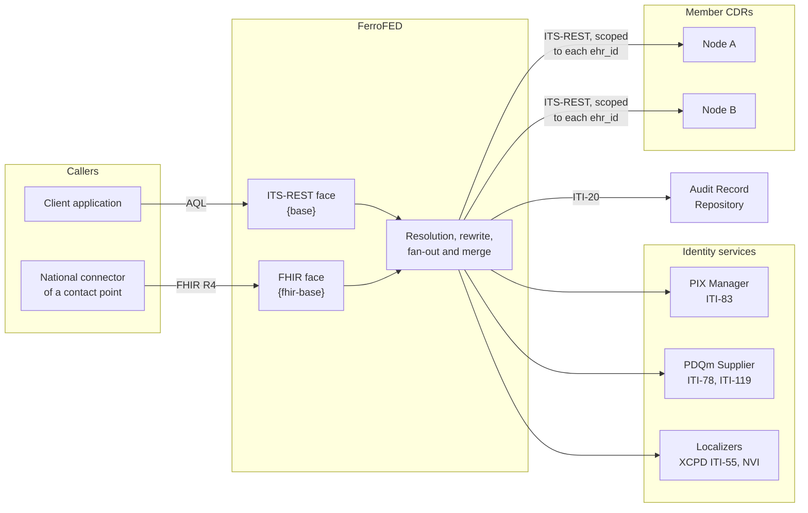
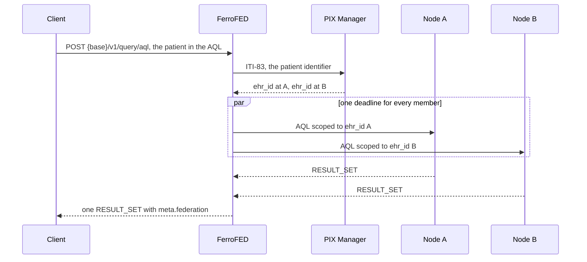
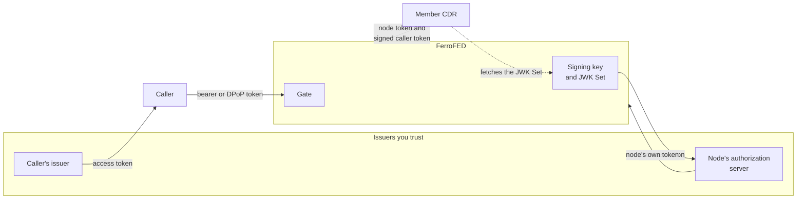
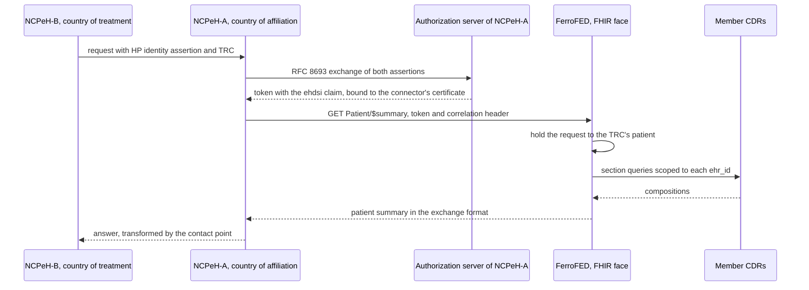

<!-- SPDX-FileCopyrightText: Cadasto B.V. -->
<!-- SPDX-License-Identifier: BUSL-1.1 -->

# How FerroFED federates

This page is for integrators, operators and anyone deciding whether FerroFED
fits a federation. It explains, on one page, what the gateway connects, the
standards it implements, and how its parts relate. Each section links to the
page that holds the detail and the configuration.

Every claim cites the specification or the regulation that governs it. The
Federation Tier with AQL specification is cited by section, requirement
(`N`) and conformance point (`CP`). Where no specification governs a
decision, the page says it is FerroFED's own design.

<!-- toc -->

## What the gateway connects

FerroFED sits in the Federation Tier between client applications and the
member CDRs (§3.1). It holds no clinical data of its own: the records stay
on the members, and the gateway keeps the registry of members, routing state
and its own few stores ([What the gateway holds](../how-it-works/overview.md#what-the-gateway-holds-and-what-it-does-not)).

It has two faces:

- **The ITS-REST face**, at `{base}`, is the Federation Tier itself. A
  client sends ordinary openEHR AQL with no federation syntax and reads one
  ordinary `RESULT_SET`, whose `meta.federation` names every member with its
  status (N1, N17).
- **The FHIR face**, at `{fhir-base}`, serves the European electronic health
  record exchange format: the interface Regulation (EU) 2025/327 Annex II
  2.1 asks of an EHR system. It answers the patient summary, the reports,
  the prescriptions and dispensations, and receives a document
  ([The patient summary over FHIR](../integrate/patient-summary.md)).

Around them sit the services each face needs: the identity services that
resolve and localize the patient, the issuers that sign the callers' tokens
and the nodes' tokens, the audit repository, and a national connector that
calls the FHIR face for a national contact point.

The two faces share one core. A summary on the FHIR face is built from
queries that go through the same resolution, rewrite and outbound gate as a
query on the ITS-REST face, so both hold the same safety property.

## The federated query

The Federation Tier answers a patient query in three steps (§4.1):

1. **Resolve the patient, outside AQL.** The gateway finds where the patient
   has records and the `ehr_id` at each member, through services of its own
   tier (N3). Under `node_selection = "ask-all"` every member is a
   candidate and the PIX Manager is asked about all of them (§4.3, N4).
   Under `"localized"` a localizer names the candidates first (§14.1).
2. **Send each member standard AQL.** The gateway parses the query with
   `openehr-query`, takes the patient out, and prints one query per member,
   scoped to that member's own `ehr_id` (§7.1, N2, N7). A member never
   learns that it is part of a federation.
3. **Merge the answers.** The gateway orders, de-duplicates and cuts the
   rows across members and reports each member with its status (§9 to §11,
   N13, N16, N37, N39). A member that does not answer within the budget
   fails the query, unless the client asked for a partial answer (§11.5,
   N38).

No request the gateway composes for a member carries a directly identifying
patient identifier: not the AQL, the path, the query string or a header
(§5.4.1, N33). Every outbound request passes one gate that refuses it
otherwise, and a query the gateway cannot reduce safely is refused before
anything is sent (§5.4.3;
[Where the patient identifier stops](../how-it-works/identifier-hygiene.md)).

A row of the answer leads to a follow-up: a read of the composition or a new
version of it. Each follow-up goes to the one member that owns the record,
decided by the four identifiers §12a ranks, and its answer comes back as the
member sent it (§12, N22, N31;
[Follow-ups and writes](../how-it-works/follow-ups-and-writes.md)). A
template goes to the member you name, and the gateway can hold stored
queries itself (§12.6, §12.7;
[Definitions and stored queries](../how-it-works/definitions.md)).

## The identity services

The specification gives patient identity to services of the Federation Tier
and binds them to IHE profiles (§5.2, §14, Annex A) and, for the
Netherlands, to the Generic Functions (Annex B). FerroFED is a client of
each; it keeps no patient index of its own
([Identity resolution](../operate/identity.md)).

| Role | What the gateway asks | Profile |
|---|---|---|
| Resolver | the patient's `ehr_id` at each member | IHE PIXm, ITI-83 (§5.2, Annex A) |
| Demographics, ahead of resolution | the patient behind an identifier the cross-reference does not know | IHE PDQm, ITI-78 or ITI-119 (Annex A §A.2) |
| Localizer | which members may hold the patient | IHE XCPD, ITI-55 (Annex A.3); the NVI (Annex B §B.1); or the PIX Manager, whose one answer localizes and resolves (§14.2) |
| Consent pre-filter | which members a patient's consent excludes | Mitz (Annex B; [Consent](../operate/consent.md)) |
| Identity feed | merges and changes of a patient's identifiers | IHE PMIR, ITI-93 |
| Registry directory | the members, read from a care services directory | IHE mCSD, ITI-90 and ITI-91 |
| Audit | a record of every IHE transaction | IHE ATNA, ITI-20 |

FerroPIX, the FerroHEALTH patient index, is the PIX Manager of the
quickstart; any PIXm Manager serves.

The XCPD localizer is an Initiating Gateway (ITI-55). A responding gateway
marked as a MyHealth@EU route is held to the eHDSI rules: mutual TLS under
the eHDSI PKI and a revocation check before any data is sent
([A MyHealth@EU route](../operate/localization.md#a-myhealtheu-route)).
FerroFED builds no XCPD or XCA responding gateway.

## Identity and trust

The gateway stands in two trust relationships: callers trust it with their
tokens, and members trust it to say who is asking. The specification asks
for both: the client authenticates to the gateway, the gateway authenticates
to each node, and the client's identity travels with each request (§13.1,
N24, N25).

- **The caller.** Every caller presents an access token from an issuer you
  trust, checked by `ferrohealth-smart` against the issuer's keys, audience
  and lifetime (RFC 9068 §4). A token that declares no purpose of use is
  refused on every route that reaches a node (§13.4), and a patient-data
  request below the assurance level you set reaches no member (Regulation
  (EU) 2025/327 Annex II 3.1;
  [Client authentication](../operate/authentication.md)).
- **The gateway to each member.** Each member is reached with a credential
  of its own: an OAuth 2.0 token by client credentials or token exchange
  with a client assertion the gateway signs (RFC 6749 §4.4, RFC 7523,
  RFC 8693), optionally bound with `DPoP` (RFC 9449) or mutual TLS
  (RFC 8705), the Nuts grant (Annex B §B.4), the FAPI 2.0 grant (Annex B
  §B.4a), or a static credential
  ([Onward credentials](../operate/onward-credentials.md)).
- **The caller, told to the member.** Every request to a member carries an
  `openEHR-federation-client` token the gateway signs for that member, which
  names the caller (§13.1, N24). The public half of the key is served at
  `{base}/.well-known/jwks.json` and declared in `OPTIONS {base}/`
  ([What a node is told about the caller](../operate/caller-token.md)).
- **Consent stays with the member.** The member decides what the caller may
  see (§13.2). The gateway can ask a consent pre-filter first, and can
  withhold that a member refused on consent grounds (§13.2.1, N27a;
  [Withholding consent exclusions](../operate/consent-exclusions.md)).

The token exchange on the caller's behalf, the key rotation and the choice
of what each member is told are configured per member. The specification
leaves the §13.4 decisions to the deployment, and FerroFED publishes its
answers ([The §13.4 deployment decisions](../operate/deployment-decisions.md)).

## The FHIR face and the exchange format

The FHIR face answers in the profiles of the HL7 Europe guides, through the
interoperability component `eehrxf`, which FerroHEALTH/FerroBRIDGE
publishes (Regulation (EU) 2025/327 Art 25(1)). A member serves each
priority category of Art 14(1) in one of two ways, which the registry
declares per member:

- **Written by the gateway.** The gateway runs its own section queries
  under `eu.ferrofed.eehrxf` at every member that holds the patient, maps
  each composition they select with the FHIRconnect mappings the deployment
  supplies, and writes one document with a `Provenance` per composition
  naming its member ([What the gateway does](../integrate/patient-summary.md#what-the-gateway-does)).
- **Passed through.** A member that serves the category on its own FHIR
  endpoint is asked there, and the gateway passes on what it answers
  ([A member that serves its own summary](../integrate/patient-summary.md#a-member-that-serves-its-own-summary)).

Prescriptions and dispensations follow the same split: a member serves its
prescriptions on its own HL7 Europe MPD endpoint, or the gateway maps them
from the member's openEHR data in the map mode. The member decides whether a
prescription can still be dispensed; the gateway holds no lock and stores no
prescription ([Prescriptions and dispensations over FHIR](../integrate/prescriptions.md)).
A received document goes to the member its category is declared for
(Annex II 2.2; [Receiving a document](../evaluate/receiving-documents.md)).
Codes are translated through a FHIR terminology server, never an embedded
map ([Terminology on the FHIR face](../integrate/terminology.md)).

## A national contact point and MyHealth@EU

Cross-border access goes through MyHealth@EU and each Member State's
national contact point for digital health (Regulation (EU) 2025/327
Art 11(2), Art 23). The contact points talk to each other; the part of a
contact point that reaches into its own country is its national connector.
FerroFED is one of the national infrastructures a connector can call, on its
FHIR face.

The MyHealth@EU NCPeH API guide 9.1.0 leaves the interface between the
national connector and the national infrastructure out of scope, and
Implementing Regulation (EU) 2026/2083 Art 3(6) leaves the operation of
national infrastructures with the contact point. How a connector reaches
FerroFED is therefore FerroFED's own design
([A national contact point](../integrate/national-contact-point.md)).

- **The token.** The contact point's authorization server exchanges the
  HP Identity Assertion and the treatment relationship confirmation (TRC)
  for a token that carries what it read under the `ehdsi` claim (RFC 8693;
  eHDSI SAML Profile 10.0.0). The connector reaches the gateway over mutual
  TLS, and the token is bound to its certificate (RFC 8705 §3).
- **The TRC binding.** Every route that reaches patient data is held to the
  patient the TRC names. A request for any other patient, a patient no
  member holds and a patient every member restricts get one answer, so none
  shows that a restriction exists (eHDSI XCA Profile 8.0.1 §4.2.1, §4.2.2;
  Regulation (EU) 2025/327 Art 8).
- **Emergency access.** A contact point's emergency accesses are limited per
  professional, at most five in 24 hours as eHDSI Section II Security
  Services 10.0.0 §2.5 sets and tighter if you set `[emergency]`, and counted in FerroFED's own store; where and
  how the count is kept is FerroFED's own design (Implementing Regulation
  (EU) 2026/2083 Art 4(1);
  [The emergency access limit](../integrate/national-contact-point.md#the-emergency-access-limit)).
- **What stays with the contact point.** Patient identification, the eHDSI
  CDA and the PDF of the original, transcoding and translation, the
  assertions, SMP and cross-border transport, and the exchange log
  ([What stays with the contact point](../integrate/national-contact-point.md#what-stays-with-the-contact-point)).

## The EHDS articles the gateway answers

FerroFED is an EHR system under Regulation (EU) 2025/327: software that
allows priority-category data to be intermediated, intended for healthcare
providers when providing patient care (Art 2(2)(k);
[Regulatory status](../evaluate/regulatory-status.md)).

| Provision | What the gateway does | Where |
|---|---|---|
| Art 2(2)(k) | classifies itself as an EHR system that intermediates | [Regulatory status](../evaluate/regulatory-status.md) |
| Art 8 | never shows that a restriction exists, under `federation.consent.disclose = false` | [Withholding consent exclusions](../operate/consent-exclusions.md) |
| Art 9(2), Annex II 3.2 | records every access to patient data with the professional, the assurance level and the purpose | [The access log](../operate/access-log.md) |
| Art 11(5) | marks an emergency access in the access record, by the purposes of use you name | [The access log](../operate/access-log.md) |
| Art 14(1) | serves the priority categories on the FHIR face | [The patient summary over FHIR](../integrate/patient-summary.md) |
| Art 23 | answers a national connector | [A national contact point](../integrate/national-contact-point.md) |
| Art 25(1), Annex II 2.1, 2.2 | gives access in the exchange format and receives a document, through `eehrxf` | [Receiving a document](../evaluate/receiving-documents.md) |
| Annex II 3.1 | admits patient data only to an authenticated professional at the assurance level you set | [Client authentication](../operate/authentication.md) |

The full record against each provision is the
[Annex II checklist](../evaluate/annex-ii.md), the
[conformity record](../evaluate/conformity-record.md) and the
[rights of natural persons](../evaluate/natural-person-rights.md). Where the
Regulation and a standard's text conflict, the Regulation wins.

## Where each specification stops

| Concern | Governed by | FerroFED's own design |
|---|---|---|
| The federated query, its merge and `meta.federation` | the Federation Tier §4 to §11 | the merge's memory bounds |
| Follow-up routing | the Federation Tier §12, §12a | the learned routes, held in memory |
| The registry | the Federation Tier §15, IHE mCSD | the registry document's format and its reload |
| Patient identity | the Federation Tier §5, §14, IHE PIXm, PDQm, XCPD, PMIR, the NL Generic Functions | the resolution bindings per caller and their lifetime |
| Caller and node authentication | the Federation Tier §13, RFC 9068, RFC 8693, RFC 9449, RFC 8705 | the per-member credential tables |
| The FHIR face | Regulation (EU) 2025/327 Annex II, the HL7 Europe guides | the section queries, and the choice between writing and passing through |
| The national connector's interface | none: the NCPeH API guide leaves it out | the token exchange your server answers, the `trc_token` parameters, the TRC binding |
| Storage | none | the `redb` files, the PostgreSQL store, the audit spools |
| The operator surface and the console | none | all of it |

The specification's own text is summarised in
[The Federation Tier with AQL](../evaluate/the-federation-tier.md), and what
FerroFED claims against it in the
[conformance statement](../evaluate/conformance-statement.md).
