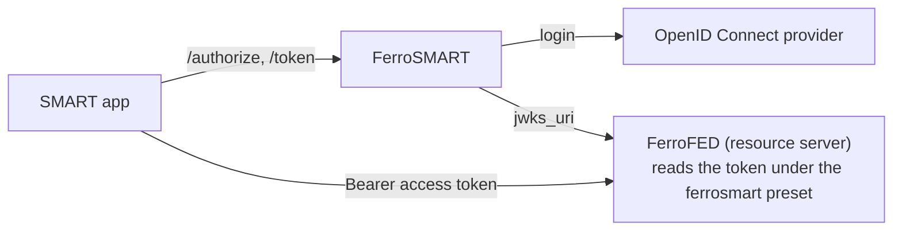

<!-- SPDX-FileCopyrightText: Cadasto B.V. -->
<!-- SPDX-License-Identifier: BUSL-1.1 -->

# Behind FerroSMART

FerroSMART is the FerroHEALTH family's SMART App Launch 2.x authorization
server. It signs people in at any OpenID Connect provider and uses that
provider for login alone. It issues plain RFC 9068 access tokens carrying
the launch context. The gateway runs behind it as a resource server: the
person never signs in to the gateway, and the gateway never sees the
provider's tokens. FerroSMART's architecture describes the whole deployment
in [§13.21, A product behind FerroSMART](https://github.com/FerroHEALTH/FerroSMART/blob/main/docs/architecture.md#1321-a-product-behind-ferrosmart).
This page is the gateway's side of it.



## FerroSMART names the gateway's base

FerroSMART issues a token only for a base it serves, and writes that base as
the token's `aud`. Its `[[ferrosmart.resource]]` table names the gateway's
public URL, the one `gateway.public_url` gives
([The public address](public-address.md)), as an `openehr` resource. Each
`[auth.issuer.<name>]` `audience` the gateway leaves out takes that same URL, so
the two agree:

```toml,ferrosmart
[[ferrosmart.resource]]
base = "https://gateway.example.org/fed"
kind = "openehr"
```

## The gateway trusts FerroSMART

One `[auth.issuer.<name>]` table names FerroSMART's issuer with `kind =
"persons"` and `profile = "ferrosmart"`
([Client authentication](authentication.md)). The preset keeps every
`rfc9068` default but two: `typ` is `at+jwt` alone (RFC 9068 §2.1), and
every token carries `scope` (SMART App Launch 2.2.0, Obtain access token,
Response). A token without `scope` is refused with `401`.

```toml
[auth.issuer.smart]
issuer = "https://smart.example.org"
kind = "persons"
preset = "ferrosmart"
```

- **A person through a SMART app.** List each app the gateway admits by
  its `client_id` in `delegates`. A person's token through a listed app
  reads as that person, delegated to the app. A token through any other app
  is no caller and is refused with `401`. The preset lists no app, because
  the apps are each deployment's.
- **A Backend Services client.** A client credentials token's `sub` is its
  `client_id` (RFC 9068 §2.2), so the same table reads it as the system: a
  `persons` issuer also signs its machines' app-only tokens.
- **One table per issuer.** Name FerroSMART in this one table. A second
  `[auth.issuer.<name>]` table of the same issuer, such as a `machines` table
  beside it, refuses the start, naming the issuer
  (FerroHEALTH/FerroSMART#591).

The gateway's own rules still apply on top: the purpose of use, the
`[[trust.issuer]]` table and the patient grants
([Patient grants](patient-grants.md)).

## Discovery

The gateway serves no `.well-known/smart-configuration`, and its `[auth]`
refuses `described_issuer`, `capabilities` and `scopes_supported` as keys it
does not read. A SMART app finds FerroSMART's endpoints at FerroSMART
itself: its own `.well-known/smart-configuration` and its RFC 8414
authorization server metadata at its issuer.

No specification governs this deployment shape: our own design, built on
SMART App Launch 2.2.0 and RFC 9068.

[auth.issuer.smart.profile]
delegates = [{ client = "growth-chart" }]
