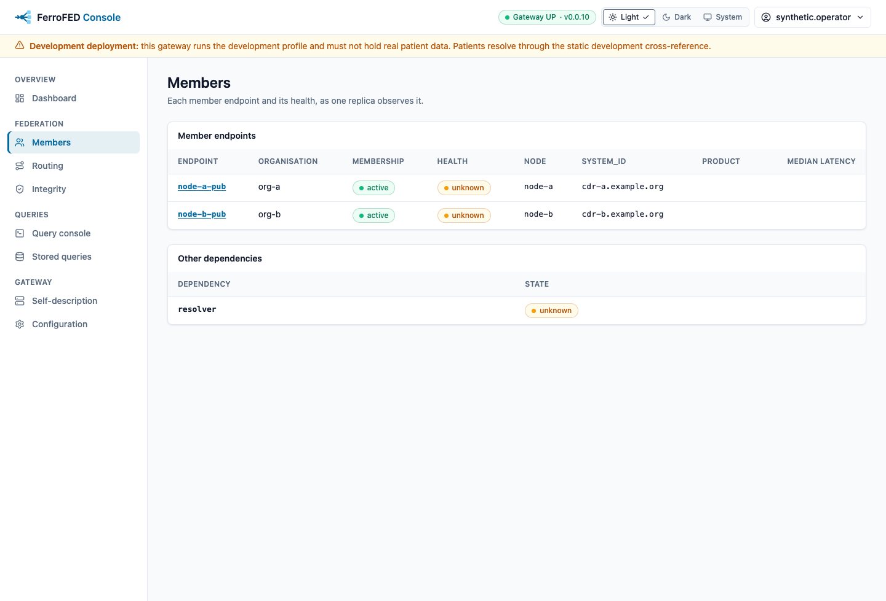
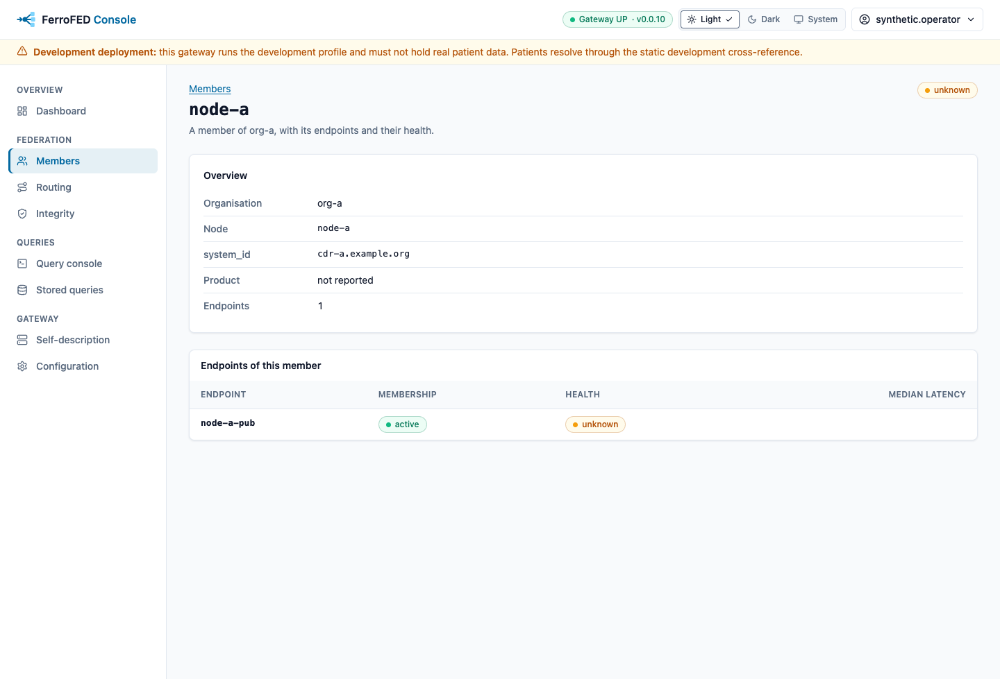
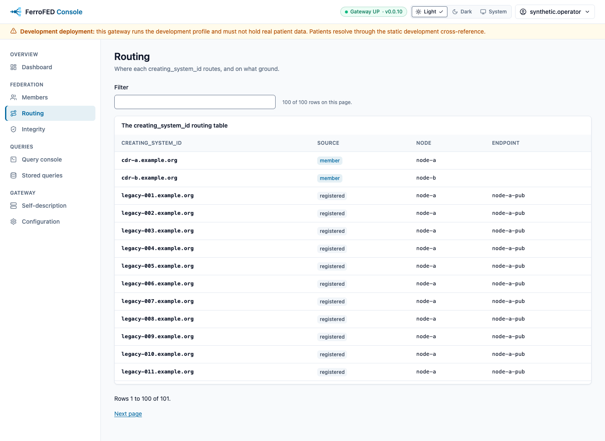
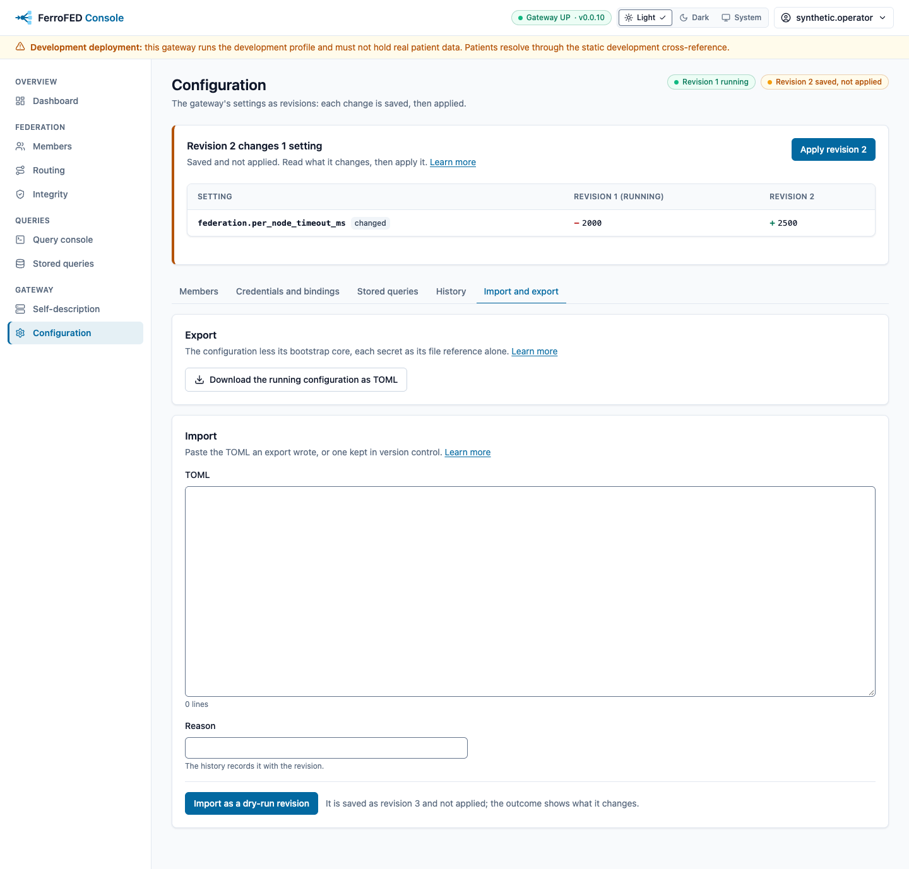

<!-- SPDX-FileCopyrightText: Cadasto B.V. -->
<!-- SPDX-License-Identifier: BUSL-1.1 -->

# The operator console

The operator console is a web interface to a FerroFED federation, for the
people who run it. It ships as its own binary, `ferrofed-viewer`, and its own
image, `ghcr.io/ferrohealth/ferrofed-viewer`, beside the gateway. No
specification governs the console: it is FerroFED's own design.

The console is one more client of the gateway. It reaches the gateway over
HTTP, on the same public surface any other client uses, and it adds no
behaviour to the gateway. It stores no clinical data: the query console
shows the signed-in operator the rows a query answered, and neither the
console nor the browser keeps them. Every page and every answer is
`Cache-Control: no-store`, and the page puts nothing in browser storage, a
service worker or a URL.

## What is built

- **A sign-in page and a shell.** A visitor reads a sign-in card. A
  signed-in operator lands on a dashboard and reads every page in a shell: a
  top bar with the gateway's status (`OPTIONS {base}/`), a light, dark and
  system theme switch, and the operator's name, which opens a menu holding
  Sign out; and a navigation grouped under Overview, Federation, Queries and
  Gateway that marks the page you are on. On a narrow screen the navigation
  is a drawer the Menu button opens. The theme is light until you choose
  another; the console keeps your choice in a second `HttpOnly` cookie,
  `ferrofed_viewer_theme`, which holds the word `light`, `dark` or `system`
  and nothing else, for 400 days, and draws each page in it on the server.
  The footer of every page names the product, its version and Cadasto B.V.,
  and links the About page, which names the manufacturer in full with the
  gateway the console reads.
- **Operator sign-in at an OpenID Provider:** `GET /login` redirects the
  browser to the provider's authorization endpoint with the authorization
  code grant, a `nonce` and a PKCE challenge (RFC 6749 §4.1, RFC 7636). The
  `state`, the `nonce` and the PKCE verifier stay on the console's server as
  a pending sign-in, which the browser knows only by an opaque `HttpOnly`
  cookie that expires with it. The provider's redirect back to
  `/auth/callback` is checked against it once. The code then goes to the
  provider's token endpoint with the PKCE verifier (RFC 6749 §4.1.3, RFC 7636
  §4.5), with the client secret as HTTP Basic for a confidential client. The
  ID Token that comes back must verify against the provider's JWK Set and
  carry the configured issuer, the console's client id as its one audience,
  an `exp` still ahead, and the sign-in's `nonce` (OpenID Connect Core 1.0
  §3.1.3.7). An ID Token for more than one audience, or signed with a shared
  secret, is refused. Only then does a signed-in session begin, holding the
  operator's access token on the server, and the browser goes back to `/`. A
  session the browser already held ends when the new one begins. An ID Token that fails a check is
  `401`, and a provider that refuses or cannot be reached is `502`.
- **The access token is refreshed on the console's server.** When the
  provider answers the sign-in with a refresh token, the session keeps it
  on the server beside the access token; it never reaches a cookie, a page,
  the browser or a log line (RFC 6749 §10.4). A request that arrives
  within 60 seconds of the access token's expiry, or in the second half of
  a lifetime shorter than two minutes, first sends the
  refresh token to the token endpoint (RFC 6749 §6), with the client secret
  as HTTP Basic for a confidential client, and the session goes on with the
  new access token. A rotated refresh token replaces the old one, which is
  never sent again, and one refresh of a session runs at a time, so
  requests that arrive together spend a rotated token once. A refresh that
  fails for any reason, an `invalid_grant` refusal, any other refusal, or a
  provider that cannot be reached, ends the session: a view sends the
  browser to `/login` and drops the session cookie. A session with no
  refresh token ends when its access token expires, and one whose provider
  sends no `expires_in` is never refreshed. The ID Token of the sign-in
  stays the sign-out's hint; one a refresh answers is not read. Set
  `offline_access = true` in `[oidc]` to ask for the `offline_access` scope
  and the `prompt=consent` it requires (OpenID Connect Core 1.0 §11), for a
  provider that issues a refresh token only then.
- **Operator sign-out:** the "Sign out" button in the operator's menu,
  which the operator's name in the top bar opens, posts to
  `POST /logout`, which ends the signed-in session on the console's server
  and removes the session cookie. Where `[oidc]` names the provider's
  `end_session_endpoint`, the console then redirects the browser there with
  the session's ID Token as `id_token_hint`, its `client_id`, and the
  `post_logout_redirect_uri` you registered with the provider (OpenID
  Connect RP-Initiated Logout 1.0 §2); without one the browser goes back to
  `/`. A `GET /logout` is `405`.
- **Requests from the console's own pages only.** Every request that is not
  a `GET`, `HEAD` or `OPTIONS`, the sign-out and every server function the
  views and the query console call, must come from the console's own pages:
  a request the browser marks `Sec-Fetch-Site: same-origin`, or, without
  fetch metadata, one whose `Origin`, or else whose `Referer`, has the
  origin of `redirect_uri`. Any other, one that names no origin among them,
  is `403` before the session is read or the gateway asked, so no other
  site can sign an operator out or spend their sign-in on a query. The
  session cookie is `SameSite=Lax` as well, and every server function is a
  `POST`: a `GET` of one runs nothing. Because the console sends
  `Referrer-Policy: no-referrer`, a browser posts the console's own forms
  with `Origin: null` and no `Referer`, so those forms pass by
  `Sec-Fetch-Site` alone; a browser that sends no fetch metadata cannot sign
  out or run a query, which fails closed.
- **Two separate pools of server-side state.** Pending sign-ins live for
  `sign_in_timeout_s` and are bounded by `max_sign_ins`; a full pool drops
  its oldest pending sign-in, so a flood of `GET /login` holds at most that
  many and stops costing anything once it ends. A signed-in session is
  created only once a sign-in completes, lives for `idle_timeout_s` without
  a request and `absolute_timeout_s` at most, and is bounded by
  `max_sessions`, which refuses a new session rather than evicting one. The
  idle and the absolute timeouts end a session whatever its tokens say,
  however long a refresh token would last. No
  sign-in traffic ever removes a signed-in session. The console does not
  limit sign-ins per client: behind a load balancer it cannot tell clients
  apart without trusting a forwarded address, so put a rate limit for
  `/login` at the edge. Both pools live in the console's memory: a restart
  ends every session, and more than one replica needs a load balancer that
  keeps an operator on one replica.
- **The operator views**, each rendered on the console's server from the
  gateway's own surface, called with the signed-in operator's own access
  token:

  | View | What it shows | Read from |
  |---|---|---|
  | `/members` | every member endpoint, its organisation, membership standing, last observed health, node, `system_id`, product and median latency, and the state of every other dependency | `OPTIONS {base}/` and `GET {base}/operator/dependencies` |
  | `/integrity` | the integrity incidents of each kind since the gateway started, the most recent ones, and the `creating_system_id` routing table, 100 rows a page | `GET {base}/operator/incidents` and `/operator/creating-systems` |
  | `/stored-queries` | every stored-query version the gateway holds by namespace, 100 versions a page, a namespace the gateway takes no write under marked read-only as the gateway marks it | `GET {base}/operator/stored-queries` |
  | `/stored-queries/{name}` | one stored query: its versions, newest first, and the AQL of the one shown, marked read-only as the gateway marks it | `GET {base}/operator/stored-queries/{name}` |
  | `/federation` | the gateway's self-description | `OPTIONS {base}/` |

  A paged view names the rows it shows and how many there are, and links
  the page before and after it by `?offset=`. A view without a signed-in
  session sends the browser to `/login` before the gateway is asked
  anything, whatever the case of its path or a trailing slash, and each
  server function a view loads through checks the session itself. A view
  the gateway refuses shows the gateway's status and its stable error code;
  a `401` links back to sign-in. A view whose answer the console cannot read
  says so with the status, and one the gateway cannot answer says so too; no
  view is ever silently empty. The `/operator/` routes need a token
  carrying the [operator scope](authentication.md#the-operator-surface) its
  issuer names. No view shows a patient identifier, a token or clinical
  data.

  `/members`, `/integrity` and `/stored-queries` each name the gateway
  replica that answered them, as the gateway's
  [operator surface](authentication.md#the-operator-surface) names it in
  every report: "Answered by replica ferrofed-0." The health, the
  incidents and the routing table are each replica's own, so read them as
  that replica's view, never the federation's. `/integrity` reads two
  reports, and when two replicas answered them it names each. A gateway
  that names no replica is shown as one that did not. The console reads
  the gateway through the one `base_url` it is configured with, so behind a
  load balancer it shows the replica the balancer chose for each request
  and cannot show every replica at once: it has no address of each replica's
  client listener. To compare replicas, reload a view until each has
  answered, or read `GET {base}/operator/incidents` at each replica's own
  address.
- **The query console, `/query`:** an AQL query, or a stored query by name
  and optional version, runs through the gateway's own query surface,
  `POST {base}/v1/query/aql` or `POST {base}/v1/query/{name}`, as the
  signed-in operator, exactly as any client sends it. The form offers what
  the gateway's `OPTIONS {base}/` declares: the member endpoints and
  organisations to target (`openEHR-federation-endpoint`,
  `openEHR-federation-organisation`, §8.4), its dedup modes
  (`openEHR-federation-dedup`, §10), and the best-effort opt-in
  (`openEHR-federation-completeness: partial`, §11.4) where it offers one.
  `offset` and `fetch` are optional. The answer shows the rows under
  `columns[]` as the gateway renders them, and every endpoint of
  `meta.federation.endpoints[]` with its status, latency, row count and
  error. An answer whose `meta.federation.complete` is `false` says
  "Incomplete answer" in words before its rows. A `504` or `424` the gateway
  answers under its all-or-nothing default shows its status and the
  endpoints that failed, from the diagnostic envelope it carries (§11.4). A
  refusal shows its status and stable error code, and a result set with no
  readable `meta.federation` is shown as unreadable, never as an answer.

  Name a patient through a parameter, one `name=value` per line, never in
  the AQL text; each value is sent as a string. The form posts its fields in
  the request body to the console, which sends them to the gateway in the
  request body, so nothing you enter reaches a URL or the browser history.
  The fields carry `autocomplete="off"`, and the console logs a refusal by
  its status and code alone, never the query or a parameter.
- **The operator's admin actions**, where `[admin]` names at least one
  gateway replica. `/integrity` offers the clear of a held `ehr_id` below
  the recent incidents, which calls
  `POST /admin/ehr-ids/{ehr_id}/clear` on the admin listener of the replica
  you pick, or of every replica one after another, since each replica keeps
  its own routing state. The form offers the `ehr_id`s the incidents name.
  `/stored-queries` offers the stored-query drift repair below the held
  versions, which calls
  `POST /admin/stored-queries/{name}/{version}/distribute` with the members
  in `openEHR-federation-endpoint` (`*` for every active member) on the
  first replica configured, since the replicas share the stored-query store.
  Each action is a card whose button opens a confirmation step, which the
  console checks again on its server, and runs once the page has loaded.
  Its answer shows at the top of the card, with the focus moved there, and
  names
  the replica it went to: what a clear found there (a collision and its
  claimants, one owner, or nothing), or the status of a repair, whether
  every member took the version, and each member's outcome. A replica that
  refuses shows its status and stable error code, a `401` links back to
  sign-in, and one the console cannot reach is named as such. The console
  calls the admin listener with your own access token, which never reaches
  the browser, so the gateway admits the action only for a token carrying
  your issuer's `operator_scope` and records you as the operator who ran it.
- **`/configuration`**, where `[admin]` names at least one gateway replica
  whose configuration is managed (`config.ui = "managed"`). It reads the
  first replica's configuration revisions. The header names the revision
  that runs and the one saved and not applied, and a card above every tab
  shows what the saved revision changes, each setting with its running
  value marked `−` and its new value marked `+`, and its apply. Five tabs,
  each at its own path, hold the rest: `/configuration/members`, every
  member with its owner and state; `/configuration/credentials`, every
  onward credential and binding section with its secrets as set, with the
  file each is read from, never by value; `/configuration/stored-queries`,
  the stored versions by name; `/configuration/history`, the newest
  revisions, each with its download as TOML and its comparison with the
  running revision; and `/configuration/import-export`, the running
  revision's download and the import of TOML as a dry-run revision. A
  member the registry document or a care services directory provides opens
  as a read-only detail that names its source. A console member is added
  or edited on a page of its own (`/configuration/members/new`,
  `/configuration/members/{node_id}`), each Query API and FHIR endpoint a
  row of its own fields, with its categories as checkboxes and its profiles
  as a list, and saved as a new revision, which you then apply. A
  credential's form shows the fields of the grant you choose, and each
  secret is kept, set by its value in a password field the page never
  fills, read from a file, or cleared; a binding section's form shows each
  setting as a field of its own. When the running revision awaits its
  confirmation, the card counts down to its deadline and offers Confirm and
  Roll back; when the saved revision takes a second operator's approval, it
  shows who made it, who approved it, and Approve
  ([Credentials and binding sections](configuration-revisions.md#credentials-and-binding-sections)).
  An apply, a roll back, a confirmation, an approval, a removal and a
  stored version each ask you to confirm in a step of their own, which the
  console checks again; a save is not applied and asks none. A form's answer
  shows at the top of its card with the focus moved there, and a field the
  console refuses is marked with what is wrong under it. Every form runs once
  the page has loaded. A replica whose configuration is not managed answers
  `404`, and the page says so and offers no form
  ([Console-managed resources](configuration-revisions.md#console-managed-resources)).
- **`GET /health`**, which answers `200` while the process serves, and the
  `healthcheck` command the image runs against it.

Every answer carries a Content-Security-Policy whose script source is a nonce
minted for that answer, `X-Content-Type-Options: nosniff`,
`X-Frame-Options: DENY` and `Referrer-Policy: no-referrer`, and no page is
stored by a cache. The site bundle under `/pkg/` is served brotli- or
gzip-compressed, as the browser's `Accept-Encoding` chooses; pages and
server function answers are never compressed, so no compression side
channel reads what an operator entered.

The console serves plain HTTP and sends no `Strict-Transport-Security`
header. Terminate TLS at a reverse proxy in front of it and set
`Strict-Transport-Security` (RFC 6797) there, as the
[hardening guide](hardening.md#tls) asks: a browser that has seen the header
then reaches the console over HTTPS alone, so no one on the network path can
turn the operator's sign-in into a plain HTTP request.

The query console shows its answer on the page that asked, so it runs a
query only once the console's WebAssembly bundle has loaded: until then the
"Run the query" button is disabled, and a plain form post that reaches the
console anyway is refused before the gateway is asked. The answer is
rendered on the console's server, with every value a node sent escaped, and
the page shows that HTML.

## The screens

Each screen is shown in the light theme, with a link to the same screen in
the dark theme. The testkit takes them against a development gateway over
two stub nodes, node A that answers and node B that fails, so every page
carries the amber development banner. To take them again, build the site
bundle, start chromedriver, and run the capture behind its gate:

```sh
scripts/release/viewer-site.sh --release
FERROFED_SCREENSHOTS=1 FERROFED_WEBDRIVER=http://127.0.0.1:9515 \
  cargo nextest run -p ferrofed-testkit -E 'test(/screenshots::/)'
```

A console route with no screenshot fails the testkit's
`every_console_route_has_a_screenshot_in_light_and_dark`.

### Sign-in

A visitor reads the sign-in card, whose button starts the sign-in at the
OpenID Provider.


[The sign-in in the dark theme](img/console/sign-in-dark.png)

### Dashboard

A signed-in operator lands on the dashboard: the members active, the nodes
up, the open incidents, the stored queries and the running revision, with
each member's health and the recent incidents.


[The dashboard in the dark theme](img/console/dashboard-dark.png)

### Members



[The members page in the dark theme](img/console/members-dark.png)

A member's page, `/members/{node}`, shows one node with its endpoints.



[The member's page in the dark theme](img/console/member-dark.png)

### Routing



[The routing page in the dark theme](img/console/routing-dark.png)

### Integrity


[The integrity page in the dark theme](img/console/integrity-dark.png)

### Query console

The editor takes AQL or a stored query, the parameters that name a patient,
and the federation options the gateway declares.


[The empty query console in the dark theme](img/console/query-dark.png)

A run against node A alone comes back complete.


[The complete answer in the dark theme](img/console/query-complete-dark.png)

A best-effort run over both nodes, where node B fails, says in words that
the answer is incomplete before its rows.


[The incomplete answer in the dark theme](img/console/query-partial-dark.png)

A query the gateway refuses shows its status and its error code.


[The refused query in the dark theme](img/console/query-refused-dark.png)

### Stored queries


[The stored queries in the dark theme](img/console/stored-queries-dark.png)

A query's detail, `/stored-queries/{name}`, shows its versions and its AQL.


[The stored query's detail in the dark theme](img/console/stored-query-dark.png)

### Self-description


[The self-description in the dark theme](img/console/self-description-dark.png)

### Configuration page

Every tab sits under the header that names the running and the saved
revision, and the card that shows what the saved revision changes. The
[configuration revisions](configuration-revisions.md) page describes what
each tab changes.


[The Members tab in the dark theme](img/console/configuration-members-dark.png)


[The Credentials and bindings tab in the dark theme](img/console/configuration-credentials-dark.png)


[The Stored queries tab in the dark theme](img/console/configuration-stored-queries-dark.png)


[The History tab in the dark theme](img/console/configuration-history-dark.png)



[The Import and export tab in the dark theme](img/console/configuration-import-export-dark.png)

A console member is added on a page of its own,
`/configuration/members/new`.


[The member form in the dark theme](img/console/configuration-member-form-dark.png)

### About and not found


[The About page in the dark theme](img/console/about-dark.png)

A path the console does not serve answers `404` with a page of its own.


[The not-found page in the dark theme](img/console/not-found-dark.png)

## Why a console of its own

The gateway authenticates every request by bearer token and holds no browser
session ([Client authentication](authentication.md)). The console holds the
operator's session on its own server and calls the gateway with the
operator's token, so the gateway's authentication stays as it is. The gateway
also serves no static files: it answers `501` on a path it does not serve,
and its request log carries no body and no header value.

## Configuration

The console reads a TOML file named by `--config` or `FERROFED_VIEWER_CONFIG`.
Every key can be set from the environment as
`FERROFED_VIEWER__<SECTION>__<KEY>`, and the client secret can be read from a
file through `client_secret_file`. A refused configuration names the key and
the line, never a value, so no secret reaches a message or a log.

```toml
[server]
listen = "0.0.0.0:3000"
site_root = "/site"

[gateway]
base_url = "https://gateway.example.org/"
timeout_ms = 30000

[session]
secure_cookie = true
sign_in_timeout_s = 300
max_sign_ins = 1000
idle_timeout_s = 1800
absolute_timeout_s = 43200
max_sessions = 10000

[oidc]
issuer = "https://idp.example.org/realms/ferrofed"
authorization_endpoint = "https://idp.example.org/realms/ferrofed/protocol/openid-connect/auth"
token_endpoint = "https://idp.example.org/realms/ferrofed/protocol/openid-connect/token"
jwks_uri = "https://idp.example.org/realms/ferrofed/protocol/openid-connect/certs"
client_id = "ferrofed-viewer"
client_secret_file = "/run/secrets/viewer-client-secret"
redirect_uri = "https://console.example.org/auth/callback"
scopes = ["openid"]
offline_access = false
end_session_endpoint = "https://idp.example.org/realms/ferrofed/protocol/openid-connect/logout"
post_logout_redirect_uri = "https://console.example.org/"

[[admin.replicas]]
name = "gateway-0"
admin_url = "https://ferrofed-0.ferrofed-admin.internal:9464/"

[[admin.replicas]]
name = "gateway-1"
admin_url = "https://ferrofed-1.ferrofed-admin.internal:9464/"
```

With `secure_cookie = true` the session and sign-in cookies carry the
`__Host-` prefix, which binds each to the console's host (RFC 6265bis
§4.1.3.2); with it off, for a loopback trial, they carry none.

`secure_cookie = false` sends the cookies over plain HTTP, so the console
refuses it at start unless `redirect_uri` is an `http` URL on a loopback
host (`localhost`, `127.0.0.0/8` or `::1`). The refusal names
`session.secure_cookie`. A console without `[oidc]` sets no cookie, so the
key has nothing to govern there and is not checked.

Without an `[oidc]` table the console offers no sign-in, and `GET /login`
answers `503`. The provider's URLs must be `https` unless their host is
loopback, and `scopes` must include `openid`. `offline_access`, off by
default, adds the `offline_access` scope and `prompt=consent` to the
sign-in; `scopes` must not list `offline_access` itself, and the refusal
names `oidc.scopes`. The console refreshes the access token with whatever
refresh token the provider issues, with or without it. `end_session_endpoint` is
optional, and `post_logout_redirect_uri` needs it. `ferrofed-viewer config check`
reads and checks a configuration without binding a socket.

`[[admin.replicas]]` names the admin listener of each gateway replica the
console runs the operator's admin actions on. Each entry has a `name`, which
the console shows and the operator picks the replica by (letters, digits,
`.`, `_` and `-`, at most 64, each name once), and an `admin_url`, the
`http` or `https` root of that replica's admin listener. Without an entry
the console offers no admin action, and its views are as before. The list
can be set from the environment as one TOML value, for example
`FERROFED_VIEWER__ADMIN__REPLICAS='[{ name = "gateway-0", admin_url = "https://ferrofed-0.internal:9464/" }]'`.

The console's server calls each admin listener directly, so it must reach
it on an internal network that nothing outside the deployment can reach;
never publish an admin listener. Its default bind is loopback, so set the
gateway's `[metrics] listen` to a non-loopback internal address with
`allow_remote = true` ([Metrics](metrics.md#who-the-admin-listener-serves)),
and prefer an `https` admin listener, since the operator's access token
travels on each call. The console's client of the admin listener is the one
it calls the gateway with: it trusts the system's root certificates and
presents no client certificate, so an admin listener that asks for mutual
TLS cannot be reached from the console.

The image sets `server.listen` to `0.0.0.0:3000` and `server.site_root` to
the site bundle it carries, runs as the numeric user `65532`, and runs
`healthcheck` as its `HEALTHCHECK`.
